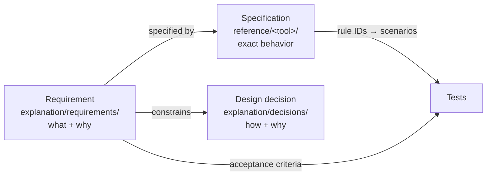

# Documentation (Diátaxis, written before implementation)

## Principles

- **Write the docs before the code.** For a new tool, a new check, or a change in behavior, first describe in docs/ what it does and how it behaves. That description is the source for the TDD scenarios (see the `tdd` skill).
- Each page belongs to exactly one of the four Diátaxis kinds. If a page mixes them, split it and link the parts.
- Everything in this repository is written in English.
- Docs that disagree with the code are a bug. If the spec changes during implementation, update the docs in the same change.

## Which kind of page

| Location | Purpose | Reader's situation | How to write |
|---|---|---|---|
| `docs/tutorials/` | Teach | First contact | One straight path. Use an example that always succeeds. No options, no background |
| `docs/how-to/` | Get a task done | Knows what they want | "How to …". Prerequisites, steps, result. Link to explanation for the why |
| `docs/reference/` | Look up facts | Searching | Complete, neutral, structured. Field tables, list of checks, conditions, output formats |
| `docs/explanation/` | Understand | Thinking | Background, design decisions, trade-offs, threat model. No step-by-step instructions |

Questions to ask when unsure:

- Is the reader doing something with their hands? Yes → tutorials / how-to. No → reference / explanation.
- Are they studying or working? Studying → tutorials / explanation. Working → how-to / reference.

## Requirements, specifications, design

They are different documents. Never mix them in one page.



| | Requirement | Specification | Design decision |
|---|---|---|---|
| Answers | What do users need? Why? | Exactly how does it behave? | How is it built? Why this way? |
| Location | `explanation/requirements/REQ-<TOOL>-NNN-title.md` | `reference/<tool>/*.md` | `explanation/decisions/NNNN-title.md` |
| Contains | Need, Requirement, Rationale, Alternatives rejected, Acceptance, Specified in, Status | Rules with IDs (`SPF-5`), inputs, outputs, algorithms, limits, error handling, findings, data formats | Context, Decision, Consequences |
| Does not contain | Algorithms, limits, field formats | Reasons, user stories, UI wishes | Behavior rules |

Requirement template:

```markdown
# REQ-MAIL-NNN: Title
Status: Proposed | Accepted | Superseded by REQ-…
## Need          — who needs it and why (diagram if useful)
## Requirement   — a few short "must" statements
## Rationale     — why this
## Alternatives rejected — table
## Acceptance    — observable criteria
## Specified in  — links to reference pages
```

Specification rules:

- Every rule has a stable ID. Tests cite it. Never reuse a retired ID.
- State the result for every error path. "Not evaluated" always has a reason.
- Cite the standard's section for each rule taken from it. Do not cite sections you have not read.

## What to write before implementing a feature

1. **Requirement** (new need or scope change): an `REQ-*` record.
2. **Specification**: the rules the code must follow. Tests come from these.
3. **Design decision** (when a choice between approaches is involved): an ADR.
4. **How-to** (when users gain a new action).
5. Tutorials come once the feature is stable.

Add every new page to the index in `docs/README.md`, except decision records and requirement records: the index links only to their folders. `explanation/requirements/README.md` lists every requirement with its status.

## Style

- **Diagrams first.** Use Mermaid for structure, flow, relationships, sequences, and states. Use prose only for what a diagram cannot say.
- **Short sentences.** One idea per sentence. No paragraph longer than three sentences. Prefer tables and lists.
- One topic per file. File names in kebab-case.
- Headings follow the reader's task or question ("How to …" for how-to, the subject's name for reference).
- When describing binary formats, give offset, size, and endianness in a table, and cite the source (APPNOTE.TXT section, ISO 32000 clause, RFC number).
- Never use real emails or personal data in examples. Build examples from synthetic data.
