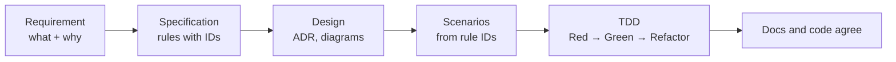

# benchside

A set of small browser-only tools for taking files apart and looking inside them (email headers and authentication, ZIP, PDF, and more). User files are never sent anywhere. The only outbound traffic is DNS-over-HTTPS lookups, which contain domain names only.

Everything in this repository — code, comments, docs, skills, commit messages — is written in English.

## Tech stack

TypeScript, Vite, Preact for the UI, vitest for tests, npm workspaces. Node is used only for building and testing during development; the deliverable is static files on GitHub Pages.

```
apps/       # one Vite + Preact app per tool (home, mail, zip, pdf), each deployed to /benchside/<tool>/
packages/   # @benchside/* — parsers (mail, zip, pdf), shared code (core), shared Preact parts (ui)
docs/       # Diátaxis documentation
samples/    # test files; samples/private/ is ignored by git
scripts/    # build and deploy helpers
```

- Parsers and analysis logic are pure, DOM-independent TypeScript in `packages/`. Apps only display their results.
- Apps never import from other apps. Shared UI moves into a package when a second app needs it.
- Keep runtime dependencies to a minimum. Write parsers in-house.
- Each app has its own CSP, injected at build time. Apps that need no network use `connect-src 'none'`; only the mail app allows the DoH endpoints.

See [docs/explanation/decisions/](docs/explanation/decisions/) for the reasoning.

## Workflow (always in this order)



1. **Requirement**: record the need in `docs/explanation/requirements/` (ADR-like).
2. **Specification**: write the exact behavior as rules with IDs in `docs/reference/`.
3. **Design**: record choices in `docs/explanation/decisions/`; update architecture diagrams.
4. **Scenarios**: derive Given / When / Then scenarios from the spec rule IDs and the requirement's acceptance criteria.
5. **Implement with TDD**: Red → Green → Refactor.
6. **Check docs and code agree**: if behavior changed along the way, update the spec in the same change.

Requirements and specifications are different documents. Never mix them.

## Documentation

docs/ follows [Diátaxis](https://diataxis.fr/). Each page belongs to exactly one kind.

- `docs/tutorials/` guided, single-path lessons
- `docs/how-to/` task-oriented guides
- `docs/reference/` specifications: rules with IDs, formats, findings
- `docs/explanation/` background: requirements (`requirements/`), design decisions (`decisions/`), architecture

The index is `docs/README.md`.

Use Mermaid diagrams aggressively. Keep sentences short; prefer diagrams, tables, and lists over prose.

## When to use each skill

| Skill | Use when |
|---|---|
| `docs` | Before any implementation (every time). Writing or updating docs/ or the README. Unsure which Diátaxis kind a page belongs to |
| `tdd` | Before writing or changing production code (every time). Fixing bugs, adding tests |
| `design` | Creating a new module or package. Unsure whether to split, abstract, or extract shared code. Planning a refactoring |
| `best-practices` | Writing or reviewing code. Adding a dependency. Configuring build, CI, or CSP. Using browser APIs such as File, DecompressionStream, DataView, or Web Crypto |
| `github-mcp` | Committing, pushing, branching, or opening PRs (this devcontainer has no git credentials) |

The usual order for a feature is `docs` → `design` (if needed) → `tdd` (with `best-practices`).

## Never

- Add code that sends, or could send, user file contents anywhere (analytics, CDNs, external fonts, telemetry, etc.).
- Widen the CSP allowlist without documenting the reason in docs/explanation.
- Write production code before the docs and scenarios.
- Commit real emails or personal data (`samples/private/` is ignored by git).
- Commit `.devcontainer/` (it is ignored by git).
