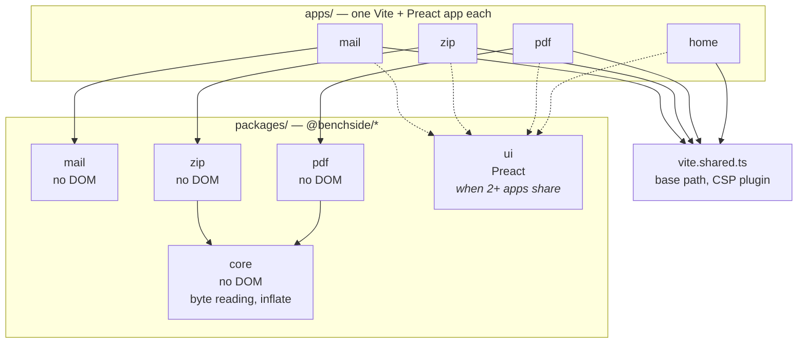
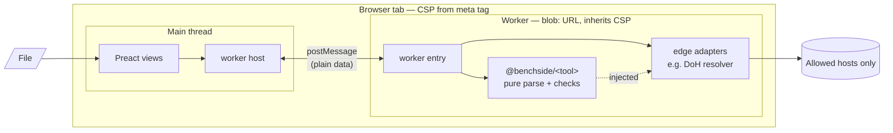
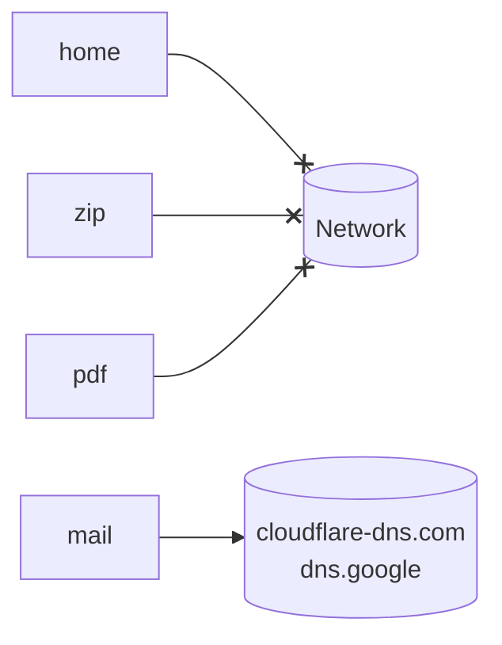
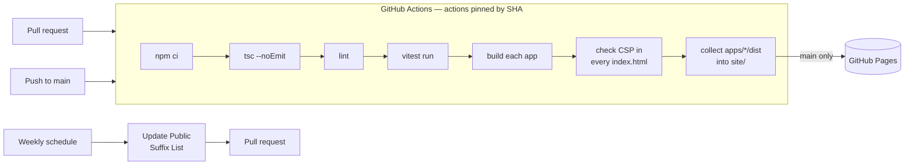
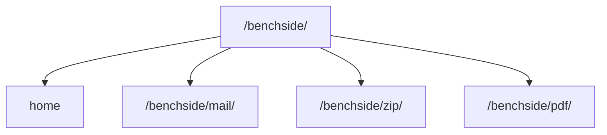
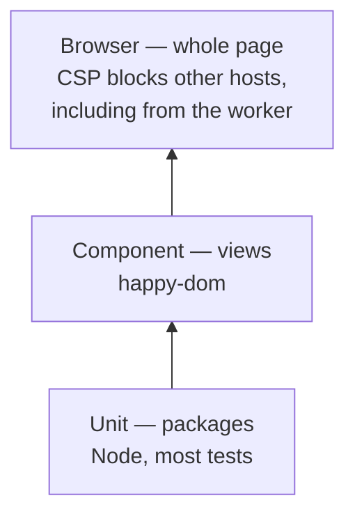

# Architecture

Repository-wide view. Per-tool details:

- [Mail analyzer architecture](mail-architecture.md)
- [ZIP analyzer architecture](zip-architecture.md)
- [PDF analyzer architecture](pdf-architecture.md)

Decisions: [0002](decisions/0002-one-app-per-tool.md) (one app per tool), [0010](decisions/0010-shared-core-package.md) (shared core package), [0004](decisions/0004-worker-from-blob-url.md) (workers from `blob:` URLs), [0005](decisions/0005-shared-vite-config-and-browser-tests.md) (shared Vite config, browser tests).

## Repository

| Rule |
|---|
| Apps never import from other apps |
| Packages never import Preact or the DOM, except `ui` |
| Dashed arrows: created only when a second user appears |
| `vite.shared.ts` is build-time only; it never ships to the browser |

## Inside one tool

Every tool follows the same shape.

| Layer | Knows about | Tested with |
|---|---|---|
| Package | Bytes in, plain data out | vitest, Node |
| Edge adapters | `fetch`, File API | vitest with fakes |
| Worker host / entry | `postMessage` | vitest |
| Views | Preact, DOM | vitest + happy-dom |
| Whole page | CSP, real browser | vitest browser mode |

| CSP-driven UI rule | Why |
|---|---|
| No inline `<script>` | `script-src` falls back to `'self'` |
| Styles via CSS files or Preact object styles only; never string `style` attributes | `style-src` falls back to `'self'`; string attributes are blocked, CSSOM property writes are not |

## Network policy per app

| App | `connect-src` |
|---|---|
| home, zip, pdf | `'none'` |
| mail | `https://cloudflare-dns.com https://dns.google` |

All apps also use `default-src 'self'; worker-src blob:; img-src 'self' blob: data:; object-src 'none'; base-uri 'none'; form-action 'none'`. Built by `vite.shared.ts` ([detailed design §10](mail-detailed-design.md#10-build-vitesharedts)).

## Build and deploy

## URLs

## Tests

- Most tests are unit tests on packages.
- Browser tests are few and focus on things only a real browser can show.
