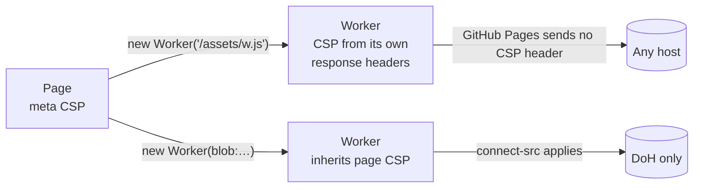

# 0004: Start workers from a blob URL

## Context

- A worker loaded from a URL takes its CSP from that file's response headers, not from the page.
- GitHub Pages cannot set response headers, so such a worker would have no CSP.
- A worker from a `blob:` URL inherits the CSP of the page that created it.

## Decision

- Build workers inline with Vite's `?worker&inline` import. Vite starts them from a `blob:` URL.
- Add `worker-src blob:` to each app's CSP.
- Never start a worker from a plain URL.
- A browser test checks that a request from the worker to a host outside the CSP is blocked.

## Consequences

- The `<meta>` CSP covers all code that runs, including workers.
- The worker code is embedded in the main bundle as base64, which makes it about one third larger.
- If benchside moves to a host that can set headers, send the CSP as a header and revisit this.
