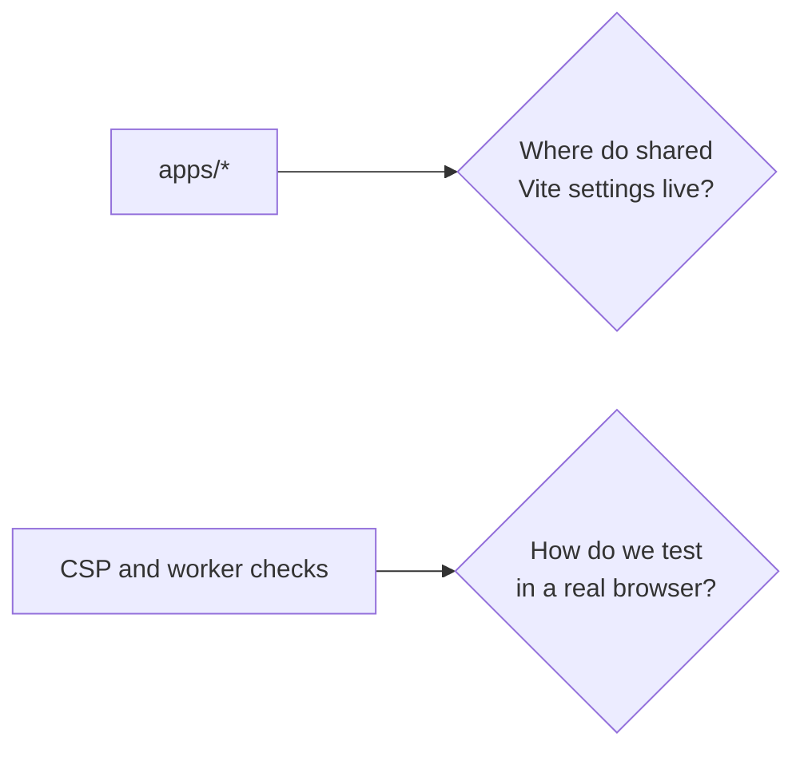

# 0005: Shared Vite config and browser tests

## Context

- Every app needs the same `base` rule and CSP plugin ([0002](0002-one-app-per-tool.md)).
- Some requirements can only be checked in a real browser: CSP blocking, worker CSP inheritance ([0004](0004-worker-from-blob-url.md)), offline mode.

## Decision

| Question | Decision | Rejected |
|---|---|---|
| Shared Vite settings | One root file, `vite.shared.ts`, imported by each `apps/*/vite.config.ts` | A `@benchside/build` package: more ceremony for one file |
| Browser tests | vitest browser mode with the Playwright provider | Standalone Playwright test runner: a second test framework |

## Consequences

- One test runner and one assertion style for all tests.
- Playwright and a browser binary become dev dependencies. CI caches the browser.
- If `vite.shared.ts` grows beyond one screen, revisit the package option.
