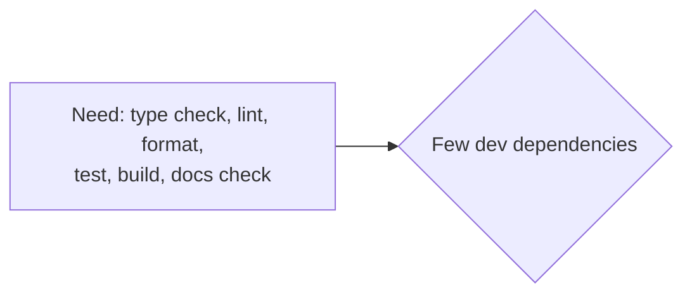

# 0006: Tooling

## Context

- Build-time dependencies can inject code into the bundle. Fewer is safer ([best practices](../../../.claude/skills/best-practices/SKILL.md)).
- Diagrams must parse on GitHub; this broke once already.

## Decision

| Concern | Tool | Rejected |
|---|---|---|
| Lint + format | Biome (one binary) | ESLint + Prettier + typescript-eslint: many packages |
| Type check | TypeScript 7 `tsc --noEmit` | — |
| JSX for Preact | Vite's built-in transform with `jsxImportSource: "preact"` | `@preact/preset-vite`: pulls in Babel |
| Tests | vitest 5: projects `unit` (Node), `dom` (happy-dom), `browser` (Playwright, Chromium) | — |
| Diagram check | `scripts/check-mermaid.ts` (mermaid + jsdom, dev only) | Rendering with mermaid-cli: needs Puppeteer |
| Node | 24 or later (`engines`); CI uses 26 | — |
| Package manager | npm workspaces, `npm ci` | pnpm: extra tool |

CI actions are pinned by commit SHA in `.github/workflows/`. Dependabot keeps the pins and their version comments current ([architecture](../architecture.md#build-and-deploy)).

## Consequences

- No Preact fast refresh in dev (preset-only). Full reload is acceptable for small apps.
- Without the preset, Preact DevTools integration needs a manual `import 'preact/debug'` in dev.
- mermaid and jsdom add many transitive dev dependencies, but none reach the bundle.
- GitHub renders Mermaid with its own version, which can lag behind npm. A newer Mermaid may accept syntax GitHub rejects, so `check-mermaid.ts` also rejects known cases by pattern (labeled two-way edges).
