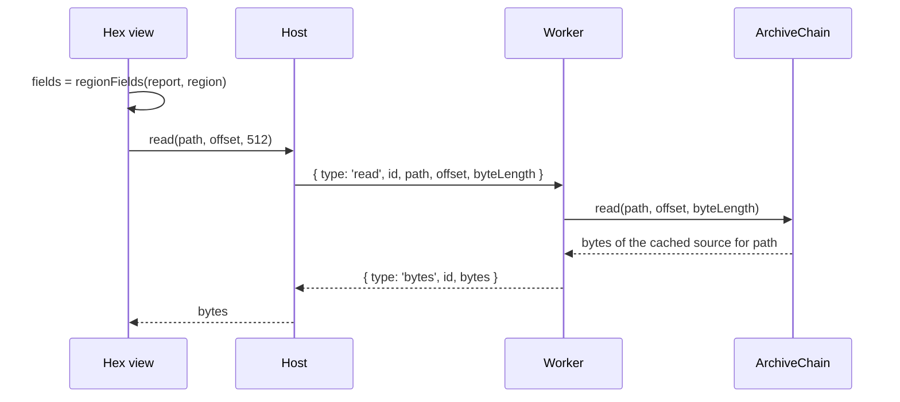

# 0008: ZIP hex view reads through the worker, on its own request lane

## Context

- The hex view ([REQ-ZIP-009](../requirements/REQ-ZIP-009-hex-view.md)) needs raw bytes from the archive being viewed.
- For the top level, the bytes are in the `File`. For a nested archive, they exist only in the worker's memory ([0007](0007-zip-read-from-the-end.md)).
- The worker host keeps only the latest request's answer, so a newer request cancels an older one. A page read must not cancel a running analysis, and an analysis must not wait for a page.
- Field names come from the APPNOTE layouts. The report already holds every length they need.

## Decision

- The worker answers `read` from the source it already caches for that path. An archive that is no longer cached gives an error, not a reopen.
- The host keeps two lanes: analysis (`analyze`, `open`) and reads. A request supersedes only the older request on its own lane.
- `@benchside/zip` gets a pure `regionFields(report, region)`. It builds the field list from the report alone, so labelling needs no read.
- One read is at most one page: 512 bytes.

## Consequences

- Memory stays bounded: a page is 512 bytes, whatever the archive's size.
- The UI cannot show bytes of an archive that is not on the current path. The view only shows regions of the archive on screen, so this does not come up.
- Field labels and decoded values come from the same report, so they cannot disagree.
- Paging one page at a time costs a round trip per page. That is fast enough for reading bytes by eye.
