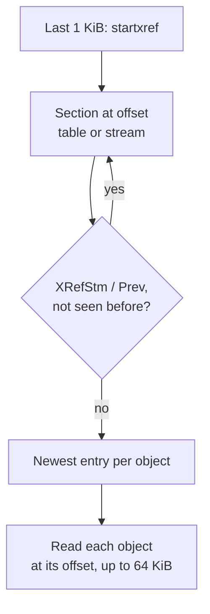

# 0009: PDF analyzer reads from the end and follows the cross-reference chain

## Context

- A PDF's cross-reference information says where every object is. It sits at the end, found through `startxref` (7.5.5).
- Each incremental update appends a section whose `Prev` points to the one before (7.5.6). Since PDF 1.5 a section may be a compressed cross-reference stream (7.5.8).
- PDFs can be hundreds of MiB. Broken and hostile files are common: wrong offsets, `Prev` loops, wrong stream lengths.
- The ZIP analyzer already reads byte ranges through a `ByteSource` in a worker ([0007](0007-zip-read-from-the-end.md)).

## Decision

- Read like a conforming reader: from the end, through `startxref`, then `XRefStm` and `Prev`, with a set of offsets already read.
- Read each object only at the offset its entry gives. Do not scan the file for `obj` keywords. Rebuilding the table by scanning, for broken files, is a later slice with its own findings.
- Parse with one tokenizer over bounded windows of the file. Each object read is capped at 64 KiB, not counting stream data, which is skipped by `Length`.
- Decode only cross-reference streams in this slice: Flate through `DecompressionStream('deflate')`, bounded, then PNG predictors written in-house (RFC 2083 §6).
- Run the analysis in a worker started from a `blob:` URL, as the other apps do ([0004](0004-worker-from-blob-url.md)).

## Consequences

- Memory depends on the cross-reference information and object headers, not on the file size.
- A file whose cross-reference information is broken shows little until the rebuild slice. Findings say why.
- Content hidden in a gap (bytes no section points at) is visible in the byte map, but its objects are not parsed yet.
- Revisions come straight from the section chain, so every update is visible with the objects it changed.
