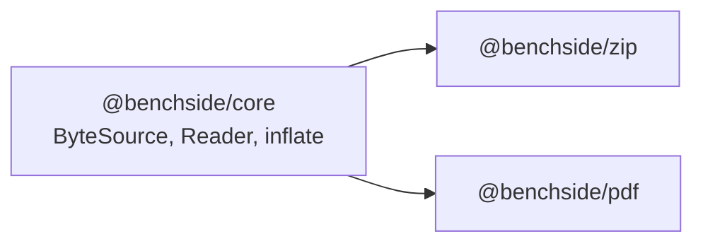

# 0010: Shared byte reading moves into @benchside/core

## Context

- `@benchside/zip` has `ByteSource`, `blobSource`, `bytesSource`, a windowed `Reader`, and bounded inflate.
- `@benchside/pdf` needs the same reading, and inflate for zlib data (`deflate`) instead of raw deflate.
- Apps never import from other apps, and packages should not import parsers they do not use.

## Decision

- A new package, `@benchside/core`, holds `source.ts` and `inflate.ts`. It has no DOM use beyond `Blob` and `DecompressionStream`, which workers have.
- `inflate(data, limit, format)` takes `'deflate'` (zlib, used by PDF) or `'deflate-raw'` (used by ZIP).
- `@benchside/zip` re-exports what it already exported, so its users do not change.

## Consequences

- One tested copy of range reading and bounded decompression.
- The core package must stay free of format knowledge.
