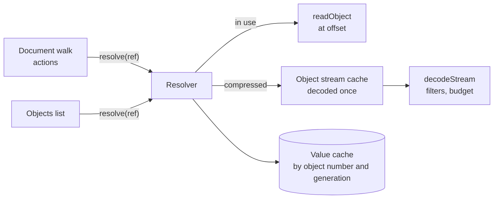

# 0011: PDF objects are resolved on demand, with one cache per analysis

## Context

- The document walk (catalog, page tree, annotations, fields, outline) and the action search follow references from object to object.
- Since PDF 1.5 most of these objects sit in object streams, which must be decoded to read any one object (7.5.7).
- Scripts may be in streams with any of the standard filters (7.4).
- Large files have hundreds of thousands of objects. Hostile files have loops, huge streams, and many references to one object.

## Decision

- One `Resolver` per analysis turns a reference into a value, using the merged entries. It caches each resolved value by object number and generation.
- An object stream is decoded once, on first use. Its header is parsed then; its objects are parsed when asked for.
- `decodeStream` runs the filter pipeline in `@benchside/pdf`. `FlateDecode` uses bounded `inflate` from `@benchside/core` ([0010](0010-shared-core-package.md)); the other filters are small, in-house, and pure.
- One decode budget per analysis bounds the total decoded bytes. Each walk has its own visited set and depth limit.
- The objects list also uses the resolver, so compressed objects show their type.
- The walk reads only objects it reaches. Content streams and images are never decoded.

## Consequences

- Each object is parsed at most once, however often it is referenced.
- Memory grows with the objects reached, not with the file size. The cache holds parsed values, not raw bytes; object streams keep their decoded data while the analysis runs.
- Cross-reference streams use the same filter pipeline, so they gain the ASCII, LZW, and run-length filters too.
- A filter bug affects every stream reader at once; filters therefore have their own unit tests against the clause examples.
