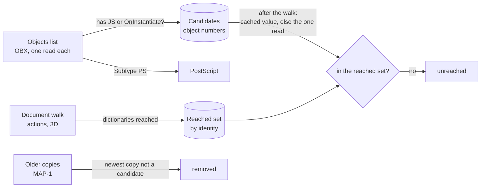

# 0012: PDF scripts are found by walking and by searching every object

## Context

- REQ-PDF-006 asks for code outside actions: 3D JavaScript, XFA scripts, PostScript XObjects, and JavaScript that nothing reaches or that an update removed.
- The document walk ([0011](0011-pdf-resolve-on-demand.md)) finds only what the document points to.
- XFA is XML. `DOMParser` is not available in Web Workers, and the analysis runs in one.
- Files can hold hundreds of thousands of objects. Objects with JavaScript are rare.

## Decision

- The objects list already reads every object once. It marks the ones that hold a JavaScript dictionary as candidates. No extra pass over the file.
- After the walk, each candidate takes its value from the resolver's cache. A walked object is there, so its dictionaries are the same values the walk saw. The reached set compares them by identity: no paths, no object numbers for direct values.
- A candidate the walk never reached is not in the cache. The value the objects list read is used; none of its dictionaries is in the reached set.
- A walk that stopped at a limit, or met an object it could not read, may have missed places. Its unreached dictionaries are then reported as unchecked, not as unreached. The page walk, the action collector, and the resolver each report this themselves; it is not inferred from findings.
- Objects too large for the 64 KiB object read are read once more, up to 4 MiB, within a per-file budget. Otherwise a padded JavaScript action would be invisible to the walk and wrongly called unreached.
- XFA is searched with a small tag scanner, over the packets joined. It skips comments and CDATA, finds `script` elements and the enclosing `event`, and decodes the five predefined entities and character references. It does not build a tree or check well-formedness. A work limit keeps it linear on hostile text.

## Consequences

- Candidates keep their parsed values until the end of the analysis. They are few, so the memory is small.
- The reached set holds only action and 3D stream dictionaries, so its memory is bounded by the action limit.
- The tag scanner can be fooled by XML it does not model, such as a `<script` inside a processing instruction or a document type declaration. It then lists too much, never runs anything, and the text stays visible for the user to judge.
- A file whose trailer cannot be read has no walk, so its JavaScript dictionaries are all listed as unreached. Readers that rebuild broken files may still reach them; the unreached finding says that other tools might run it.
