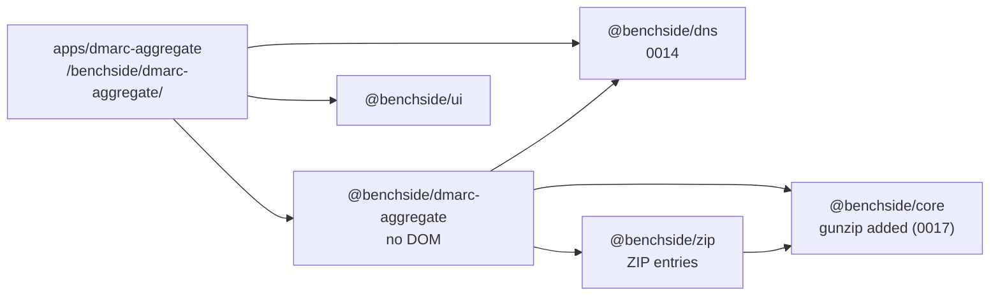

# 0013: DMARC aggregate reports get their own app and package

## Context

- REQ-DMARC-001 to 011 ask for a tool that reads batches of DMARC aggregate reports.
- The mail app analyzes one message. Its input, UI, and state are different: one file, one result, no batch.
- Reports come as XML, gzip, ZIP, or tar, and users keep them in folders. `@benchside/zip` already reads ZIP files within limits. `@benchside/core` has bounded inflate for `deflate` and `deflate-raw`, over a whole buffer only.
- The optional reverse lookup (REQ-DMARC-008) needs the DoH endpoints. Every other part needs no network.
- The other apps send one file to the worker and get one report back. A batch keeps growing as the user adds files, and filters change often.

## Decision

- A new app, `apps/dmarc-aggregate`, deployed to `/benchside/dmarc-aggregate/`, and a new package, `@benchside/dmarc-aggregate`.
- The package reads ZIP files through `@benchside/zip` (`analyzeZip` and its entry data).
- `@benchside/core` gains `gunzip`: gzip members decoded in chunks by an in-house inflate ([0017](0017-gzip-members-in-house-inflate.md)). Callers count bytes against their own limits: 32 MiB per XML document, 1 GiB per batch. No archive is held whole in memory. The existing whole-buffer `inflate` stays for ZIP entries and PDF streams. Core stays free of report knowledge.
- The worker holds the batch. The UI sends files, filters, and lookup settings. The worker answers with snapshots: the batch changes since the last snapshot, a `View` for the current filters, and progress ([Report](../../reference/dmarc-aggregate/report.md), [Progress](../../reference/dmarc-aggregate/progress.md)). Records never cross to the main thread in bulk.
- The worker reads in short steps and sends a snapshot every 250 ms, so results show while a large batch is read (REQ-DMARC-010). Reverse lookups report in batches the same way.
- Folders are walked on the main thread. `DropZone` in `@benchside/ui` gains folder drops and a folder picker; the other apps keep their single-file use.
- CSP: `connect-src https://cloudflare-dns.com https://dns.google`, the same as the mail app. Reason: the opt-in reverse lookup of REQ-DMARC-008. With lookup off, the app makes no requests. The policy blocks every other host, including from the worker.
- Charts are SVG drawn by Preact components in the app. No chart library.

## Consequences

- The CSP allowlist grows by one app. [Privacy model](../privacy-model.md) and [Architecture](../architecture.md) list it.
- A stateful worker is new in this repository. "Clear" replaces the worker's state and starts a new generation; the UI drops messages from older generations, and from older lookup sessions takes only final results that nothing newer has replaced (PRG-13).
- Each filter change costs one pass over the records in the worker. The implementation must measure this at the 1 000 000-record limit. The UI keeps the previous view until the new one arrives.
- Charts written in-house must keep to the CSP rules: no string `style` attributes; colors come from CSS classes.
- A snapshot recomputes the `View` from all counted reports. If that grows too slow on large batches, the view can be updated incrementally later; the protocol does not change.
- RFC 1952 allows several members in one gzip file (INP-4). Step 2 checked `DecompressionStream('gzip')`: it fails on the bytes after the first member and does not report where the member ended. gzip input is therefore decoded by an in-house inflate ([0017](0017-gzip-members-in-house-inflate.md)).
