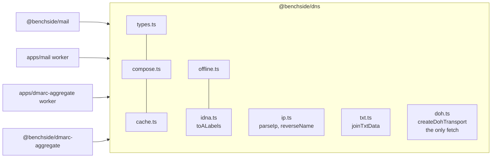

# 0014: The DNS resolver moves into @benchside/dns

## Context

- The mail package has the resolver: query types, composition (log, budget, policy, cache), the session cache, and offline records. `toALabels` and `parseIp` sit in the mail package's shared helpers. SPF builds reverse names inline (`spf/evaluate.ts`).
- The DoH transport (`createDohTransport`) lives in `apps/mail`. Apps never import from other apps.
- The DMARC aggregate app is the second user (REQ-DMARC-008). It needs the transport, the cache, the budget, the log, and the sensitive-query gate. `@benchside/dmarc-aggregate` needs `parseIp` for FMT-12 and reverse names for RDNS-3.

## Decision

- A new package, `@benchside/dns`, holds what both apps need: the types, `composeResolver`, the cache, offline records, IDNA conversion, IP parsing, reverse names, TXT joining, and the DoH transport.
- `reverseName(ip)` replaces the inline code in SPF, so both reverse lookups build names the same way (RFC 1035 §3.5, RFC 3596 §2.5).
- `doh.ts` is the only code in any package that calls `fetch`. It is a separate entry point, `@benchside/dns/doh`, so importing `@benchside/dns` never loads it. Only app workers import it. Checks still receive a resolver and never see the transport.
- TXT joining (DNS-7) moves too: the DoH transport applies it to every TXT answer.
- The mail findings (`dnsFindings`), `isDomainName` (RFC 6376), `isPublic` (ENV-8), and `inCidr` (SPF-22) stay in the mail package. They are mail rules.
- `@benchside/mail` stops exporting DNS symbols. The mail app was their only user, and it now imports them from `@benchside/dns`, so each symbol has one public path.
- The budget stays a parameter: 200 for mail (DNS-13), 2 000 per reverse lookup session (RDNS-6).

## Consequences

- One tested copy of the transport and the cache. `vite.shared.test.ts` checks that the transport's endpoints (`DOH_ENDPOINTS`) and `DOH_ORIGINS` name the same origins. The build test checks each app's CSP against `DOH_ORIGINS`.
- The rule "packages never call `fetch`" gets one named exception, `@benchside/dns/doh.ts`. Lint enforces both sides. The rest of `@benchside/dns` may not use `fetch`, `XMLHttpRequest`, `WebSocket`, `EventSource`, `navigator`, `globalThis`, or `self`. Packages and app code outside `src/worker/` may not import `@benchside/dns/doh`.
- The refactor moves files and tests without changing behavior. It lands as its own change before the DMARC aggregate app uses it.
