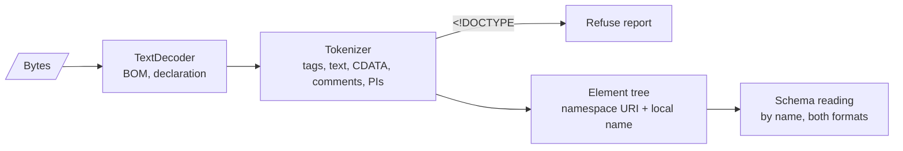

# 0015: Reports are read with a small in-house XML reader

## Context

- Reports are XML. Parsing runs in a worker (REQ-DMARC-009).
- `DOMParser` is not available in Web Workers ([0012](0012-pdf-find-scripts.md) met the same limit).
- Report XML is a hostile input: RFC 9990 §8.1 names XML bombs. Entity expansion is the usual vector.
- The repository keeps runtime dependencies to a minimum and writes parsers in-house.
- Reports use a tiny part of XML: elements, text, a few namespace declarations, one attribute (`lang`).

## Decision

- A non-validating XML reader inside `@benchside/dmarc-aggregate`, covering the subset in [XML reader](../../reference/dmarc-aggregate/xml.md).
- A document type declaration refuses the report. Only the five predefined entities and character references are expanded. No entity can grow the input.
- Well-formedness errors refuse the report. Schema deviations do not: schema reading is a separate, tolerant step ([Format](../../reference/dmarc-aggregate/format.md)).
- The reader is incremental: it takes text in chunks from the input stream and can pause between chunks, so the worker can answer messages while it reads (PRG-8).
- One input may hold several documents (XML-10). After a root element closes, the reader looks for the next one. This goes beyond XML 1.0 on purpose, for `cat`-joined reports.
- The reader builds a small tree. Reports are at most 32 MiB of XML, and records are flattened as soon as a `record` element closes, so memory stays near the size of the input.

## Consequences

- We own and fuzz a few hundred lines of code.
- Documents that rely on a DTD are refused. Neither schema needs one, and the RFC 9990 sample (Appendix B) has none.
- The reader stays in `@benchside/dmarc-aggregate` until a second package needs a tree reader. The PDF XFA scanner does not: it only looks for tags.
