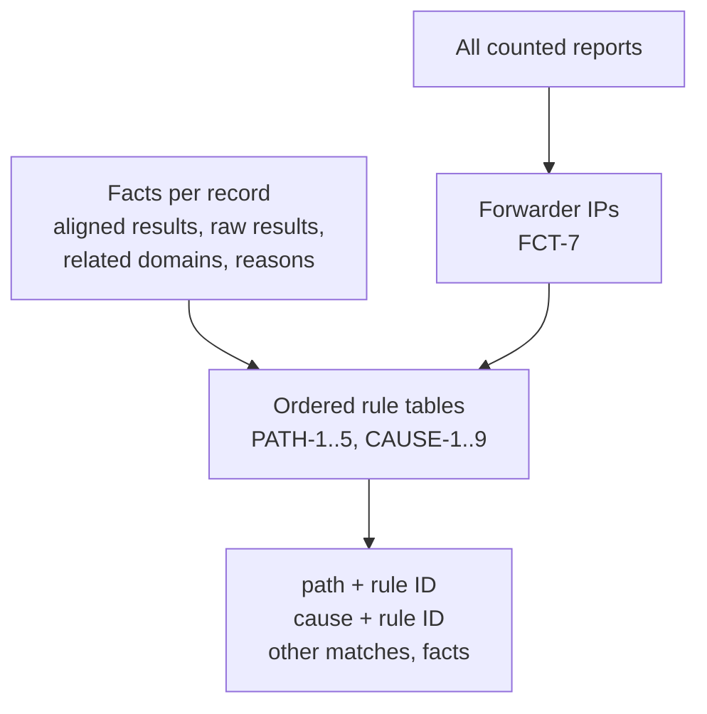

# 0016: Delivery paths and causes come from ordered rules over report data

## Context

- REQ-DMARC-005 asks for a delivery path (direct, forwarded, other) and a cause for each failure.
- A report record holds only: source IP, count, the aligned results, the raw SPF and DKIM results with domains, the identifiers, the disposition, and override reasons. It has no route, no ARC result (unless an extension adds one), and no message content.
- RFC 9989 §7.4 names the pattern of relayed mail: SPF fails at the relay, DKIM survives.
- Users must be able to check and dispute the result.

## Decision

| Choice | Why |
|---|---|
| Alignment is the reporter's verdict (`policy_evaluated`) | Re-evaluating needs DNS at the time of delivery and the reporter's organizational domain method. The report already holds the answer |
| "Related domain" by whole-label suffix | Stands in for relaxed alignment without a public suffix list or a tree walk. Good enough to tell "the domain's own signature failed" from "someone else's signature" |
| First match wins, other matches listed | One answer per record for charts; the rest stays visible |
| Forwarder IPs inferred across all counted reports | An IP that relays DKIM-passing mail with broken SPF is a forwarder. Its failing mail is then explained by forwarding. Using all counted reports keeps results stable when filters change |
| No reverse DNS, no lists of known services | Results must not depend on an optional lookup or on data that goes stale |

## Consequences

- Classifications are reproducible and testable from the rule tables alone.
- Some cases come out wrong by design: SRS forwarders look direct, a spoofer with its own SPF looks like an unaligned direct sender. The [known limits](../../reference/dmarc-aggregate/classify.md#known-limits) table lists them, and the UI calls the result an estimate.
- Adding a batch can change a record's class: a new report can reveal a forwarder IP (FCT-7). The rule ID makes the reason visible.
- If receivers adopt an ARC extension in reports, a later rule can use it. No change is needed until one exists.
