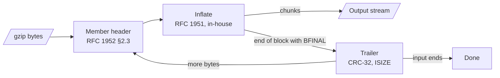

# 0017: gzip input is decoded by an in-house inflate

## Context

- INP-4 reads gzip input member after member: RFC 1952 §2.2 makes a gzip file a series of members, and `cat a.gz b.gz` is a common way to join reports.
- [0013](0013-dmarc-aggregate-app.md) planned `inflateStream` over `DecompressionStream('gzip')` and asked step 2 to check that it reads past the first member.
- It does not. Node 26 throws "Trailing junk found after the end of the compressed stream" on a second member, on any bytes after the first member, and on a truncated member alike. The Compression Streams standard makes bytes after the end of the compressed data an error.
- The error does not say where the first member ended. Node emits the whole first member before it throws, but the standard does not promise that, so no engine-independent way finds the boundary.
- Retrying on prefixes up to each `1F 8B` candidate needs a decode per candidate, and a failed try has already emitted output that cannot be taken back.

## Decision

- `@benchside/core` gains `gunzip`: an in-house inflate (RFC 1951) inside a gzip member reader (RFC 1952). It yields output in chunks, member after member, and knows where each member ends.
- It checks each member's CRC-32, ISIZE, and header CRC (FHCRC). A mismatch, a bad header, a truncated member, or bytes after a member that neither start another one nor are all zero is an error. Zero padding after the last member is accepted, as gzip(1) does. The chunks yielded before the error stay with the caller.
- The caller passes the most output it will take. `gunzip` stops as soon as the output passes it, so a bomb never grows past the caller's limit (INP-6).
- It works in steps: the caller pulls chunks, so the reading job can stop between chunks (PRG-8).
- The whole-buffer `inflate` over `DecompressionStream` stays for ZIP entries and PDF streams: those have one stream with a known end.

## Consequences

- We own a deflate decoder (a few hundred lines). Tests decode `node:zlib` output of random and repetitive data at several levels and compare the bytes, including back references across the 32 KiB history shift. They also cover RFC 1951 edge cases (stored, fixed, and dynamic blocks; incomplete codes) and check that mutated input never throws.
- It runs slower than the native decoder. The 1 GiB batch budget bounds the work, and the reading job yields between chunks, so the UI stays live.
- Every engine reads multi-member files the same way. No browser test is needed for member handling; the browser test of 0013 for multi-member gzip is replaced by unit tests.
- `inflateStream` is not added. 0013 and the architecture name `gunzip` instead.
