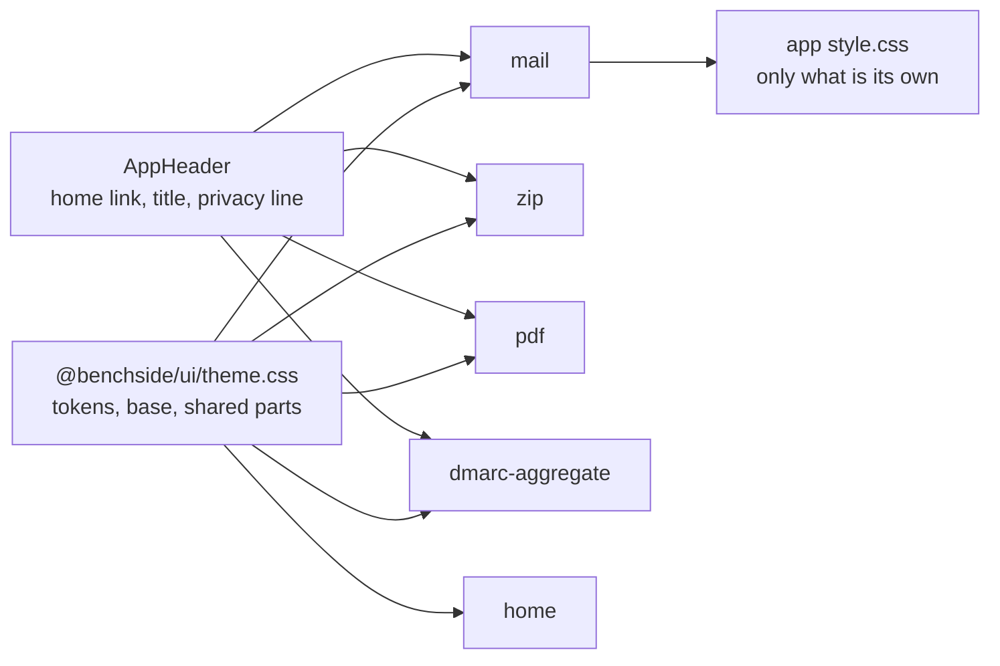

# 0018: One shared look in @benchside/ui

## Context

- The DMARC aggregate app has design tokens, dark mode, and styled controls. Mail, ZIP, PDF, and home use browser defaults.
- The four default-styled pages hard-code their colors (`#c33`, `#c80`, `#2a7`, `#06c`) and stay white in dark mode.
- No page links back to home or to another tool. Only home and DMARC state the privacy promise.
- Every app now has the same building blocks: a title, a drop zone, a summary, findings, and tables.

## Decision

| Choice | Why |
|---|---|
| Tokens, base styles, and shared parts live in one file, `theme.css`, in `@benchside/ui` | One place to change a color; dark mode everywhere |
| Each app imports `theme.css` before its own `style.css` | The app's rules win where they differ |
| Home links the same file from its HTML | Home has no script |
| `AppHeader` renders the home link, the title, and a one-line privacy statement | The way home and the privacy promise appear on every tool |
| System fonts only | Web fonts would be a request to another host (CSP, privacy model) |
| Classes only; no `style` attributes | CSP (`style-src` falls back to `'self'`) |
| Seeded from the DMARC tokens | Their colors were already checked for contrast and color blindness |

The parts, tokens, and values are in [UI design system](../ui-design-system.md).

## Consequences

- `DropZone` no longer ships its own CSS. Its styles are in `theme.css`, so an app that uses it must import the theme.
- A change to `theme.css` changes every app. Check all five pages before merging one.
- App stylesheets shrink to what is specific to the app: DMARC charts, the ZIP hex view, the mail result borders.
