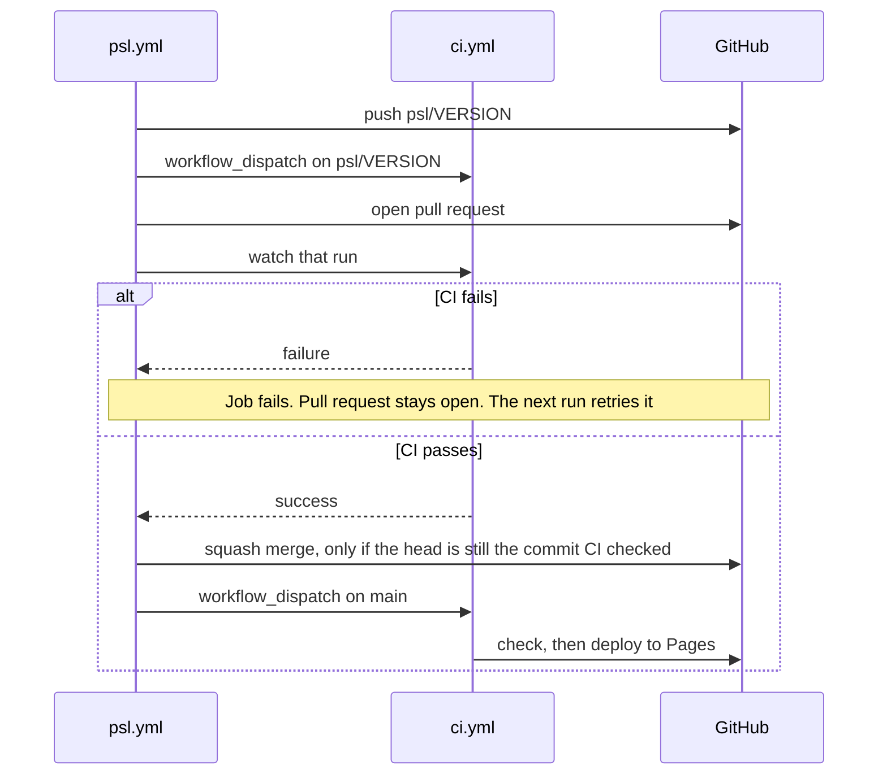

# 0019: Merge Public Suffix List updates automatically

## Context

- The `Update Public Suffix List` workflow ([0003](0003-bundle-public-suffix-list.md)) opens a pull request each week the list changes. A person then merged it by hand.
- The change is one data file. Review adds little: the workflow already checks the file's shape, and CI runs every test on it.
- The workflow runs with `GITHUB_TOKEN`. A push or merge made with that token starts no `push` workflow. Only `workflow_dispatch` and `repository_dispatch` are exceptions.
- So GitHub's built-in auto-merge, enabled with `GITHUB_TOKEN`, would merge into `main` without running CI there. Nothing would deploy until the next human push.

| Option | Problem |
|---|---|
| Keep merging by hand | Weekly chore for a data-only change |
| GitHub auto-merge with `GITHUB_TOKEN` | Merge starts no CI on `main`, so no deploy. Needs a ruleset with a required check |
| GitHub auto-merge with a PAT or GitHub App token | A long-lived secret to store and rotate |
| **The PSL workflow waits for CI, merges, and dispatches CI on `main`** | The job stays open while CI runs |

## Decision

The PSL workflow merges its own pull request when CI on that commit passes. Then it starts CI on `main` with `workflow_dispatch`, and that run deploys.

- `ci.yml` deploys on `push` and on `workflow_dispatch`, from `main` only.
- The merge names the commit that CI checked (`--match-head-commit`). If the branch moved, the merge fails.
- A run that finds its own pull request still open retries it: it rebuilds the branch, runs CI, and merges. A merged or closed pull request settles that `VERSION`.
- The wait for CI is capped below the job's time limit, so every failure leaves a message in the log.

## Consequences

- No weekly chore. New lists go live within the hour.
- No new secret, no repository ruleset, no new workflow.
- Data from publicsuffix.org reaches the site with no human review. The only gates are the shape check in `psl.yml` and CI. A bad list would change organizational domains in RFC 7489 mode. The report shows the snapshot `VERSION`, so such a result can be traced.
- Anyone with write access can now redeploy `main` with **Actions → CI → Run workflow**.
- If a branch protection rule on `main` requires a review, the merge step fails, and the pull request waits for a person as before.
