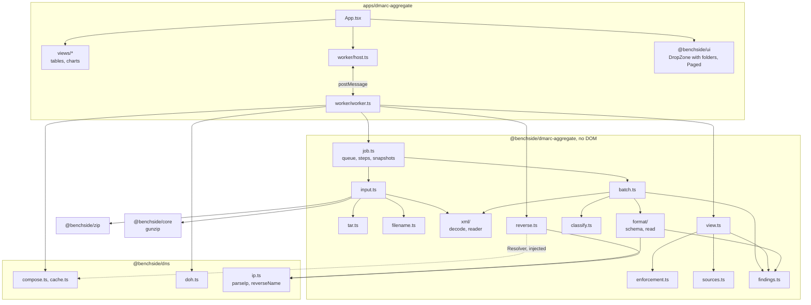
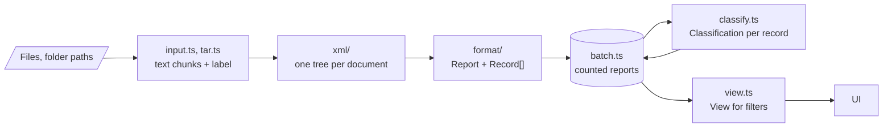
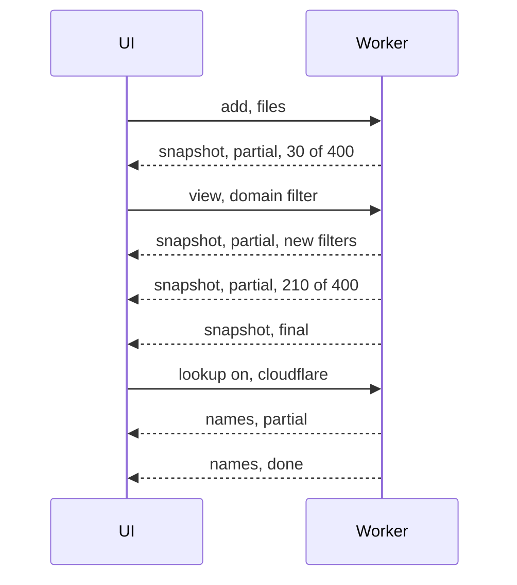

# DMARC aggregate report analyzer architecture

Spec: [DMARC aggregate report analyzer specification](../reference/dmarc-aggregate/README.md). Requirements: REQ-DMARC-001 to 011 ([list](requirements/README.md#dmarc-aggregate-report-analyzer)). Decisions: [0013](decisions/0013-dmarc-aggregate-app.md), [0014](decisions/0014-shared-dns-package.md), [0015](decisions/0015-dmarc-aggregate-xml-reader.md), [0016](decisions/0016-dmarc-aggregate-classify.md), [0017](decisions/0017-gzip-members-in-house-inflate.md). UI: [DMARC aggregate report UI design](dmarc-aggregate-design/ui.md). XML reader: [design](dmarc-aggregate-design/xml.md). Input: [design](dmarc-aggregate-design/input.md).

## Modules

| Module | Does | Rules |
|---|---|---|
| `input.ts` | File kind by leading bytes, gzip members as one stream (`gunzip`, 0017), ZIP entries (`inflateRawStream`), nesting, labels, byte budget | INP-3..7, INP-13 |
| `tar.ts` | tar headers, pax and GNU long names, checksums, entries as a stream | INP-12 |
| `filename.ts` | Attachment name grammar, comparison with content | INP-8..10 |
| `xml/decode.ts` | BOM, declaration, `TextDecoder` per value, UTF-16 to UTF-8 transcoding | XML-1, XML-2, XML-10 |
| `xml/reader.ts` | `XmlReader`: takes bytes in chunks. Tags, text, CDATA, comments, PIs, references, DTD refusal; namespace scopes, element tree, depth limit, document boundaries, line ends | XML-2..10 |
| `format/schema.ts` | One table of paths with the multiplicity per format, and the enumerations per path, as data | FMT-4..10 |
| `format/read.ts` | `readReport`: root check and format; report and extension elements; missing and repeated elements; enumerations, integers, IPs, domains, legacy SPF values, truncation; skipped records; content hints and the mixed-format finding | FMT-1..18 |
| `job.ts` | The reading queue; file count, size, and folder skips at `add`; steps of at most 50 ms; snapshots every 250 ms; null `View` when unchanged; stop; generations | INP-1, INP-2, INP-11, PRG-1, PRG-3..9, PRG-13, PRG-16 |
| `batch.ts` | Holds counted reports and records; identity, duplicates, overlaps, policies, forwarder IPs; tracks what changed since the last snapshot | CMB-1..5, CMB-8, FCT-7, PRG-14 |
| `classify.ts` | Facts, path, cause, rule IDs | FCT-1..6, PATH-*, CAUSE-* |
| `view.ts` | Filters, days, totals, timeline, reporters, formats, reporter errors | CMB-6, CMB-7, CMB-9..13 |
| `enforcement.ts` | Policy in effect, failing messages, direct sources, SPF-only passes, overrides, status | ENF-* |
| `sources.ts` | Source rows, detail rows, path and cause filters | SRC-1..5 |
| `reverse.ts` | Sessions, targets, PTR, forward confirmation, states, batched `names`, the budget finding; takes a `Resolver` | RDNS-2..5, RDNS-9, PRG-2, PRG-11..13 |
| `findings.ts` | Finding collector with the 10 000 limit | REP-7, REP-8 |

In the app, `state.ts` applies snapshots on the main thread: it drops older generations, merges batch changes, picks the `View` that matches the filters and focus, keeps the shown `View` when a snapshot has none, sets the partial label from the snapshot of the shown `View`, and keeps host names from `names` messages (PRG-13, PRG-15, PRG-16).

`format/schema.ts` holds the element table of [Format](../reference/dmarc-aggregate/format.md#elements) as data. The tests and the reader both use it, so the two schemas are written down once.

## Data flow

- Folders are walked on the main thread, where the File and Entries APIs live (`webkitGetAsEntry` for drops, `webkitdirectory` for the picker). The worker gets `File` objects with their relative paths.
- Input is a pipeline of streams: file bytes, then gzip members, then tar entries, then text chunks for the tokenizer. No step holds a whole archive in memory; one document holds at most 32 MiB (INP-6).
- A record is classified once, when its report is counted.
- A new report can reveal a forwarder IP (FCT-7). The batch then classifies again the records of that IP, and only those.
- Records are stored in columns (typed arrays and string tables). They never cross to the main thread; the UI gets grouped rows in the `View` and only the batch changes since the last snapshot (REP-10, PRG-14).

## Worker protocol

| Direction | Message |
|---|---|
| UI → worker | `{ type: 'add', id, files: { file: File, path: string }[] }` |
| UI → worker | `{ type: 'stop', id }`: stops reading (PRG-9) |
| UI → worker | `{ type: 'clear', id }` |
| UI → worker | `{ type: 'view', id, filters, focus }`: `focus` is a path or cause filter (SRC-5), or null |
| UI → worker | `{ type: 'lookup', id, on: boolean, provider }` |
| worker → UI | `{ type: 'snapshot', id, generation, changes, view, progress, partial, filters, focus }`: periodic while reading (PRG-4), and the answer to every `view` (PRG-8); `id` is the request it answers, or null |
| worker → UI | `{ type: 'names', generation, session, changes, counts, log, findings }`: changed lookup states (PRG-11, PRG-12), new query log entries, and `dns.budget-exhausted` once |
| worker → UI | `{ type: 'failed', id, message }` |

- `File` objects pass by reference. The worker reads them.
- Snapshots carry the filters and focus they were computed for and the batch generation (PRG-13). The UI drops snapshots from an older generation. From every other snapshot it takes the batch changes, progress, and `partial`; it shows the `View` only when there is one and the filters and focus match (PRG-14 to PRG-16).
- `names` messages of the current generation apply in full from the active session; from an ended session (including one just turned off) only final states that nothing newer replaced (PRG-13). Host names never change a view (RDNS-8). The UI merges them into its host name map by IP.
- The UI keeps expanded rows by source IP and keeps its scroll position across snapshots (REQ-DMARC-010).
- `lookup` with `on: true` starts a session and computes the first targets from the table as shown, focus included. After that the worker recomputes them whenever it computes a snapshot (RDNS-2); a `view` always produces one, so filter and focus changes are covered. `on: false` aborts the session's signal (RDNS-9).

## Build order

Each step is one pull request that passes CI on its own.

```mermaid
flowchart LR
  s1["1 Extract @benchside/dns<br/>0014, no behavior change"] --> s2["2 gunzip<br/>@benchside/core, 0017"]
  s2 --> s3["3 XML reader<br/>XML-*"]
  s3 --> s4["4 Format<br/>FMT-*"]
  s4 --> s5["5 Input and batch<br/>INP-*, tar, CMB-1..5"]
  s5 --> s6["6 Classification<br/>FCT, PATH, CAUSE"]
  s6 --> s7["7 View, sources, enforcement<br/>CMB-6..13, SRC, ENF"]
  s7 --> s8["8 Job and snapshots<br/>PRG-*"]
  s8 --> s9["9 App: folders, indicator,<br/>tables, reports, findings"]
  s9 --> s10["10 Charts"]
  s10 --> s11["11 Reverse DNS<br/>RDNS-*"]
```

## Tests

| Layer | What | Data |
|---|---|---|
| `xml/` | Each XML-* rule; truncated and mutated documents finish with findings | Strings built in tests |
| `format/` | Every row of the element table in both formats; namespaces; hints | The RFC 9990 Appendix B sample; a synthetic report built from the RFC 7489 schema |
| `classify.ts` | One scenario per PATH and CAUSE rule, and one per known limit | Records built from facts |
| `batch.ts`, `view.ts` | Duplicates, conflicts, overlaps, days, filters, totals | Synthetic reports from two reporters and two domains |
| `input.ts`, `tar.ts` | gzip with several members, ZIP, tar, tar.gz, nesting, bombs, unknown types | Fixtures built in tests with `CompressionStream`, the ZIP test writer, and a small tar writer |
| `job.ts` | Snapshot timing, partial flag, stop, add while reading | A fake clock |
| `reverse.ts` | Order, confirmation, states, budget | A fake `Resolver` |
| App | Views render a `View`; filters send `view`; the indicator follows `progress`; expanded rows survive snapshots | happy-dom |
| Browser | CSP blocks other hosts; no request while lookups are off | Chromium in CI |

All data uses documentation addresses (192.0.2.0/24, 198.51.100.0/24, 203.0.113.0/24, 2001:db8::/32) and `example` domains. Real reports stay in `samples/private/`.
