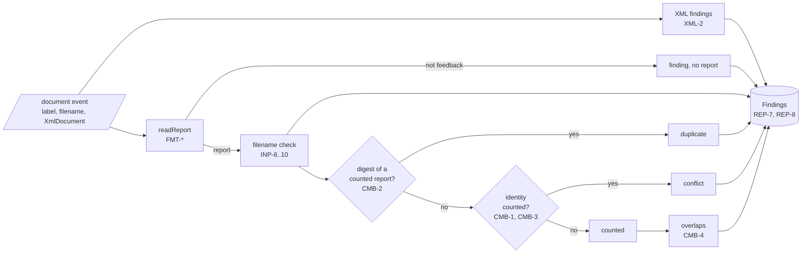
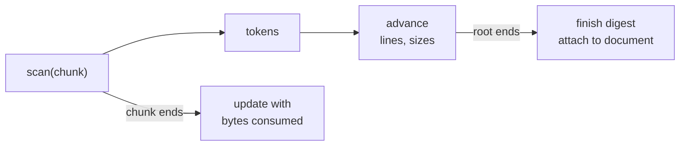
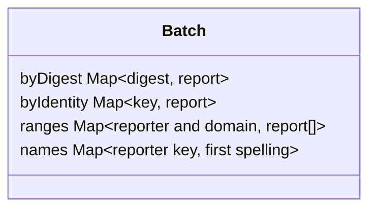

# DMARC aggregate batch design

How `batch.ts`, `findings.ts`, and `sha256.ts` in `@benchside/dmarc-aggregate` meet [Combining reports](../../reference/dmarc-aggregate/combine.md) CMB-1 to CMB-5, INP-9, INP-10, REP-7, and REP-8. Where the documents come from: [Input design](input.md).

## Shape



```ts
class Findings {                       // REP-8: order kept, 10 000 then one too-many-findings
  constructor(limit?: number);
  add(f: Finding): void;
  readonly list: readonly Finding[];
  countFor(file: number): number;      // REP-1 file counts
}
class Batch {
  constructor(findings: Findings);
  addDocument(doc: { label: string; filename: string | null; document: XmlDocument },
              file: number): ReportSummary | null;   // null: not a report (FMT-1)
  readonly reports: readonly ReportSummary[];        // every report, in the order read
  reporterName(org: string): string;                 // CMB-5: the first spelling
}
```

- The job (step 8) calls `addDocument` for each `document` event and adds `finding` events to the same `Findings`, so all findings keep one order.
- `ReportSummary` gets `day` in step 7, with CMB-7.

## Digests

`XmlReader` hashes the bytes it scans (XML-11). The reader already walks every byte once for line numbers; the digest takes the same ranges.



| Choice | Why |
|---|---|
| The digest covers the bytes scanned, not the input bytes | The reader sees no gzip or tar framing, so the same report in `.xml`, `.xml.gz`, or a ZIP gives one digest |
| One SHA-256 per document, updated per chunk | A document can be 32 MiB; holding its bytes for `crypto.subtle.digest` would double memory, and that API is async |
| SHA-256 is in-house, in this package | Web Crypto has no streaming digest. Only this package needs one; it moves to `core` when a second package does |
| The digest is a lowercase hex string | It is a `Map` key and a test value |

## Identity and overlaps



| Choice | Why |
|---|---|
| CMB-2 is checked before CMB-3 | A byte-identical copy is a duplicate even when its identity also matches |
| Only counted reports enter the maps | A copy of a conflicting report is compared with the report that stayed |
| Overlaps are found by a linear scan of the counted reports of the same reporter and domain | Groups are small (a reporter sends about one report a day per domain); 10 000 reports in one group cost about 50 million comparisons in total, once |
| Keys lowercase the reporter; the domain comes lowercased and without its trailing dot from FMT-14 | CMB-1 and CMB-5 compare them that way |

## Findings

| Finding source | `file` | `label` | `report` |
|---|---|---|---|
| Input (`InputFinding`) | the file read | its label | none |
| XML document warnings | the file read | the document label | the report, when one is read |
| Format, filename, CMB | the file read | the document label | the report |
| `aggregate.input.too-large` at `add`, `too-many-files`, `skipped` | step 8 | | |

`aggregate.too-many-findings` carries no file and no label. After the limit, `add` counts nothing more, so `countFor` matches the kept list (REP-1).
