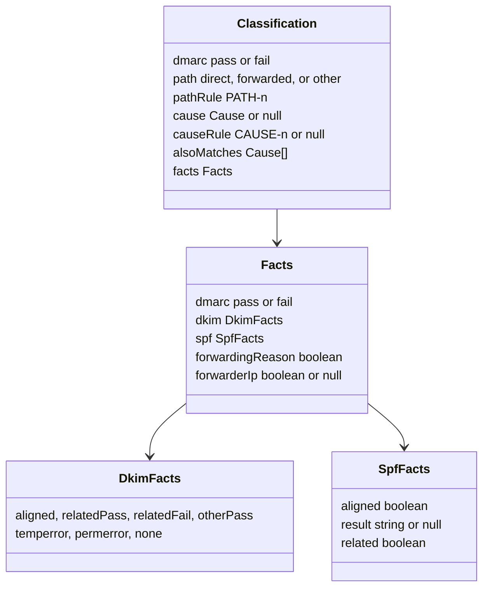
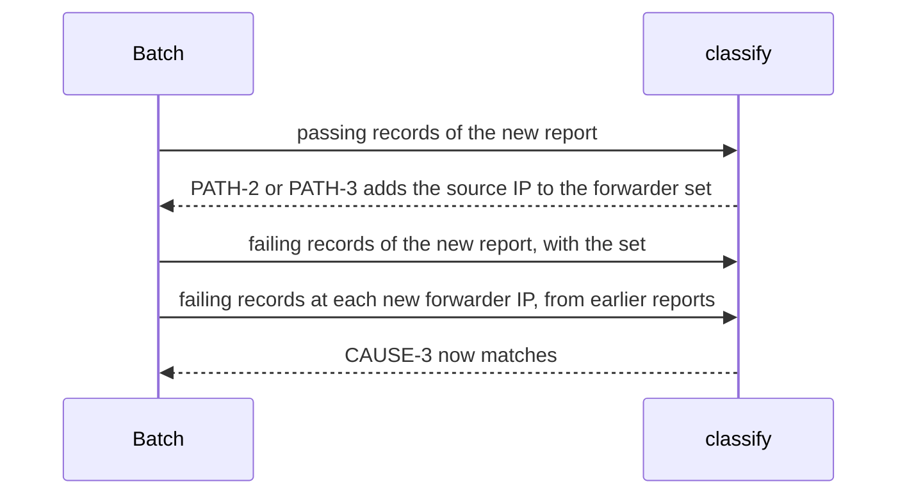

# DMARC aggregate classification design

How `classify.ts` and `batch.ts` in `@benchside/dmarc-aggregate` meet [Classification](../../reference/dmarc-aggregate/classify.md) FCT-1 to FCT-7, PATH-1 to PATH-5, and CAUSE-1 to CAUSE-11. Why ordered rules: [0016](../decisions/0016-dmarc-aggregate-classify.md).

## Shape

```ts
function recordFacts(record: ReadRecord, policyDomain: string,
  forwarder: (ip: string) => boolean): Facts;       // FCT-1..7
function classify(facts: Facts): Classification;   // PATH-*, CAUSE-*, pure
function inconsistent(record: ReadRecord): ('dkim' | 'spf')[];   // FCT-6
```



- `classify` reads nothing but its facts, so each rule table row is one test.
- `forwarderIp` is null for DMARC-passing records: no PATH rule uses it, so a new forwarder IP never changes them.

## Forwarder IPs

Only passing records make an IP a forwarder (PATH-2, PATH-3). Only failing records use it (CAUSE-3). So a report is classified in two passes, and earlier records are revisited only for new forwarder IPs.



| Choice | Why |
|---|---|
| The batch keeps failing records by source IP | A new forwarder IP revisits only its own failing records (architecture: "only those") |
| Classifications are kept per counted report, one per record | Step 7 groups them into rows; a record is never classified twice for the same set |
| FCT-6 is checked when a report is counted, one finding per record naming each method | Records are classified only then. The finding does not depend on the forwarder set, so it is fixed once raised (PRG-14) |
| Domains are compared as written | FMT-14 already lowercased them and dropped the trailing dot |
