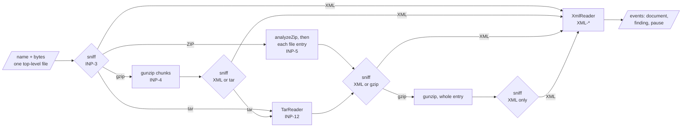
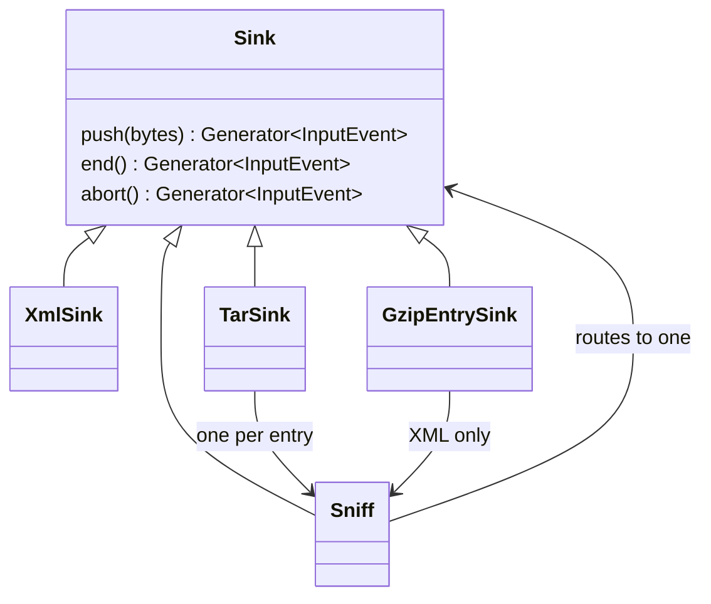
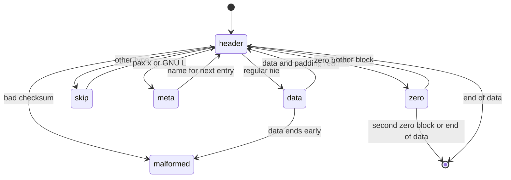

# DMARC aggregate input design

How `input.ts`, `tar.ts`, and `filename.ts` in `@benchside/dmarc-aggregate` meet the [Input](../../reference/dmarc-aggregate/input.md) spec. What happens to each document next: [XML reader design](xml.md).

## Shape



```ts
interface Budget { remaining: number; exhausted: boolean }    // INP-6, shared by a batch
function readInput(file: { name: string; bytes: Uint8Array }, budget: Budget,
  limits?: Partial<InputLimits>): AsyncGenerator<InputEvent, void>;  // limits: INP-5, 6, 12, 13
type InputEvent =
  | { type: 'kind'; kind: 'xml' | 'gzip' | 'zip' | 'tar' | 'unknown' }  // once, first
  | { type: 'document'; label: string; filename: string | null; document: XmlDocument }
  | { type: 'finding'; finding: InputFinding }
  | { type: 'pause' };                                       // the job may stop here (PRG-8)
```

- `filename` is the innermost name for INP-8, or null when the XML holds several documents.
- The generator is async only because `analyzeZip` is. Every other layer is synchronous.
- The job (step 8) reads the `File` into memory first. INP-2 caps a file at 64 MiB.

## Layers are generators

Each layer is a sink with three generator methods. A layer yields its own events and passes chunks down with `yield*`, so a pause deep inside a nested archive reaches the job.



| Sink | Does |
|---|---|
| `Sniff` | Buffers the first 262 bytes, decides the kind, and routes to one inner sink. A kind its place does not allow gives `aggregate.input.nested` inside an archive and `aggregate.input.unknown-type` outside (INP-4, INP-13) |
| `XmlSink` | Feeds an `XmlReader`. Holds back the last completed document until the next one or the end, so it knows whether to add ` #n` (INP-7) |
| `TarSink` | Feeds a `TarReader`; opens a `Sniff` per regular file entry with the entry label |
| `GzipEntrySink` | Collects a gzip entry of a ZIP or tar archive, then decompresses it with pause points |

A sink is `done` once it takes no more bytes: it rejected its kind, the XML reader stopped, or the tar archive ended. Decompression stops there, so a rejected stream spends no more of the budget (INP-6).

`abort()` ends a sink after an error above it, such as a gzip error under a tar. It emits documents already completed and nothing else, so one error gives one finding.

## Choices

| Choice | Why |
|---|---|
| The kind is decided from the first 262 bytes, or all bytes when fewer | `ustar` sits at 257..261. A cap keeps the sniff buffer small. When all 262 hold only white space after the BOM, the input is read as XML, and the XML reader reports what follows |
| ZIP entries are inflated by `inflateRawStream` from `@benchside/core` | The deflate decoder of `gunzip` in raw mode (0017). Output comes in chunks, so an entry is never held whole, and the budget is checked chunk by chunk. `DecompressionStream` returns the whole output |
| A gzip entry of an archive is collected whole before decompressing | `gunzip` takes its input whole. Such an entry is a compressed report; INP-13 caps it at 64 MiB, the top-level file size |
| `TarReader` is push-based and does no decompression | Its work per chunk is small, so it needs no pause points of its own. `TarSink` yields after each entry's data |
| Budget is one object shared by the batch | Nested decompression draws on the same 1 GiB. Every layer's output counts (INP-6) |
| Labels are built as the sinks nest | Each entry adds ` › name`; gzip adds nothing (INP-7) |

## tar



- The name is the pax `path`, else the GNU long name, else `prefix/name`. `prefix` counts only with the POSIX magic `ustar` NUL, since GNU tar uses those bytes for other fields.
- Names are decoded as UTF-8; invalid bytes become U+FFFD.
- A lone zero block followed by a header does not end the archive.
