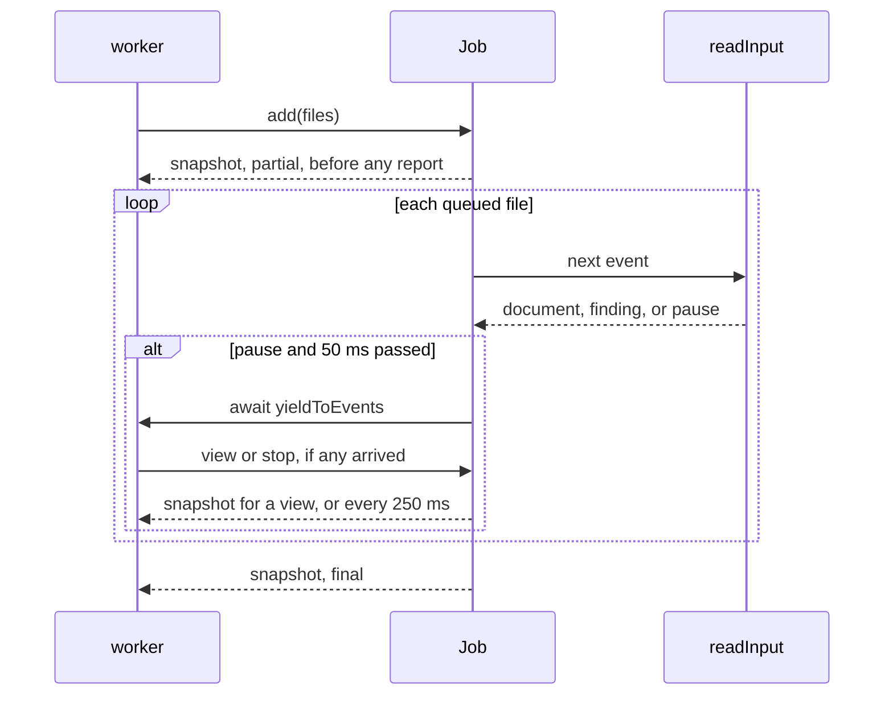
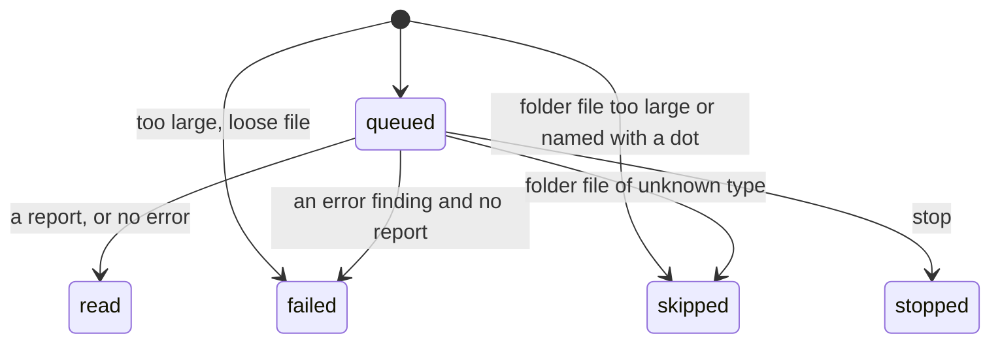

# DMARC aggregate job design

How `job.ts` in `@benchside/dmarc-aggregate` meets [Progress](../../reference/dmarc-aggregate/progress.md) PRG-1, PRG-3 to PRG-9, and PRG-13 to PRG-16, with INP-1, INP-2, INP-11, and REP-1. The lookup job (PRG-2, PRG-10 to PRG-12) comes with reverse DNS.

## Shape

```ts
interface JobFile { name: string; size: number; fromFolder: boolean; read(): Promise<Uint8Array> }
class Job {
  constructor(o: {
    send(s: Snapshot): void;            // to the UI
    clock?: () => number;               // ms, for steps (50) and snapshots (250)
    yieldToEvents?: () => Promise<void>; // lets messages in between steps
    now?: () => number;                 // seconds, the time of reading (CMB-7)
  });
  add(files: JobFile[]): void;          // INP-1, INP-2, INP-11; starts reading
  view(id: number, filters: Filters, focus: Focus | null): void;   // PRG-8
  stop(): void;                         // PRG-9
  clear(): void;                        // PRG-3, PRG-13
  readonly idle: Promise<void>;         // settles when reading ends; for tests and the worker
}
```

The worker (step 9) owns `postMessage` and the `File` objects. The job sees only `JobFile`, so tests drive it with fake files, a fake clock, and an immediate yield.

## The reading loop



| Choice | Why |
|---|---|
| A step ends at a `pause` event of `readInput` once 50 ms have passed | Every layer yields `pause` after bounded work (input design), so a step stays near 50 ms (PRG-8) |
| A `view` while reading is answered after the current step; while idle, at once. A newer request replaces one not yet answered | PRG-8: within one step either way. The UI shows only the `View` for its current filters (PRG-15), so an older answer would be dropped anyway |
| Stop takes effect at the next step boundary; the generator is returned, dropping a report half read | PRG-9 |
| `bytesRead` counts the sizes of the files finished | `readInput` reports no position inside a file. A file is at most 64 MiB (INP-2) |
| Each snapshot is computed from offsets into `Batch.reports` and `Findings.list`, and from `policyRevision` | PRG-14: only what changed |
| The `View` is null when nothing it depends on changed since the previous snapshot | PRG-16 |
| Clear stops reading, makes a new batch with the next generation, and sends one empty snapshot | The UI learns the generation (PRG-13) |
| A file the browser refuses gives `aggregate.input.unreadable` and reading goes on; any other error ends the run with a final snapshot, phase `stopped`, then reaches the worker | INP-14. The job is never left in `reading`, so later adds and view requests are answered |

## Files



| Choice | Why |
|---|---|
| Too large, and a dot name for folder files, are decided at `add` | Size and name are known without reading |
| An unknown type in a folder file is known only once read; it becomes `skipped` with no finding | INP-11: "gives no finding of its own" |
| One `aggregate.input.skipped` per add, after the last of its folder files is decided | INP-11: the count and the first 20 paths of that add |
| `aggregate.input.too-many-files` once per add that goes past 20 000 files; those files are not listed | INP-2: "later files are not read" |
| Findings of the files carry the file `index` and its name as label | REP-7 |
