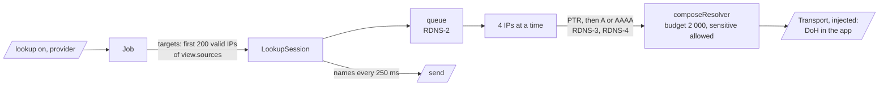
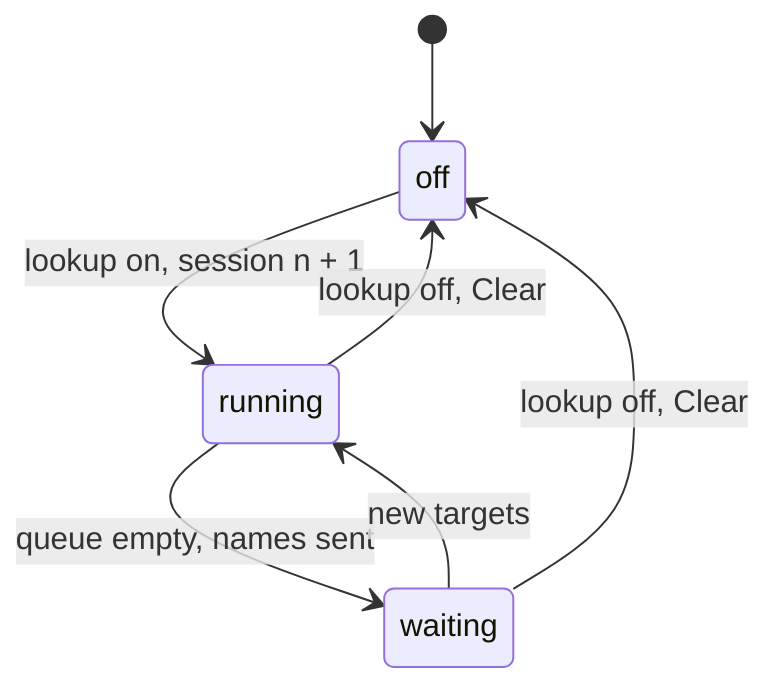

# DMARC aggregate reverse lookup design

How `reverse.ts` and `job.ts` in `@benchside/dmarc-aggregate` meet [Reverse DNS](../../reference/dmarc-aggregate/reverse-dns.md) RDNS-1 to RDNS-9 and [Progress](../../reference/dmarc-aggregate/progress.md) PRG-2 and PRG-10 to PRG-13. The resolver is the shared one ([0014](../decisions/0014-shared-dns-package.md)).

## Shape



```ts
type HostState =
  | { state: 'queued' } | { state: 'looking-up' } | { state: 'removed' }
  | { state: 'confirmed'; names: string[] } | { state: 'unconfirmed'; names: string[] }
  | { state: 'none' } | { state: 'error'; rcode: Rcode };
interface Names {
  type: 'names'; generation: number; session: number;
  changes: Record<string, HostState>;      // by source IP, only what changed (PRG-11)
  counts: { queued: number; lookingUp: number; done: number; targets: number };
  log: DnsLogEntry[];                       // new entries only (DNS-15)
  findings: Finding[];                      // dns.budget-exhausted, once per session
}
job.lookup(on: boolean, provider: 'cloudflare' | 'google'): void;
new Job({ ..., transport: (provider) => Transport, sendNames: (n: Names) => void });
```

## Sessions



| Choice | Why |
|---|---|
| Final states live in the job, across sessions; a session skips `confirmed`, `unconfirmed`, and `none` | RDNS-9. `error` is queued again |
| One resolver per session, one cache for the generation | RDNS-6: the budget is per session; the cache (DNS-14) is the same |
| Targets come from the `View` the job computes for a snapshot, or one computed when lookups turn on | RDNS-2: the table as shown; a filter or focus change always makes a snapshot |
| Four IPs at a time; one IP's queries run in order | 200 targets finish in seconds without flooding the provider |
| Turning off aborts the session's signal; results that arrive after it are dropped, and the session sends nothing more | RDNS-9. PRG-13 lets the UI handle a late `names`, but it never depends on one |
| `names` go out at the start, every 250 ms, and when the queue empties | PRG-12 |
| The transport is injected per provider | The package never calls `fetch`; the CSP allowlist stays in the app (design skill) |
