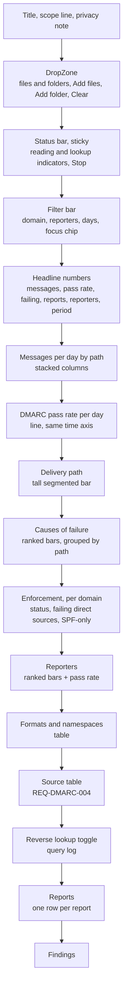
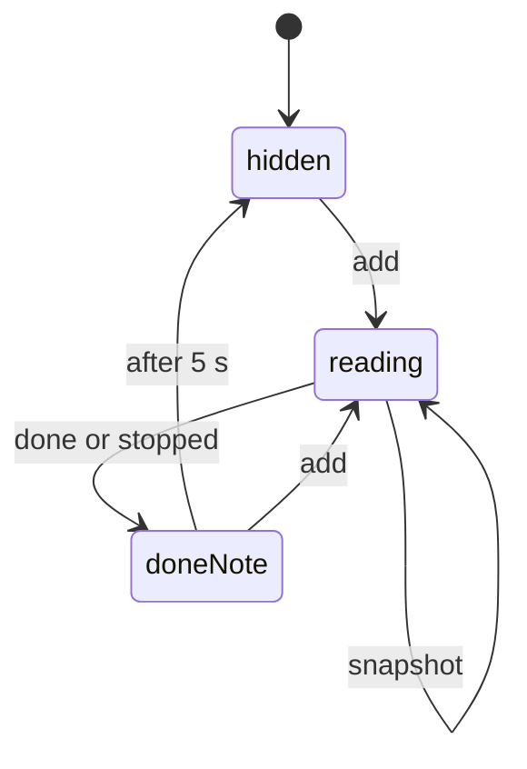
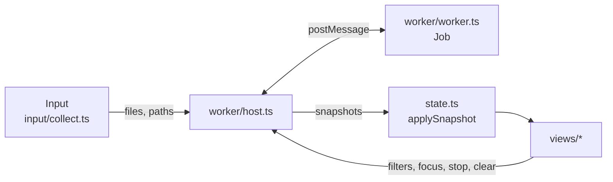
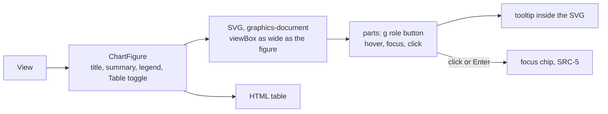

# DMARC aggregate report UI design

How the DMARC aggregate app shows a `View` ([Report](../../reference/dmarc-aggregate/report.md)). The numbers come from the spec. This page covers layout, chart forms, color, and interaction. Requirements: [REQ-DMARC-007](../requirements/REQ-DMARC-007-visualize.md), [REQ-DMARC-010](../requirements/REQ-DMARC-010-live-results.md), [REQ-DMARC-011](../requirements/REQ-DMARC-011-bulk-input.md).

## Layout

| Rule | Why |
|---|---|
| Charts come before tables | REQ-DMARC-007: the state at a glance first |
| Enforcement comes right after the causes | It answers the question the causes raise: can I enforce? |
| The source table keeps the focus chip of a selected path or cause | Users click a bar, then read the sources behind it (SRC-5) |
| Filters sit in one row above every chart | One place changes everything below it |
| The status bar sticks to the top of the window while a job runs | Users scrolled down to the table still see that results are partial |
| The page lays out in one column under 48 rem; charts go two across above that | Laptops and narrow windows |

## Input

| Control | Behavior |
|---|---|
| Drop area | Takes files and folders together. Folders are read with their subfolders (INP-11) |
| "Add files" | A file picker with several files at once |
| "Add folder" | A folder picker (`webkitdirectory`) |
| "Clear" | Stops running jobs and empties the batch (PRG-3) |
| Accepted kinds | The drop area says: "XML, .gz, .zip, .tar, .tar.gz, or a folder of them. Aggregate reports only." |

## Progress

| Element | Behavior | Rule |
|---|---|---|
| Reading indicator | A determinate bar by bytes, and the text "Reading files: 120 of 400 (31 MiB of 98 MiB), 1 380 reports". A "Stop" button beside it | PRG-6, PRG-9 |
| Lookup indicator | A second bar: "Looking up host names: 35 of 200". Its own "Stop" button turns lookups off | PRG-12, RDNS-9 |
| Done note | "Read 400 files, 4 102 reports" or "Stopped after 120 of 400 files" for 5 s, then the bar hides. Files not read are listed under the reports | PRG-6, PRG-9 |
| Partial label | The headline numbers and every chart title carry "Partial: 120 of 400 files", counted by the snapshot the shown `View` came from, while that snapshot is partial. It goes away when a `View` from a non-partial snapshot is shown | PRG-5, PRG-15, PRG-16 |
| Host name cells | `queued` shows "Waiting", `looking-up` shows "Looking up". Final states follow RDNS-5. Cells update in place; the row order does not change for host names | PRG-11, RDNS-8 |
| Stable place | Snapshots keep expanded source rows (by IP), the "Show more" count, the scroll position, and keyboard focus | REQ-DMARC-010 |
| Redraw | The UI merges the batch changes of every snapshot. It renders at most one `View` per animation frame: the newest `View` that matches the filters and focus, skipping snapshots without one. If no snapshot in the frame has a matching `View`, the one shown stays | PRG-4, PRG-14 to PRG-16 |

The bars use `role="progressbar"` with `aria-valuenow` and `aria-valuemax`. A polite live region announces the start, each quarter, and the end, so screen reader users are not flooded every 250 ms. Under `prefers-reduced-motion`, the bars change without animation.

## Chart forms

Chosen with the dataviz method: the data's job picks the form.

| Question | Data | Form | Why this form |
|---|---|---|---|
| How much, how good? | CMB-9 | Stat tiles in a row | Six headline numbers need no axis |
| How does volume change, and by which path? | CMB-10 | Stacked columns, one per UTC day, 3 series | Change over time of a part-to-whole |
| Is the pass rate getting better? | CMB-10 | Line, 2 px, 0 to 100 % | Trend; a second chart instead of a second y-axis |
| How does mail split by path? | CMB-9 | Tall segmented bar, 3 parts, figures on the parts | One whole, 3 parts, read at a glance |
| Why does mail fail? | CMB-9, CAUSE-* | Ranked horizontal bars, grouped under their path | Compare up to 9 parts; long labels |
| Who reports, and how much passes there? | CMB-11 | Ranked horizontal bars with the pass rate as text | Compare reporters; rate as a figure |
| Can I enforce? | ENF-* | Status line with icon and text, then two short tables | One state and two lists |
| Which format do receivers use? | CMB-12 | Table: format, namespace URI, reports, mixed | Users must read the URI itself |

Days with no reports show a gap in the columns and the line, never a zero (CMB-10). Undated messages show as a note under the time axis. When the period is empty (CMB-9), its tile reads "No dated reports".

## Color

| Role | Light | Dark | Used for |
|---|---|---|---|
| Series 1, blue | `#2a78d6` | `#3987e5` | `direct` |
| Series 2, orange | `#eb6834` | `#d95926` | `forwarded` |
| Series 3, aqua | `#1baf7a` | `#199e70` | `other` |
| Status good | `#0ca30c` | `#0ca30c` | DMARC pass, status `clear` |
| Status warning | `#fab219` | `#fab219` | Status `add-dkim`, `check-forwarded` |
| Status critical | `#d03b3b` | `#d03b3b` | DMARC fail, status `fix-direct` |
| Primary ink | `#0b0b0b` | `#f0efec` | Pass rate line, text |
| Chart surface | `#fcfcfb` | `#1a1a19` | Chart background |

- The three path colors passed the palette validator in both modes, all pairs (worst CVD ΔE 9.2 light, 9.4 dark). In dark mode the worst tritan pair is ΔE 4.0 (aqua and orange), so the legend, the direct labels, and the 2 px gaps carry identity too.
- Aqua is below 3:1 on the light surface. The rule that follows: every path also has a direct label or a legend entry in text, and every chart has a table view.
- A path keeps its color in every chart. A cause bar takes the color of its path. Filtering never repaints a path.
- Status colors always come with an icon and a word ("Pass", "Fail", "Fix direct sources first"). Color never carries a state alone.
- The pass rate line is drawn in primary ink, because it is not a path.
- The path colors live in CSS custom properties in the app's `style.css`. Ink, surface, line, and status colors come from the shared theme ([UI design system](../ui-design-system.md)). Both are set per theme with `prefers-color-scheme`. SVG elements get classes, never string `style` attributes (CSP).
- Status words and icons use the status ink tokens (`--warning-ink` and the others), which reach 4.5:1 on the surface. The fills above are for marks beside words.

## Marks

| Mark | Spec |
|---|---|
| Columns and bars | Rounded 4 px at the data end, square at the baseline; 2 px surface gap between stacked segments and between bars |
| Line | 2 px; markers 8 px only on hover and on the last point |
| Axes and grid | Hairline grid, muted labels; y-axis starts at 0 |
| Labels | Direct labels on the segmented bar and the bar ends; no number on every column |
| Numbers | Tabular figures in tables and on axes; thousands separated by the browser locale |

## Interaction

| Element | Behavior |
|---|---|
| Columns, bars, segments | Hover or focus shows a tooltip: day or name, messages, share. The hit area spans the full column or row |
| Line | A crosshair on the hovered day with that day's rate and messages |
| Path segment, cause bar | Click or Enter sets the focus chip; the source table filters (SRC-5). Clicking it again clears it |
| Every chart | A "Table" toggle shows the same numbers as an HTML table |
| Filter bar | Domain select, reporter multi-select, day range from the first to the last day. Changes send a `view` request |
| Reverse lookup | A checkbox labeled "Look up host names. Sends source IP addresses to {provider} as reverse DNS names", with a provider select (Cloudflare or Google). Off by default (RDNS-1) |

## Text in the UI

| Item | Text |
|---|---|
| Page title | DMARC aggregate report analyzer |
| Scope line | "Reads aggregate reports (rua). Failure reports (ruf) are not read." |
| Path names | Direct, Forwarded, Other |
| Estimate note | "Estimated from report data. Click a source to see the facts behind it." |
| Format badge | `RFC 9990 (DMARCbis)`, `RFC 7489`, `RFC 7489, no namespace`, `Unknown namespace` |
| Namespace | The URI as written, in code style; "none" when absent |
| Content hints | "Also contains RFC 9990 elements: np, testing" |

## Accessibility

- Each chart is an `svg` with `role="graphics-document"` (WAI-ARIA Graphics), labeled by a text summary such as "Messages per day, 7 days, mostly direct". Not `role="img"`: that would hide its focusable parts from assistive technology. Parts that only show a tooltip are `graphics-symbol`; parts that set the focus are buttons. The table view is the full alternative.
- Bars and segments can take keyboard focus and announce the tooltip text.
- Under `forced-colors`, paths use the 45° and 135° line textures and direct labels instead of fills.
- Text from reports (reporter names, domains, comments, error texts) renders as text, never as HTML.

## App structure

| Module | Does | Rules |
|---|---|---|
| `input/collect.ts` | Picked files in order; folder files by relative path in code point order; dropped files first, then each dropped folder walked with `webkitGetAsEntry` | INP-1, INP-11 |
| `worker/worker.ts` | Wraps each `File` as a `JobFile` and drives one `Job`; an unexpected error becomes a `failed` message | PRG-1..9 |
| `worker/host.ts` | Starts the worker from a blob URL (0004), sends requests with ids, passes snapshots on | |
| `state.ts` | Pure: drops older generations, merges batch changes, keeps the shown `View` and its partial label | PRG-13..16 |
| `views/*` | Status bar, headline numbers, reports, findings, files not read; filters, tables, and charts in later steps | |

- The path and cause tables are the "Table" views of the charts. Their rows set the focus (SRC-5) until the charts draw over them.
- Source rows keep their open state and "Show more details" count by IP, so snapshots never close them (REQ-DMARC-010).
- The folder walk stays in the app. It moves to `@benchside/ui` when a second app needs folders.
- The CSP allows the two DoH endpoints, as 0013 records; nothing is sent until lookups are turned on (RDNS-1).

### Host names in `state.ts` (PRG-13)

| Per source IP | Holds |
|---|---|
| `current` | `queued` or `looking-up`, with the session that sent it |
| `final` | The newest final state (RDNS-5), with its session |

| `names` from | Applied |
|---|---|
| The active session | Every change and the counts. `removed` clears `current`, so `final` shows again |
| An ended session of this generation | Final states only, for sources with no final state from a newer session. A newer `current` still shows first, so such a final waits behind it until it is removed |
| Any session of this generation | Query log entries and findings |
| An older generation | Nothing |

- The worker numbers sessions by counting each "lookup on" from page load, across generations (PRG-13). The UI sends every one, so it counts the same way and knows the active session's number before its first `names` arrives.
- Turning lookups off clears every `current` at once (PRG-13).

## Charts in code

| Choice | Why |
|---|---|
| Hand-written SVG in Preact, no chart library | Five simple forms; CLAUDE.md keeps runtime dependencies to a minimum |
| The `viewBox` is as wide as the figure, from 240 to 640 units, so one unit is one pixel; a figure under 240 px (a page under about 272 px) scales the drawing down | SITE-11: text stays 12 px on a phone instead of shrinking with a 640-unit drawing scaled down. Without layout (tests), the width is 640 |
| The chart lays out again at once when its figure narrows, but only after it widens by 24 px | A page scrollbar that comes and goes with the chart's height cannot make the layout flip back and forth |
| A figure is never wider than 40 rem (640 px) | Scaled up, 12-unit text would grow past body text (seen on the full-width reporter chart) |
| Cause and reporter labels and tooltip lines wrap to the width at ordinary spaces (never at a no-break space); a word wider than a line, such as a domain, is cut between user-perceived characters and its pieces join with no space; rows grow to fit | SITE-11: no label reaches past the chart's edge |
| Text widths are measured with a canvas in the page font, bold where the label is drawn bold, and cached; without a canvas (tests), 7.5 units per character, 12 for CJK, full-width forms, and emoji | Capitals and CJK draw wider than an average letter; an estimate let them spill past the edge |
| Each table view sits in a `TableScroll` | SITE-9: a wide table scrolls in its own area |
| The tooltip is an SVG group placed with `x` and `y` attributes | The CSP forbids `style` attributes; positions need none |
| Clickable parts are `g` elements with `role="button"`, `tabindex="0"`, and an accessible name | Keyboard and screen reader users reach every part (Accessibility) |
| Columns: at most 24 units wide, a 2 unit surface gap between stacked segments, rounded 4 units at the top only | dataviz mark specs |
| A day without reports draws nothing, and breaks the rate line | CMB-10: no value, not zero |
| Under `forced-colors`, paths fill with 45° and 135° hatches defined once in the page | Identity without hue |
