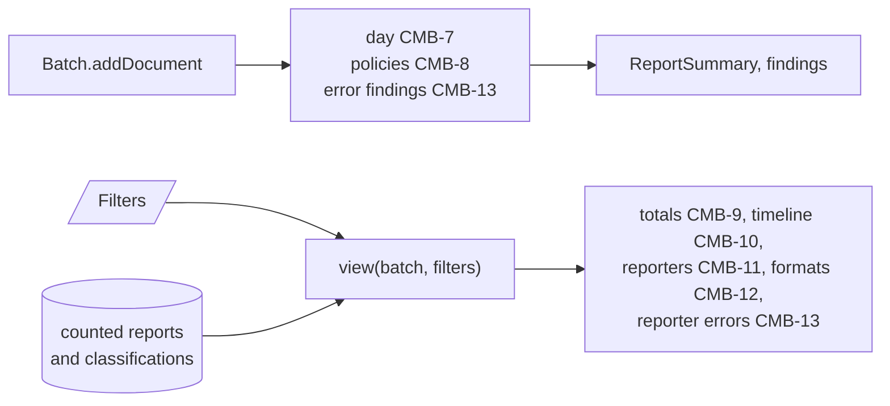
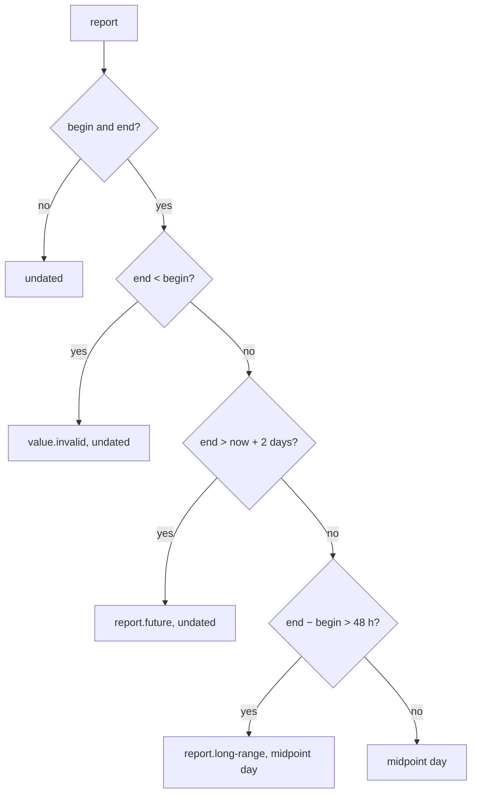
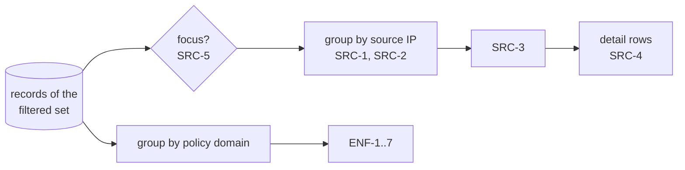

# DMARC aggregate view design

How `batch.ts` and `view.ts` in `@benchside/dmarc-aggregate` meet [Combining reports](../../reference/dmarc-aggregate/combine.md) CMB-6 to CMB-13. Sources and enforcement come in the same `View` later (SRC-*, ENF-*).

## What is fixed when a report is read, and what is not



- A report's day, its findings, and the policy list depend only on the reports read, so the batch computes them once (PRG-14).
- Everything filtered is computed by `view` on request. Classifications can change (FCT-7), so a `View` is never updated in place.

```ts
interface Filters {
  domain: string | null;              // one policy domain, or all
  reporters: readonly string[] | null; // reporter names, compared case-insensitively (CMB-5); null is all
  days: { from: string; to: string } | null;   // YYYY-MM-DD, inclusive; null is all
}
new Batch(findings, { now?: () => number });   // seconds since the epoch; CMB-7 reads it once per report
function view(batch: Batch, filters: Filters): View;   // CMB-6, CMB-9..13
```

## Days (CMB-7)



| Choice | Why |
|---|---|
| Findings of CMB-7, CMB-8, and CMB-13 are raised for counted reports only | A duplicate or conflict already has its finding; its copies would repeat the counted report's |
| The midpoint is `floor((begin + end) / 2)` | Integer seconds; the day is the UTC date of that second |
| `aggregate.policy.changed` is raised once per domain, when its second configuration appears | One finding says the domain changed; the list shows every configuration |

## Policies (CMB-8)

- Configurations are keyed by the nine values of CMB-8. A domain keeps its configurations in the order first seen; domains too.
- `policyRevision` moves with every counted report, since each one changes a configuration's report count. Step 8 sends the list only when it moved (REP-11).
- In effect: the latest last day; ties go to more reports, then to the one seen first. A configuration with no dated report ranks below any dated one.

## The view

| Choice | Why |
|---|---|
| `view` walks every record of the counted reports that pass the filters | Simple and exact. Records stay in the worker. Columns come only if measurements need them |
| Report-level filters first: a report outside the filters is skipped whole | CMB-6 filters reports, not records |
| Timeline days are made from the first to the last day, then cut to the latest 1 000 | CMB-10. Days without reports carry `null`, not zero |
| Reporter rows are keyed by the lowercased name and shown with the first spelling | CMB-5 |

## Sources and enforcement

```ts
type Focus = { path: Path } | { cause: Cause };                  // SRC-5
function view(batch: Batch, filters: Filters, focus?: Focus | null): View;
// View.sources: SourceRow[] (SRC-1..5), View.domains: DomainEnforcement[] (ENF-1..7)
```



| Choice | Why |
|---|---|
| The focus filters source rows only | SRC-5 names rows and detail rows; enforcement answers for the whole domain |
| Rows are sorted by `parseIp` bytes: IPv4, then IPv6, then invalid text | SRC-3 |
| A detail row takes the classification of its first record | Path and cause are part of its key, so they agree |
| SPF and DKIM result counts take every raw result of a record | REP-5 keeps them all; a legacy `helo` result is worth seeing |
| ENF-6 compares with the policy of the record's own report under ENF-2; a policy not stated counts as `none` | The receiver applied that report's policy, not the one in effect today |
| `aggregate.record.no-reason` is raised when a report is counted | It depends only on the record and its report, so it is fixed once read (PRG-14) |
