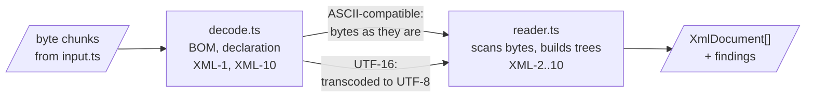

# DMARC aggregate XML reader design

How `xml/` in `@benchside/dmarc-aggregate` meets the [XML reader](../../reference/dmarc-aggregate/xml.md) spec. Why an in-house reader: [0015](../decisions/0015-dmarc-aggregate-xml-reader.md).

## Shape



```ts
class XmlReader {
  push(bytes: Uint8Array): XmlOutput;   // reads as far as the bytes allow
  end(): XmlOutput;                     // the input ended
}
interface XmlOutput {
  documents: XmlDocument[];             // documents completed by this call, in order
  stop: XmlFinding | null;              // an error that ends reading of this input (XML-6, XML-10)
}
interface XmlDocument { root: XmlElement; findings: XmlFinding[] }
interface XmlElement {
  ns: string | null; prefix: string | null; local: string;
  lang: string | null; text: string; line: number; children: XmlElement[];
}
```

## Scanning bytes

| Choice | Why |
|---|---|
| The tokenizer scans bytes, not decoded text | Every markup character (`<` `>` `&` `"` `'` `=` `/` `?` `!` `[` `]`) is ASCII. In UTF-8 and single-byte encodings these bytes never occur inside a multi-byte character |
| Names, text, and attribute values are decoded with `TextDecoder` for the chosen encoding, one value at a time | XML-2 replaces invalid bytes per value; the finding is counted once per document |
| UTF-16 input is transcoded to UTF-8 by a small in-house transcoder before scanning | UTF-16 is not ASCII-compatible; transcoding keeps one scanner. For a later document, a BOM of the same byte order arrives as U+FEFF and the other order as U+FFFE, so XML-10 still tells them apart. A lone surrogate becomes U+FFFD, and a value holding U+FFFD counts as replaced (XML-2). A UTF-8 BOM inside UTF-16 input decodes to text outside the root and gives `aggregate.xml.malformed` |
| Byte offsets come for free in ASCII-compatible input | XML-10 checks the raw bytes where a later document begins |
| Line numbers count `LF`, `CR LF`, and lone `CR` | XML-2 line ends. Columns count bytes from the line start |

Double-byte legacy encodings (Shift_JIS, GBK) have trail bytes from `0x40`, so `<` `>` `&` `"` `'` `=` `/` `?` never occur inside a character. `[` and `]` can; a CDATA section in such an encoding could end early. Reports in these encodings are rare, and the result is a well-formedness finding, not a wrong value. Stateful 7-bit encodings (`ISO-2022-JP`) put markup bytes inside characters, so XML-1 refuses them.

## Chunks and steps

- `push` keeps only the bytes of the token being read, in a buffer that grows geometrically. A token cut by a chunk end waits for the next chunk, and the search resumes where it stopped, so a long token costs linear time.
- Bytes are counted per document. Past 32 MiB (INP-6), the reader stops with `aggregate.input.too-large`, and a document that ended in the token that crossed the limit is dropped too. For UTF-16 input the count is of the transcoded UTF-8 bytes.
- Each call does work in proportion to its bytes, so the caller's chunk size bounds the step (PRG-8); `gunzip` already yields bounded chunks (0017).
- `end` turns an unfinished document into `aggregate.xml.malformed` (XML-6: an element left open at the end).

## Tests

| What | Data |
|---|---|
| Every XML-1 to XML-10 rule, one scenario each | Strings and byte arrays built in tests |
| The same documents fed in every chunk split (1, 2, 3, 7 bytes, whole) | Results must be equal |
| Truncated and mutated documents | Must finish with findings and never throw |
