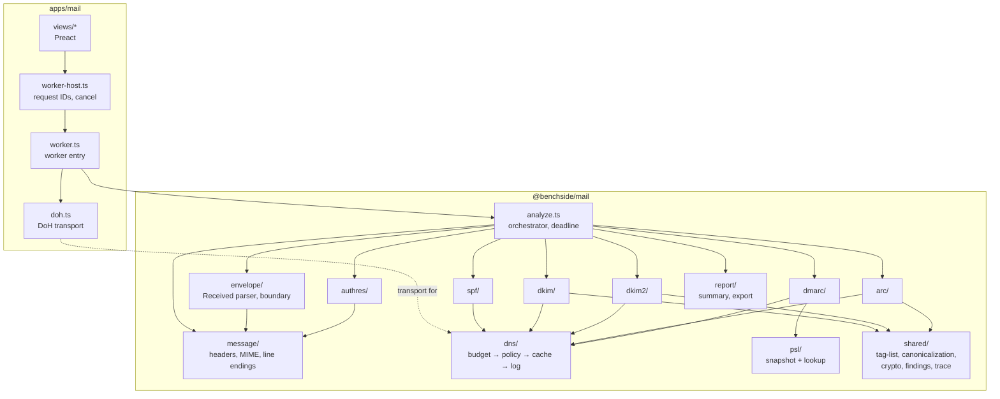
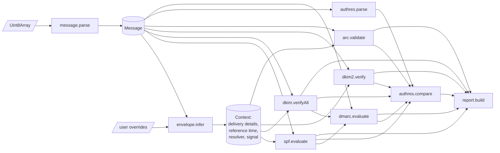
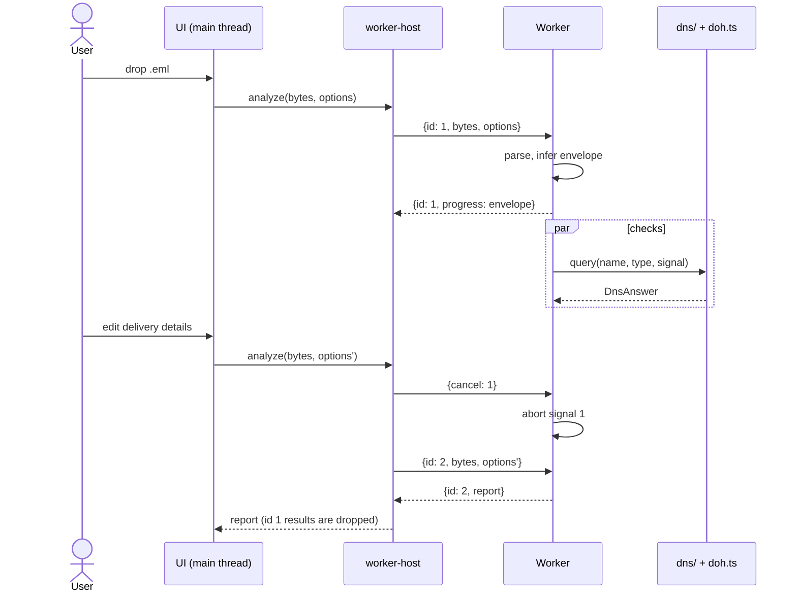
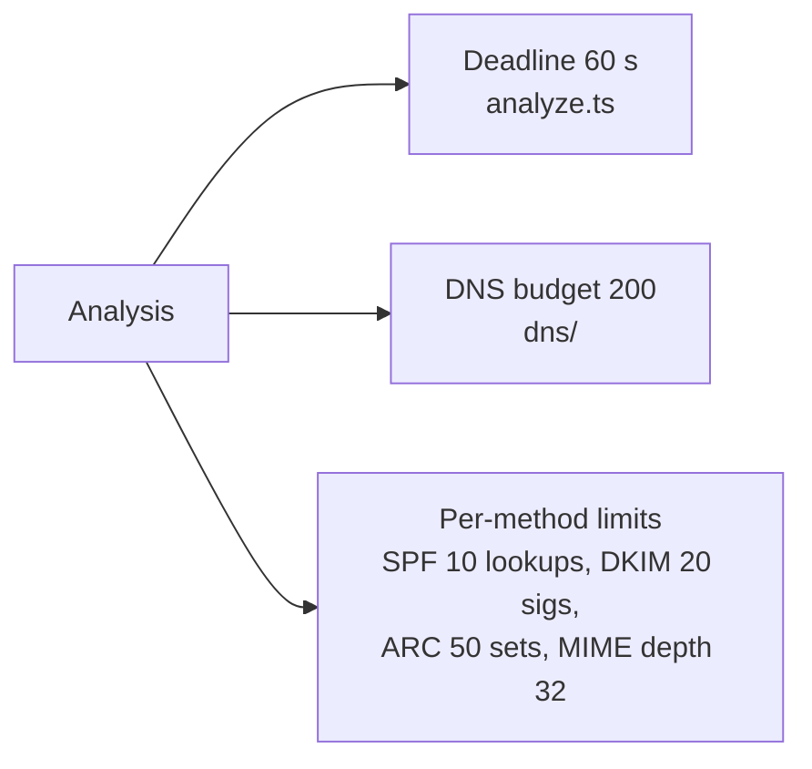
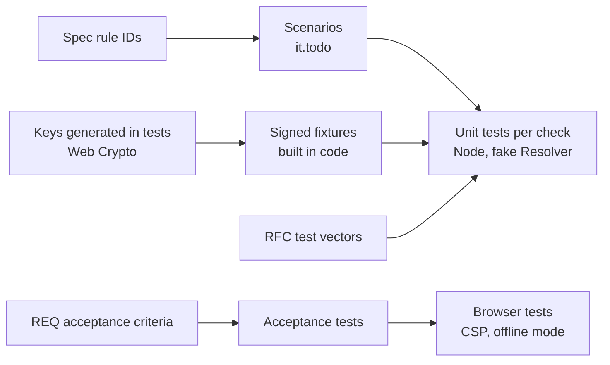

# Mail analyzer architecture

- Why: [requirements](requirements/)
- What exactly: [specification](../reference/mail/)
- Repository-wide view: [Architecture](architecture.md)

## Context

```mermaid
flowchart LR
  user([User]) -- ".eml / pasted source" --> app
  subgraph browser [Browser tab — CSP enforced]
    app[apps/mail<br/>Preact UI] <-- postMessage --> worker[Worker<br/>@benchside/mail]
  end
  worker -- "names + types only;<br/>sensitive names blocked by default" --> doh[(DoH provider)]
  app -. "nothing" .-x net[(Any other host)]
  worker -. "nothing" .-x net
```

- The message never leaves the tab.
- The worker starts from a `blob:` URL, so it inherits the page's CSP ([0004](decisions/0004-worker-from-blob-url.md)).

## Packages and modules



| Rule | Why |
|---|---|
| Only `doh.ts` calls `fetch` | Network stays at the edge |
| Every DNS query passes budget, policy, cache, and log | Limits and privacy apply in one place ([DNS spec](../reference/mail/dns.md#layers)) |
| `@benchside/mail` has no DOM and no Preact | Runs in Node for tests |
| Checks never call each other; only `analyze.ts` combines them | Each check is testable alone |
| `shared/` holds only code used by 2+ checks | DKIM, DKIM2, and ARC share tag lists, canonicalization, and crypto |
| Nothing goes to `@benchside/core` yet | No second package exists |

## Analysis pipeline



- SPF, DKIM, DKIM2, and ARC run in parallel. DMARC waits for SPF and DKIM.
- A missing input gives `not-evaluated`, never an exception.

## Interaction and cancellation



| Rule |
|---|
| Each request has an ID. The host drops responses whose ID is not the latest |
| Each analysis has an `AbortController`. Its signal reaches every check and every DNS query |
| Cancel aborts in-flight `fetch` calls; the session cache keeps answers already received |

## Limits



- Values and behavior: [spec limits](../reference/mail/README.md#limits).
- The deadline aborts the same signal as a cancel. Unfinished methods become `not-evaluated` (reason `timeout`).

## Data model

Defined in the [Report spec](../reference/mail/report.md#data-model). Design rules:

| Rule | Why |
|---|---|
| Plain data only (no classes, no functions) | Crosses `postMessage`; serializes to JSON |
| Evidence holds offsets into the original bytes | The UI highlights the source without copies |
| Finding IDs are the names in the spec | Tests, docs, and UI use one vocabulary |

## Testing


