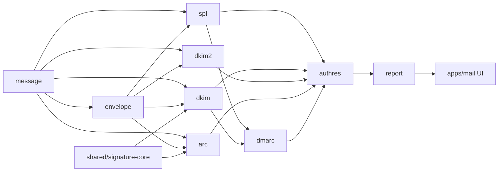

# Mail analyzer module design

Internals of each module. Cross-cutting design (types, DNS layers, worker, build): [detailed design](../mail-detailed-design.md).

| Page | Module | Spec |
|---|---|---|
| [Message](message.md) | `message/` | [Input](../../reference/mail/input.md) |
| [Envelope](envelope.md) | `envelope/` | [Delivery details](../../reference/mail/envelope.md) |
| [SPF](spf.md) | `spf/` | [SPF](../../reference/mail/spf.md) |
| [Signature core and DKIM](dkim.md) | `shared/signature-core.ts`, `dkim/` | [DKIM](../../reference/mail/dkim.md) |
| [DKIM2](dkim2.md) | `dkim2/` | [DKIM2](../../reference/mail/dkim2.md) |
| [DMARC](dmarc.md) | `dmarc/`, `psl/` | [DMARC](../../reference/mail/dmarc.md) |
| [ARC](arc.md) | `arc/` | [ARC](../../reference/mail/arc.md) |
| [Receiver results](authres.md) | `authres/` | [Receiver results](../../reference/mail/authres.md) |
| [Report](report.md) | `report/` | [Report](../../reference/mail/report.md) |
| [UI](ui.md) | `apps/mail` | [REQ-MAIL-002](../requirements/REQ-MAIL-002-explain-results.md) |

## Conventions for all modules

| Rule | Why |
|---|---|
| Work on bytes (`Uint8Array` + `ByteRange`); decode to strings only for display or for ASCII-only syntax | Hashes need exact bytes; UTF-8 headers exist (RFC 6532) |
| Parsers return `{ value, findings }`; they never throw on input | REQ-MAIL-012 |
| Every loop over input has a bound from the spec limits | No hangs on crafted input |
| Pass `ctx.signal` to every `await` that can wait (DNS) | Cancel and deadline |
| Trace nodes are built where decisions are made, not reconstructed later | The trace shows what actually happened |
