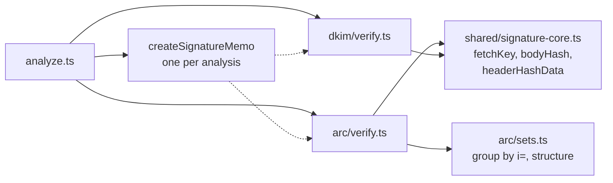
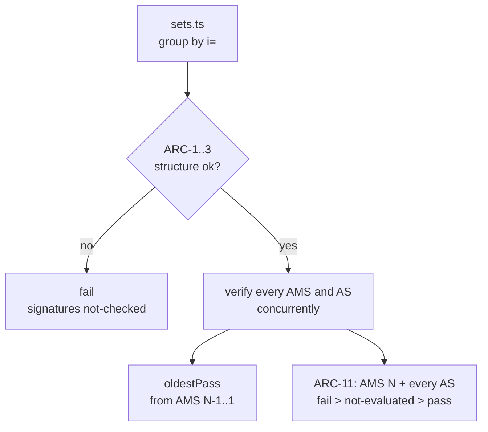
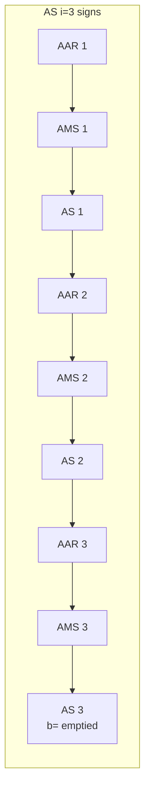

# ARC

Spec: [ARC](../../reference/mail/arc.md).

## Modules



- ARC is the second user of the key lookup and the body hash, so both move into `shared/signature-core.ts` (`fetchKey`, `bodyHash`).
- `analyze` creates one `SignatureMemo` and gives it to DKIM and ARC. A key or body hash used by both is fetched or computed once, and the DNS log shows one query.
- `fetchKey` returns the key, or a problem (`no-key`, `key-syntax`, …, or the DNS rcode). Each method maps the problem to its own result and finding: DKIM to `permerror`/`temperror`, ARC to `fail` with `arc.key` or `not-evaluated`.

## Flow



## Grouping (`sets.ts`)

```ts
interface ArcGroup {
  instance: number;
  aar: HeaderField[];      // normally 1
  ams: HeaderField[];
  as: HeaderField[];
}
```

- `i=` is read with a minimal parse, so grouping works even when the rest is malformed: an AAR's first `;`-separated part (RFC 8617 §4.1.1 puts `i=` first); any `;`-separated part of an AMS or AS.
- Sets are kept as arrays so duplicates can be reported, not silently dropped.
- The structure check also parses each AMS and AS tag list (ARC-5, ARC-7). It runs before any DNS query.

## Seal input



- This is `headerHashData(bytes, [AAR 1, AMS 1, AS 1, …, AAR 3, AMS 3], AS 3, 'relaxed')`: the same function as DKIM, with the field list given instead of selected by `h=`.

## Verification order and cost

| Step | Signatures | Key lookups |
|---|---|---|
| AMS N..1 | N | up to N |
| AS N..1 | N | up to N |

- Every signature is verified, not only until the first failure, so the trace shows each hop.
- Keys are memoized per `(selector, domain)`. Typical chains reuse 1–3 keys.
- With N = 50, at most 100 key lookups; within the 200 DNS budget.

## Failure reporting

- RFC 8617 makes every error a `fail`. The finding keeps the cause (`arc.key` vs `arc.seal-mismatch`), so the UI can explain it.
- Limits of this tool (offline, header-only input, the DNS budget) give `not-evaluated`, never `fail`.
- ARC is guarded as one method (ARC-12): a throw gives `internal-error`, the deadline `timeout`.
