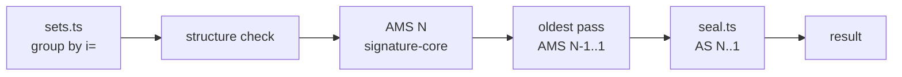
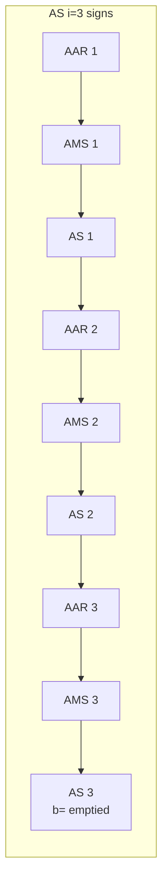

# ARC

Spec: [ARC](../../reference/mail/arc.md).

## Flow



## Grouping (`sets.ts`)

```ts
interface ArcSet {
  instance: number;
  aar: HeaderField[];      // normally 1
  ams: HeaderField[];
  as: HeaderField[];
}
```

- `i=` is read with a minimal parse (`i=<digits>` before the first `;`), so grouping works even when the rest is malformed.
- Sets are kept as arrays so duplicates can be reported, not silently dropped.

## Seal input (`seal.ts`)



- Every field is canonicalized with `headerRelaxed`.
- The last field has no trailing CRLF.
- Reuses `signature-core.canonicalizeHeaders` with an explicit field list instead of `h=`.

## Verification order and cost

| Step | Signatures | Key lookups |
|---|---|---|
| AMS N | 1 | 1 |
| Oldest pass | up to N-1 | up to N-1 |
| AS N..1 | N | up to N |

- Keys are memoized per `(selector, domain)`. Typical chains reuse 1–3 keys.
- With N = 50, at most 100 key lookups; within the 200 DNS budget.

## Failure reporting

- RFC 8617 makes every error a `fail`. The finding keeps the cause (`arc.key` vs `arc.seal-mismatch`), so the UI can explain it.
- Evaluation does not stop at the first failure: all seals are checked so the timeline can show each hop's state.
