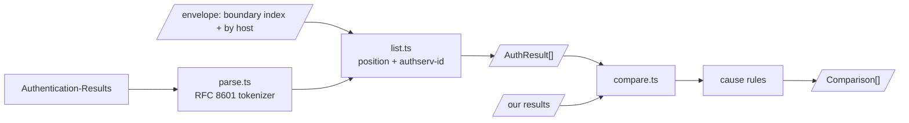

# Receiver results

Spec: [Receiver results](../../reference/mail/authres.md).

## Flow



- `Received-SPF` is not read (AR-2 retired). The `spf` entry in `Authentication-Results` carries the receiver's SPF verdict.
- `AuthResult[]` is listed even when no comparison runs (AR-10, AR-11).

## Trust

```ts
// list.ts
function isTrusted(field: number, authservId: string, received: ParsedReceived[], boundary: ParsedReceived | null): boolean;
```

| Field position | Trusted |
|---|---|
| no boundary | no |
| `field < boundary` | yes |
| `boundary < field < next Received` | `authservId` equals the boundary's `by` (ENV-16), case-insensitive |
| otherwise | no |

## Parsed form

```ts
interface AuthResult {
  field: number;
  trusted: boolean;
  authservId: string;
  entries: {
    method: string;                    // lowercase
    result: string;
    reason?: string;
    props: Record<string, string>;     // 'header.d', 'smtp.mailfrom', …
  }[];
}
```

- The tokenizer shares CFWS and quoted-string handling with the envelope tokenizer (`shared/rfc5322-tokens.ts`: 2 users).

## Matching

| Method | Our side | Key |
|---|---|---|
| `spf` | MAIL FROM or HELO identity | `smtp.mailfrom` / `smtp.helo` |
| `dkim` | one signature | `header.d` + `header.s`, else `header.b` prefix |
| `dmarc` | selected mode | `header.from` |
| `arc` | chain | — |

## Cause rules

```ts
interface CauseRule {
  id: 'key-changed' | 'dns-changed' | 'modified' | 'boundary' | 'line-endings';
  applies(diff: Difference, report: PartialReport): boolean;
}
```

- Rules are a plain array, evaluated in order; all that apply are listed.
- `dns-changed` applies only when no other rule matched.
