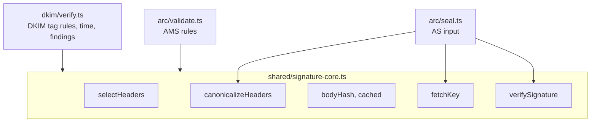
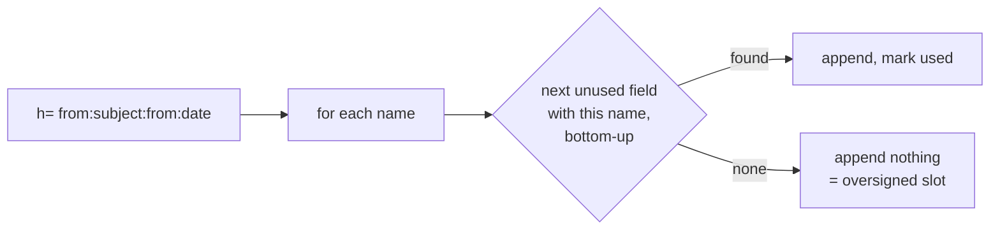
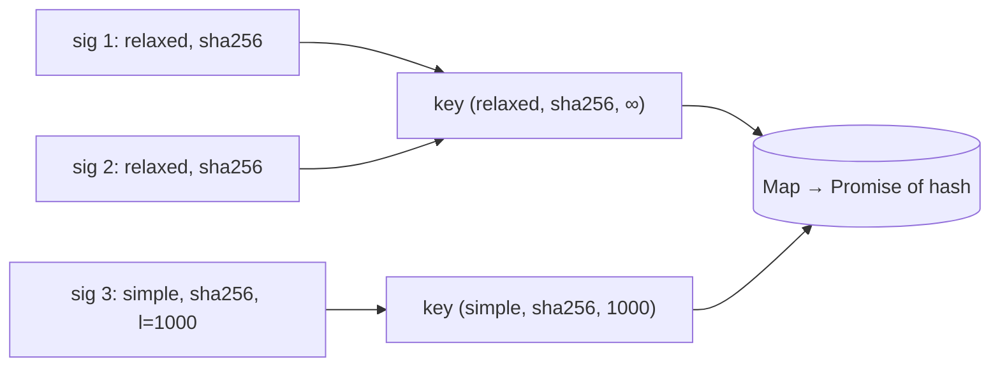
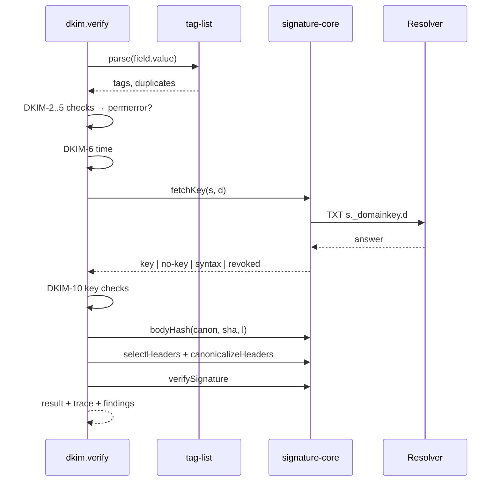

# Signature core and DKIM

Spec: [DKIM](../../reference/mail/dkim.md), [ARC](../../reference/mail/arc.md).

DKIM signatures and ARC-Message-Signatures are verified the same way. Checks must not import each other, so the shared part lives in `shared/signature-core.ts`.

## Split



## Core API

```ts
interface SignatureSpec {
  field: HeaderField;            // the signature field itself
  tags: TagList;                 // parsed
  algorithm: 'rsa-sha256' | 'rsa-sha1' | 'ed25519-sha256';
  canon: { header: 'simple' | 'relaxed'; body: 'simple' | 'relaxed' };
  signedHeaders: string[];       // h=, lowercase, in order
  bodyLength?: number;           // l=
  domain: string; selector: string;
}

selectHeaders(msg, signedHeaders, exclude: HeaderField): HeaderField[];  // RFC 6376 §5.4.2
canonicalizeHeaders(msg, fields, sigField, canon): Uint8Array;           // b= emptied, no final CRLF
bodyHash(msg, canon, hash, length?): Promise<Uint8Array>;                // memoized per analysis
fetchKey(ctx, selector, domain): Promise<KeyResult>;                     // memoized per analysis
verifySignature(key, algorithm, data, signature): Promise<boolean>;
```

## Header selection



- One cursor per lowercase name, starting at the bottom.
- The signature field itself is excluded even if listed.
- The `b=` value is emptied in the bytes: find the `b` tag's value range in `raw`, copy without it. Other tags stay byte-exact.

## Body hash cache



- Canonicalization runs over body bytes once per `(canon, hash, l)`.
- `bodySimple`: strip trailing empty lines; empty body → CRLF.
- `bodyRelaxed`: collapse WSP runs to SP, strip WSP at line end, then as simple; empty body → empty.

## DKIM verify flow (`dkim/verify.ts`)



- Signatures are verified concurrently (`Promise.all` over at most 20).
- `rsa-sha1`: crypto still runs, so the trace shows "valid but not acceptable".

## Key parsing (`fetchKey`)

| Record | Result |
|---|---|
| NXDOMAIN / NODATA | `no-key` |
| Several TXT | first that parses + `dkim.multiple-keys` |
| `p=` empty | `revoked` |
| `k=rsa`, DER is SPKI | import SPKI |
| `k=rsa`, DER is PKCS#1 `RSAPublicKey` | wrap in SPKI, import |
| `k=ed25519`, 32 bytes | import raw |
| Anything else | `syntax` |

The DER is classified by its first bytes (`SEQUENCE { SEQUENCE { OID rsaEncryption …` vs `SEQUENCE { INTEGER …`). No ASN.1 library.
