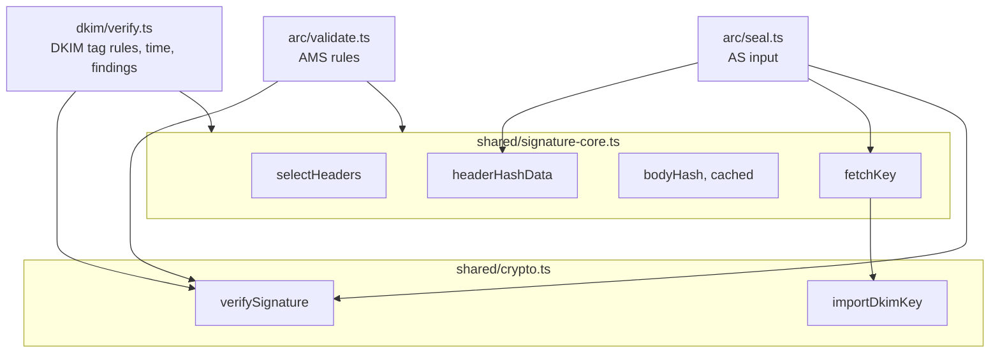
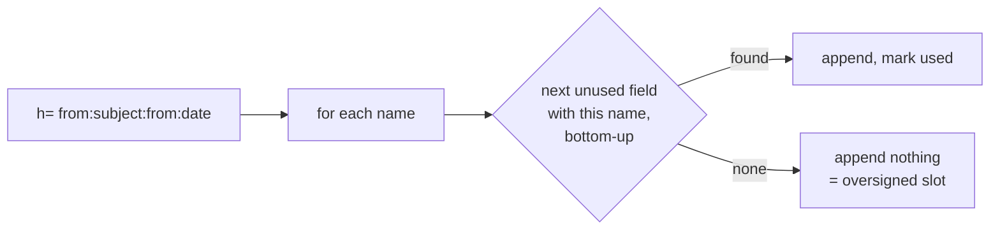
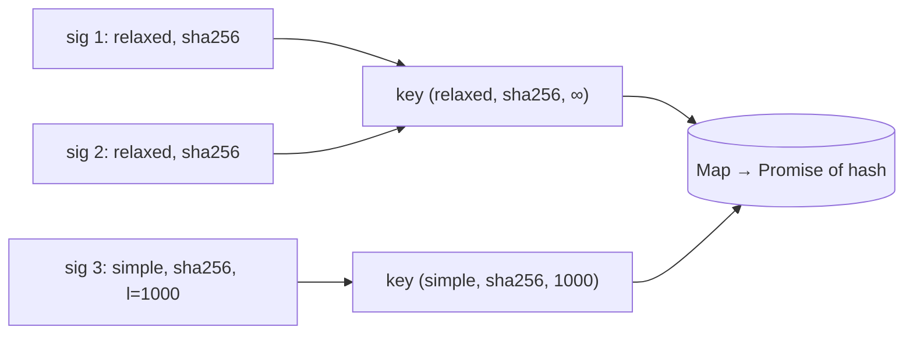
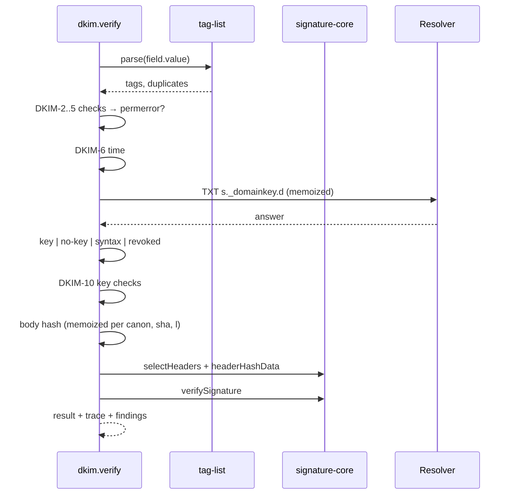

# Signature core and DKIM

Spec: [DKIM](../../reference/mail/dkim.md), [ARC](../../reference/mail/arc.md).

DKIM signatures and ARC-Message-Signatures are verified the same way. Checks must not import each other, so the shared part lives in `shared/signature-core.ts`.

## Split



## Core API

```ts
interface SignatureSpec {
  field: HeaderField;            // the signature field itself
  tags: TagList;                 // parsed
  algorithm: 'rsa-sha256' | 'rsa-sha1' | 'ed25519-sha256';
  canon: { header: 'simple' | 'relaxed'; body: 'simple' | 'relaxed' };
  signedHeaders: string[];       // h=, lowercase, in order
  bodyLength?: number;           // l=
  domain: string; selector: string;
}

// shared/signature-core.ts
selectHeaders(headers, signedNames, signature): HeaderField[];           // RFC 6376 §5.4.2
signatureFieldWithoutValue(raw, 'b'): Uint8Array;                       // value removed, no final CRLF
headerHashData(bytes, selected, signature, canon): Uint8Array;          // RFC 6376 §3.7 step 2
bodyHash(msg, canon, hash, length?): Promise<Uint8Array>;                // memoized per analysis
fetchKey(ctx, selector, domain): Promise<KeyResult>;                     // memoized per analysis: the record, not the CryptoKey
// The RSA hash is fixed when a key is imported, so the key is imported per (record, hash):
// an rsa-sha1 and an rsa-sha256 signature with the same s= and d= each get their own import.

// shared/crypto.ts
importDkimKey(k, p, hash): Promise<DkimKey>;     // { ok: true, key, kind, bits? } | { ok: false }
verifySignature(key, data, signature): Promise<boolean>; // Ed25519 verifies over SHA-256(data)

// shared/tag-list.ts, shared/base64.ts, shared/canonicalize.ts: see detailed design §7
```

## Header selection



- One cursor per lowercase name, starting at the bottom.
- The signature field itself is excluded even if listed.
- The `b=` value is emptied in the bytes: find the `b` tag's value range in `raw`, copy without it. Other tags stay byte-exact.

## Body hash cache



- Canonicalization runs over body bytes once per `(canon, hash, l)`.
- `bodySimple`: strip trailing empty lines; empty body → CRLF.
- `bodyRelaxed`: collapse WSP runs to SP, strip WSP at line end, then as simple; empty body → empty.

## DKIM verify flow (`dkim/verify.ts`)

```ts
interface DkimContext {
  bytes: Uint8Array;               // normalized (IN-7)
  headers: readonly HeaderField[];
  body: ByteRange | null;          // null: header-only input (DKIM-13)
  resolve: Resolver;               // composed per analysis (dns.md)
  referenceTime: Date;             // TIME-1..3
  signal: AbortSignal;
}
verifyDkim(ctx): Promise<DkimSignatureResult[]>;   // one per DKIM-Signature, top to bottom
```

| Memo (one `verifyDkim` call) | Key | Value |
|---|---|---|
| Key records | `(s, d)` | DNS answer + `queryId` |
| Imported keys | `(record, hash)` | `DkimKey` |
| Canonical bodies | `canon` | canonicalized body bytes |
| Body hashes | `(canon, hash, l)` | digest |

- For now the key lookup and the body-hash memos live in `dkim/verify.ts`. They move to `shared/signature-core.ts` (as `fetchKey` and `bodyHash`) when ARC becomes their second user.



- Signatures are verified concurrently (`Promise.all` over at most 20).
- `rsa-sha1`: crypto still runs, so the trace shows "valid but not acceptable".

## Key parsing (`fetchKey`)

| Record | Result |
|---|---|
| NXDOMAIN / NODATA | `no-key` |
| Several TXT | first that parses + `dkim.multiple-keys` |
| `p=` empty | `revoked` |
| `k=rsa`, DER is SPKI | import SPKI |
| `k=rsa`, DER is PKCS#1 `RSAPublicKey` | wrap in SPKI, import |
| `k=ed25519`, 32 bytes | import raw |
| Anything else | `syntax` |

The DER is classified by its first bytes (`SEQUENCE { SEQUENCE { OID rsaEncryption …` vs `SEQUENCE { INTEGER …`). No ASN.1 library.
