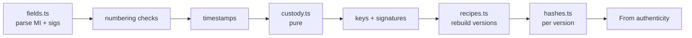
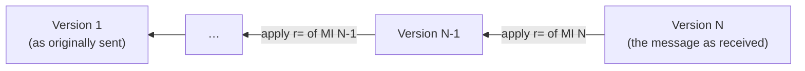
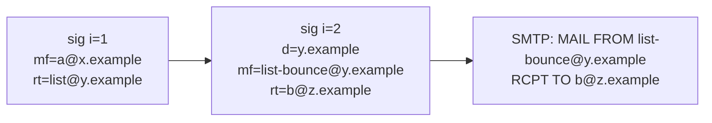

# DKIM2

Spec: [DKIM2](../../reference/mail/dkim2.md). Pinned to draft-07.

## Flow



Order follows draft §14. Each step can end the evaluation with a result; later steps are then skipped and shown as such in the trace.

## Message versions

```ts
interface Version {
  instance: number;                     // Message-Instance m=
  headers: HeaderLine[];                // numbered bottom-up from 1
  body: Uint8Array[] | null;            // lines; null = not rebuildable
}
type HeaderLine = { name: string; raw: Uint8Array };
```



## Recipe engine (`recipes.ts`)

```ts
type Step = { c: [number, number] } | { d: string[] } | { u: string[] };
interface Recipe { h?: Record<string, Step[]>; b?: Step[] | null }

function applyHeaders(prev: HeaderLine[], r: Recipe['h']): HeaderLine[] | Error;
function applyBody(prev: Uint8Array[], steps: Step[] | null | undefined): Uint8Array[] | null | Error;
```

| Step | Effect |
|---|---|
| `c: [a, b]` | Copy items a…b of the newer version (headers bottom-up, body lines top-down) |
| `d: [...]` | Emit these UTF-8 lines |
| `u: [...]` | Emit base64-decoded lines |
| `h` name absent | Keep that header name unchanged |
| `h` name with `[]` | Remove all fields of that name |
| `b` absent | Body unchanged |
| `b: null` | Body not rebuildable; this and older body hashes `not-evaluated` |

- Step count is summed over all recipes; over 10 000 → `dkim2.recipe-too-complex`.
- Out-of-range `c` or bad base64 → `dkim2.recipe-invalid`.

## Diff for display

- Rebuilt versions are returned in the DKIM2 result as `versions: { instance, headers: string[], body: string[] | null }[]`. They are message content: the export drops them without opt-in.
- The app runs a line-based Myers diff between consecutive versions when the user opens a hop. Display-only, so it lives in the app.
- Capped at 5 000 lines per side; above that, show "too large to diff" and the line counts.

## Custody (`custody.ts`)

```ts
function checkCustody(sigs: Dkim2Sig[], envelope: Envelope): CustodyIssue[];
```



- Pure function over parsed signatures and the envelope. No DNS, no crypto. Easy to test exhaustively.

## Crypto reuse

| From `shared/` | Used for |
|---|---|
| `tag-list.ts` | Both field types |
| `crypto.ts` | rsa-sha256, ed25519-sha256, SHA-256/512 digests |
| `signature-core.fetchKey` | Key lookup (key `h=` ignored for DKIM2) |
| `domain.relaxedMatch` | Custody and From checks |
