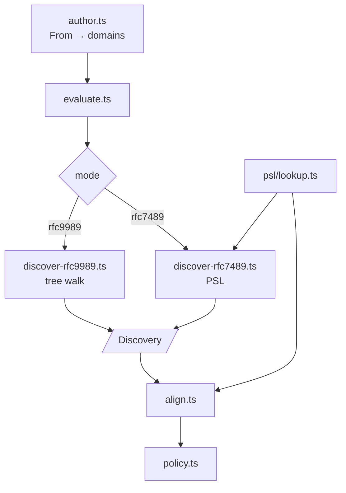
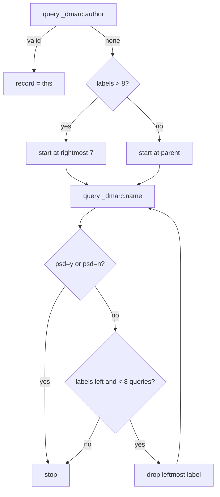
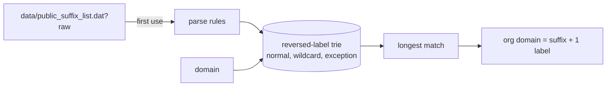
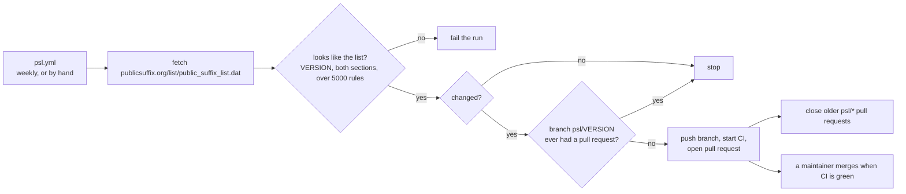
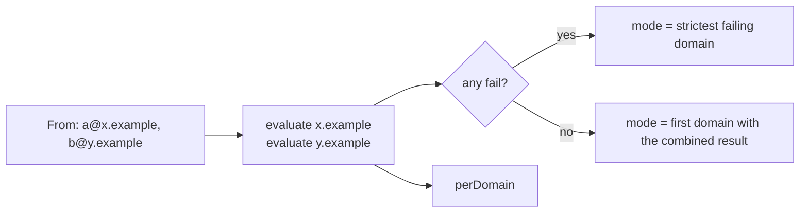
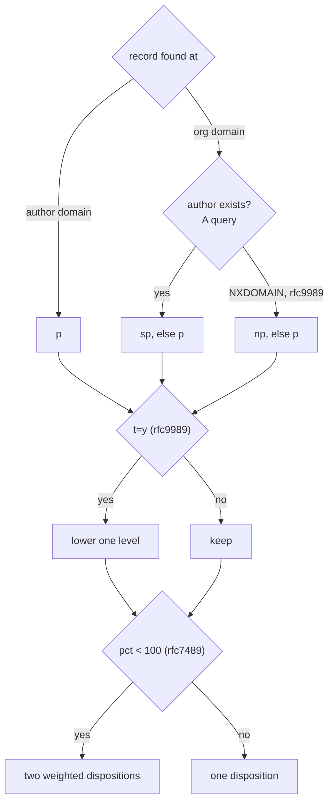

# DMARC

Spec: [DMARC](../../reference/mail/dmarc.md).

## Structure



Build order: `rfc9989` first (no PSL needed), then `rfc7489` with the PSL snapshot and the mode option. With the second mode, `ModeStrategy` gets its second implementation and the alignment and policy steps move out of `evaluate.ts`. `record.ts` parses and validates records (DMARC-9..11, DMARC-23).

Both modes share one interface. `evaluate.ts` does not branch on mode except to pick the discovery and org-domain functions.

```ts
interface Discovery {
  record: DmarcRecord | null;
  foundAt: string | null;               // name the record was found at
  orgDomain: string;
  orgDomainRule: string;                // 'psd=n at x', 'shortest record', or PSL rule
  queries: string[];                    // query IDs, for evidence
}
interface ModeStrategy {
  discover(ctx, authorDomain): Promise<Discovery | { error: 'temperror' }>;
  orgDomainOf(name): Promise<string>;   // used by relaxed alignment
  tags: ReadonlySet<string>;
}
```

## Author domain (`author.ts`)

| Input | `rfc9989` | `rfc7489` |
|---|---|---|
| No / several `From` fields | `not-evaluated` | `not-evaluated` |
| One address | its domain | its domain |
| Several addresses, one domain | that domain + warning | that domain |
| Several domains | `not-evaluated` | evaluate each; strictest failing policy |
| Group syntax, no address | `not-evaluated` | `not-evaluated` |

Address parsing: RFC 5322 `address-list` with comments, quoted local parts, and groups. Only the domain is used.

## Tree walk (`discover-rfc9989.ts`)



- All records found are kept, longest name first, for org-domain selection (DMARC-6).
- `orgDomainOf(name)` for alignment runs the same walk on the other domain. Answers come from the session cache when names overlap.

## PSL (`psl/lookup.ts`)



- The snapshot is `packages/mail/data/public_suffix_list.dat`, the upstream file byte for byte, license header included.
- `pslVersion` comes from the file's `// VERSION:` header line.
- Rules are parsed on first use, once per worker lifetime. Lookups compare ASCII only (DMARC-26): the `!` prefix and `*` labels are kept as they are, and each other label with non-ASCII characters becomes an A-label through `URL` host parsing. Only a few hundred rules have such labels.
- `parsePsl(text)` is separate from the bundled snapshot, so tests use small rule lists.

### Snapshot updates



- The workflow only proposes. A person reviews and merges, so an upstream mistake never ships unseen.
- A closed pull request is not reopened for the same `VERSION`. Only the newest snapshot stays open, so an older one cannot be merged over it.
- Pull requests opened with `GITHUB_TOKEN` start no workflows, so the workflow starts CI on the branch itself.
- A branch left by a run that could not open its pull request is rebuilt on the current `main`, so its CI never runs on a stale base.
- It needs the repository setting that lets GitHub Actions create pull requests ([how-to](../../how-to/update-public-suffix-list.md)).

## Multiple author domains (`rfc7489`)



- Each domain runs the whole procedure; the mode report copies the deciding domain's details (DMARC-3).
- `rfc9989` never gets here: several domains are `not-evaluated` (DMARC-2).

## Alignment table (`align.ts`)

```ts
interface AlignmentRow {
  identifier: 'spf' | 'dkim';
  domain: string;                // SPF MAIL FROM domain or DKIM d=
  authResult: string;            // spf / dkim result
  mode: 'strict' | 'relaxed';    // aspf / adkim
  orgDomain?: string;            // relaxed only, when looked up
  aligned: boolean;
  counts: boolean;               // authResult is pass and aligned
}
```

- DMARC `pass` ⇔ some row has `counts: true`.
- Rows are built concurrently. A relaxed row walks only domains that equal or end in the author's organizational domain (DMARC-25); others cannot align.
- `analyze` starts DMARC as soon as SPF and DKIM finish, alongside ARC.

## Policy (`policy.ts`)



- The existence query runs only when the record came from the org domain.
- Both modes can run concurrently; they share the DNS cache.
- `pct` < 100 (`rfc7489`) adds `dispositions` with weights. `disposition` stays the policy, so the summary has one value (DMARC-18).
- With both modes, `analyze` compares results and dispositions and adds `dmarc.modes-differ` (DMARC-28).
