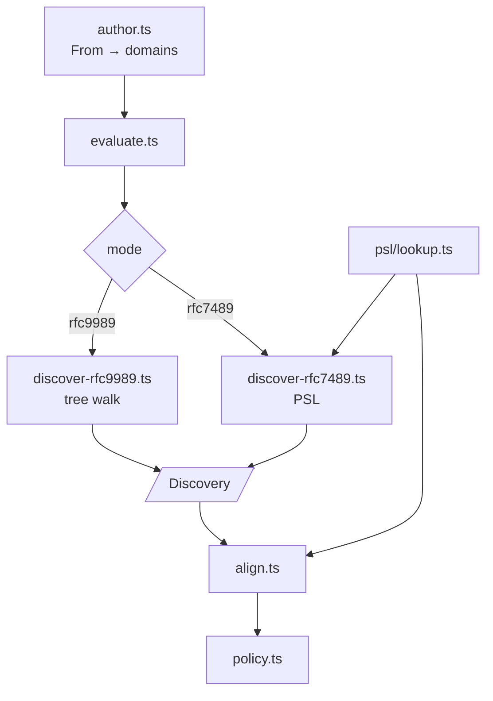
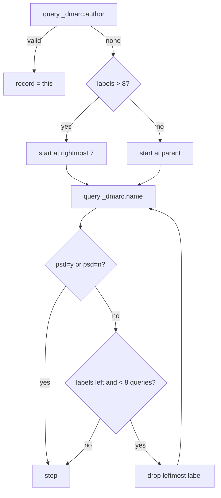
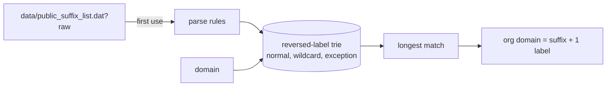
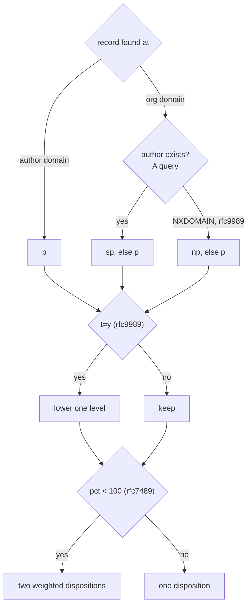

# DMARC

Spec: [DMARC](../../reference/mail/dmarc.md).

## Structure



Build order: `rfc9989` first (no PSL needed), then `rfc7489` with the PSL snapshot and the mode option. Until then `ModeStrategy` has one implementation; `align.ts` and `policy.ts` live in `evaluate.ts` and move out when the second mode arrives. `record.ts` parses and validates records (DMARC-9..11, DMARC-23).

Both modes share one interface. `evaluate.ts` does not branch on mode except to pick the discovery and org-domain functions.

```ts
interface Discovery {
  record: DmarcRecord | null;
  foundAt: string | null;               // name the record was found at
  orgDomain: string;
  orgDomainRule: string;                // 'psd=n at x', 'shortest record', or PSL rule
  queries: string[];                    // query IDs, for evidence
}
interface ModeStrategy {
  discover(ctx, authorDomain): Promise<Discovery | { error: 'temperror' }>;
  orgDomainOf(name): Promise<string>;   // used by relaxed alignment
  tags: ReadonlySet<string>;
}
```

## Author domain (`author.ts`)

| Input | `rfc9989` | `rfc7489` |
|---|---|---|
| No / several `From` fields | `not-evaluated` | `not-evaluated` |
| One address | its domain | its domain |
| Several addresses, one domain | that domain + warning | that domain |
| Several domains | `not-evaluated` | evaluate each; strictest failing policy |
| Group syntax, no address | `not-evaluated` | `not-evaluated` |

Address parsing: RFC 5322 `address-list` with comments, quoted local parts, and groups. Only the domain is used.

## Tree walk (`discover-rfc9989.ts`)



- All records found are kept, longest name first, for org-domain selection (DMARC-6).
- `orgDomainOf(name)` for alignment runs the same walk on the other domain. Answers come from the session cache when names overlap.

## PSL (`psl/lookup.ts`)



- Snapshot date comes from the file's `// VERSION:` header line.
- Parse cost is paid once per worker lifetime.

## Alignment table (`align.ts`)

```ts
interface AlignmentRow {
  identifier: 'spf' | 'dkim';
  domain: string;                // SPF MAIL FROM domain or DKIM d=
  authResult: string;            // spf / dkim result
  mode: 'strict' | 'relaxed';    // aspf / adkim
  orgDomain?: string;            // relaxed only, when looked up
  aligned: boolean;
  counts: boolean;               // authResult is pass and aligned
}
```

- DMARC `pass` ⇔ some row has `counts: true`.
- Rows are built concurrently. A relaxed row walks only domains that equal or end in the author's organizational domain (DMARC-25); others cannot align.
- `analyze` starts DMARC as soon as SPF and DKIM finish, alongside ARC.

## Policy (`policy.ts`)



- The existence query runs only when the record came from the org domain.
- Both modes can run concurrently; they share the DNS cache.
