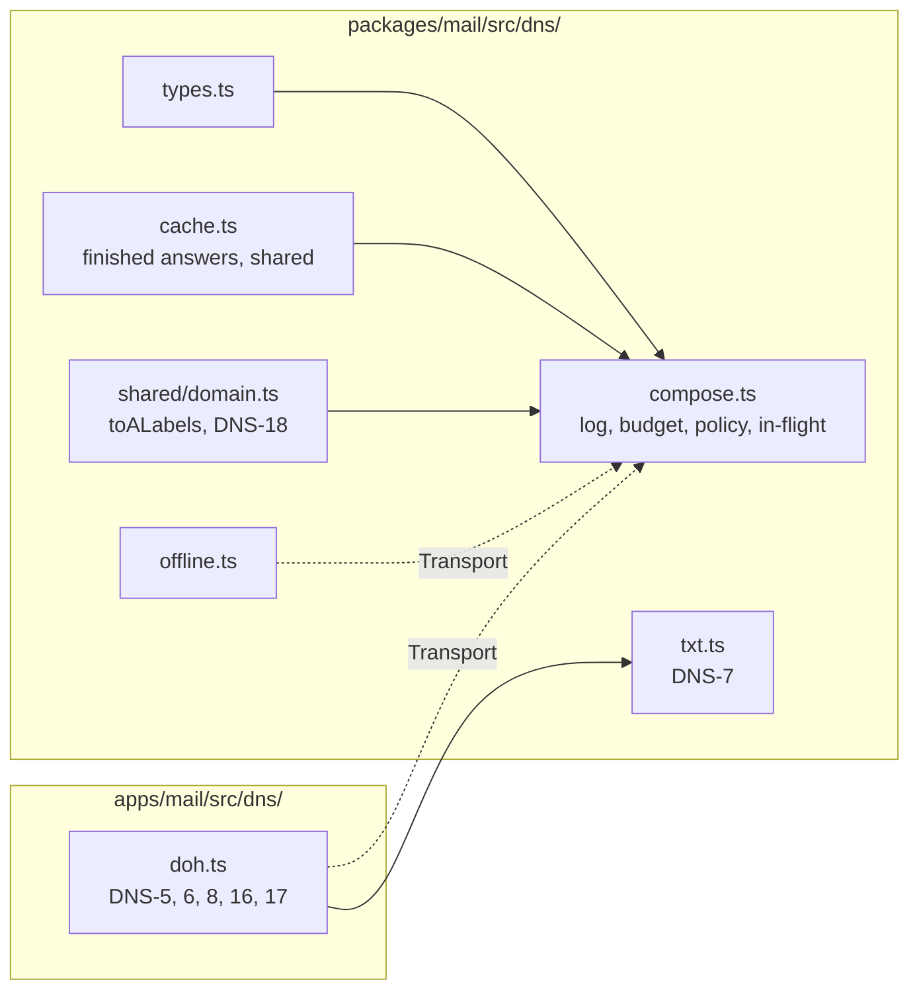
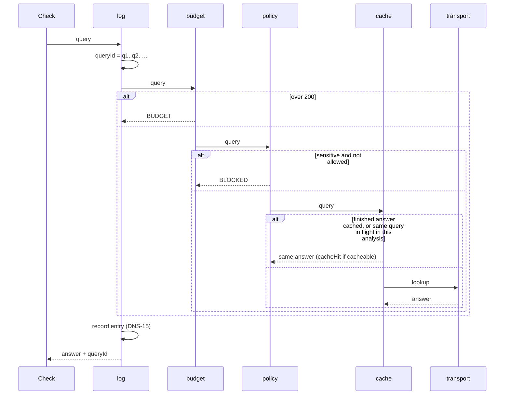

# DNS

Spec: [DNS](../../reference/mail/dns.md). Layer order: [detailed design §6](../mail-detailed-design.md#6-dns-composition).

## Modules



- The package never calls `fetch` (DNS-1). `doh.ts` lives in the app and is passed in as a `Transport`.
- `doh.ts` takes `fetch` as a parameter, so tests replace it without a network.

## Types

```ts
type Transport = (q: { name: string; type: DnsType }, signal: AbortSignal) => Promise<Lookup>;
interface Lookup { rcode: Rcode; records: string[]; authenticated: boolean }
interface ComposedResolver {                // one per analysis
  resolve(q: DnsQuery, signal: AbortSignal): Promise<DnsAnswer>; // Lookup + queryId
  readonly log: readonly DnsLogEntry[];     // finished queries, in queryId order
}
```

| State | Lifetime | Holds |
|---|---|---|
| `DnsCache` | Session, shared | Finished `NOERROR` / `NXDOMAIN` answers per `(source, name, type)` |
| In-flight map | One analysis | Pending lookups, so concurrent identical queries send one request |
| Log, budget counter | One analysis | Entries and the query count |

- In-flight lookups never cross analyses: an aborted analysis cannot fail another one.
- `queryId` comes from a counter, so it is never reused, even when a query throws.

## One query through the layers



## Transport mapping (`doh.ts`)

| Situation | `rcode` |
|---|---|
| `Status: 0` | `NOERROR` (records of the queried type only, DNS-17) |
| `Status: 3` | `NXDOMAIN` |
| Other status, HTTP error, network error, bad JSON | `SERVFAIL` |
| 5 s timeout | `TIMEOUT` |
| Caller's signal aborted | rethrows `AbortError` (the analysis is discarded) |

## Findings from the log

| Finding | Built from |
|---|---|
| `dns.budget-exhausted` | Any entry with `BUDGET` |
| `dns.blocked-sensitive` | Any entry with `BLOCKED` |
| `dns.unauthenticated` | `analyze`: the `NOERROR`/`NXDOMAIN` answers a check used (for DKIM, each signature's key query) that are not `authenticated` |
| `dns.answers-are-current` | `analyze`: `NOERROR`/`NXDOMAIN` entries when the source is not `offline` |
