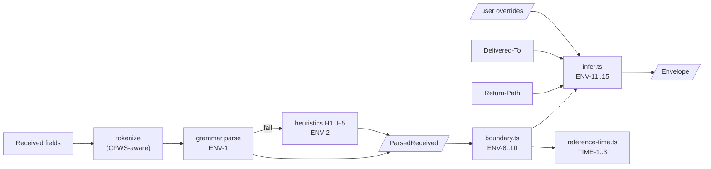
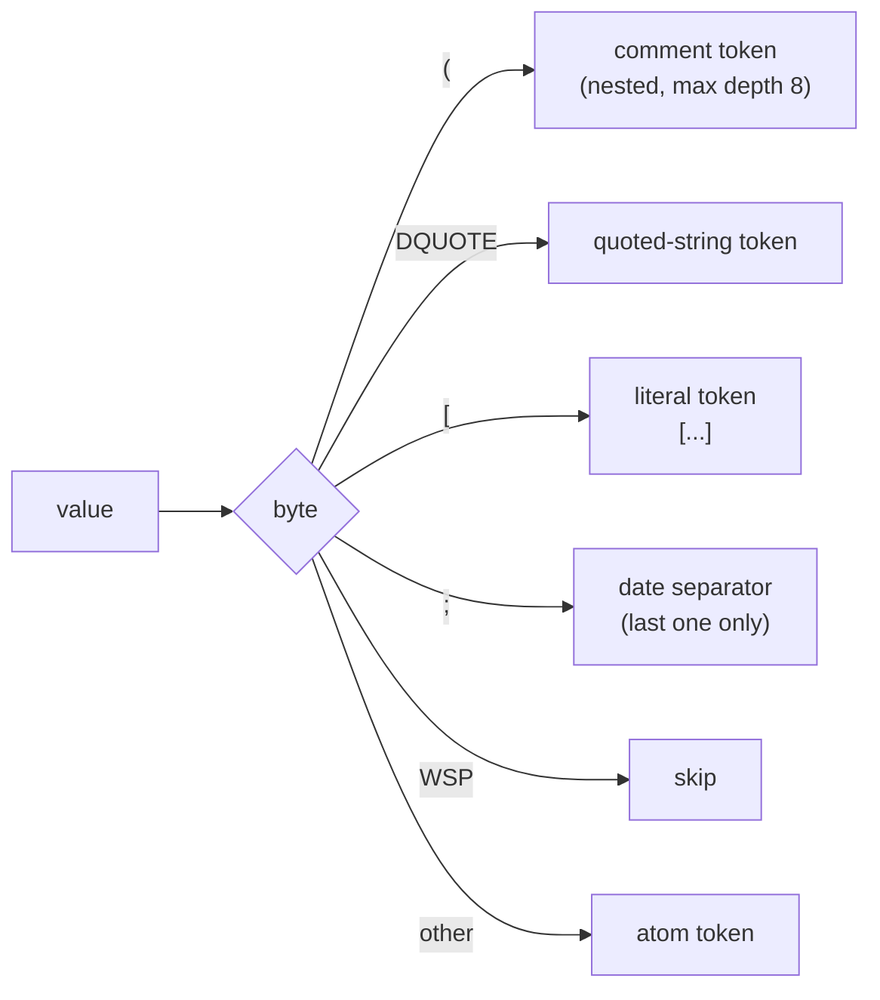
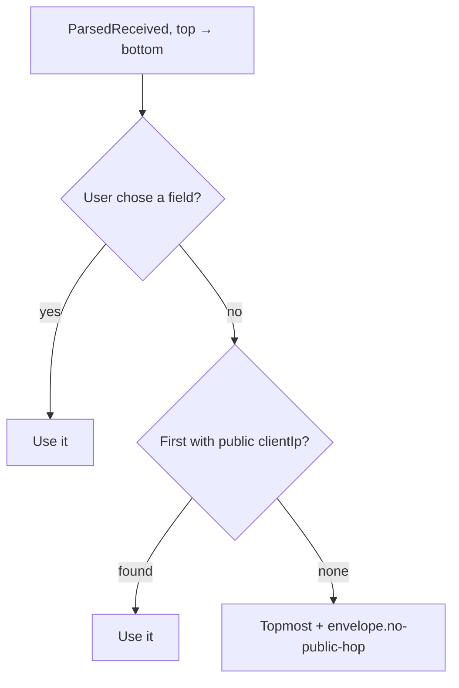

# Envelope

Spec: [Delivery details](../../reference/mail/envelope.md).

## Pipeline



## Types

```ts
interface ParsedReceived {
  field: number;                         // header index
  confidence: 'grammar' | 'heuristic' | 'none';
  rule?: 'ENV-1' | 'H1' | 'H2' | 'H3' | 'H4' | 'H5';
  helo?: string;
  clientIp?: string;                     // RFC 5952 / dotted quad
  rdns?: string;
  by?: string;
  for?: string;
  date?: Date;
}

type Sourced<T> = { value: T; source: { field: number; rule: string } | 'user' } | null;

interface Envelope {
  boundary: number | null;               // index into ParsedReceived[]
  clientIp: Sourced<string>;
  helo: Sourced<string>;
  mailFrom: Sourced<string | '<>'>;
  rcptTo: Sourced<string[]>;
}
```

## Tokenizer



- Comments are tokens, not discarded: TCP-info lives in comments.
- Keywords (`from`, `by`, `via`, `with`, `id`, `for`) are atoms compared case-insensitively.

## Grammar, then heuristics

| Step | Input | Output |
|---|---|---|
| Grammar | Tokens in RFC 5321 order | `helo` = domain after `from`; IP = literal in the TCP-info comment |
| H1–H4 | The `from` clause tokens | Pattern match on (atom, comment) shapes |
| H5 | Any literal in the `from` clause | IP only |
| None | — | `confidence: 'none'`, `envelope.unparsed-received` |

Each heuristic is a pure function `(tokens) → Partial<ParsedReceived> | null`. They are tried in order. Tests have one synthetic sample per MTA.

## IP handling (`shared/ip.ts`)

| Input | Result |
|---|---|
| `[192.0.2.1]`, `192.0.2.1` | IPv4 |
| `[IPv6:2001:db8::1]`, `[2001:db8::1]`, `2001:db8::1` | IPv6, RFC 5952 form |
| `::ffff:192.0.2.1` | IPv4 (ENV-7) |
| Anything else | Not an IP |

`isPublic` returns false for RFC 1918, RFC 6598 (carrier-grade NAT), loopback, link-local, and RFC 4193 addresses. Documentation ranges (192.0.2.0/24, 2001:db8::/32) count as public, so synthetic test data behaves like real traffic.

## Boundary and overrides



- Overrides replace single values. A value with `source: 'user'` is never re-inferred when the boundary changes.
