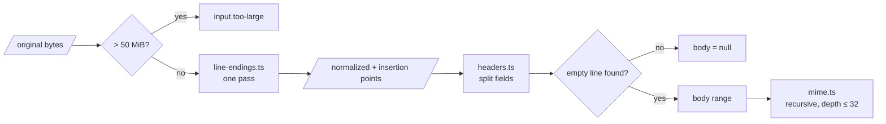
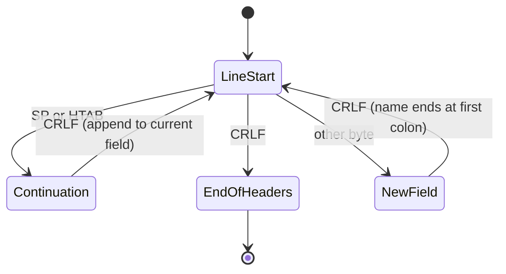

# Message

Spec: [Input](../../reference/mail/input.md).

## Pipeline



## Line endings (`line-endings.ts`)

```ts
interface Normalized {
  bytes: Uint8Array;            // CRLF everywhere a bare LF was
  inserted: Int32Array;         // sorted normalized offsets where a CR was inserted
  kind: 'crlf' | 'lf' | 'mixed';
  bareCr: ByteRange[];          // for input.bare-cr evidence (first 100)
}
```

| Step | Detail |
|---|---|
| Count | First pass counts bare LFs, to allocate `bytes` once |
| Copy | Second pass copies, inserting CR before bare LF and recording the offset |
| Map back | `toOriginal(n) = n − (number of inserted ≤ n)`, binary search: O(log k) |
| CRLF-only input | `bytes` is the original array itself; no copy |

## Header fields (`headers.ts`)



| Case | Handling |
|---|---|
| Line without colon | `input.malformed-header`; kept as raw, `lname` = `""` so no check matches it |
| Continuation before any field | Same as line without colon |
| More than 10 000 fields | `input.too-many-headers`; stop |
| Field name | ASCII bytes before the colon; trailing WSP before the colon is kept in `raw`, trimmed from `name` |
| `value` | Bytes after the colon, CRLF removed before WSP (unfold), decoded as UTF-8 with replacement |

`raw` keeps the exact bytes. Canonicalization reads `raw`, never `value`.

## MIME (`mime.ts`)

```ts
interface MimeNode {
  range: ByteRange;             // whole part incl. its headers
  headers: HeaderField[];
  contentType: { type: string; subtype: string; params: Map<string, string> };
  transferEncoding: string;     // lowercase, default '7bit'
  body: ByteRange;
  children: MimeNode[];         // multipart only
}
```

| Step | Detail |
|---|---|
| Content-Type | RFC 2045 token/quoted-string parameters; RFC 2231 continuations (`name*0`) joined |
| Boundary search | Byte search for `CRLF--boundary`; the first part may start at offset 0 without CRLF |
| Close delimiter | `--boundary--`; missing → `input.mime-boundary`, part ends at parent end |
| Depth | Recursion depth counter; > 32 → `input.mime-too-deep`, child kept opaque |
| Bodies | Never decoded during analysis. Decoded only when the UI asks to display a part |

## Encoded words (`encoded-words.ts`)

| Step | Detail |
|---|---|
| Find | `=?charset?B|Q?text?=`, adjacent words separated only by WSP are joined |
| Decode | `new TextDecoder(charset)`; unknown label → raw text + `input.encoded-word` |
| Use | Display only. Checks never see decoded words |
