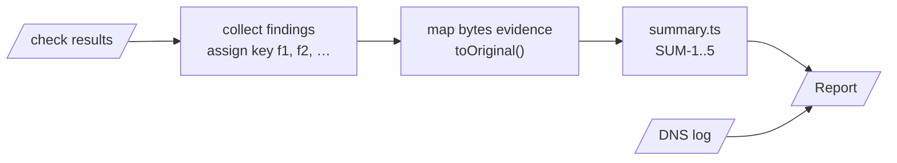
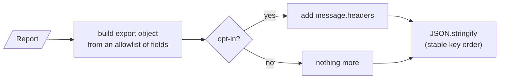

# Report

Spec: [Report](../../reference/mail/report.md).

## Build (`build.ts`)

- Keys follow emission order, so the same input gives the same keys.
- `bytes` evidence is converted once here. Checks never see original offsets.

## Export (`export.ts`)

| Rule | Why |
|---|---|
| Allowlist, not deny-list | A new field never leaks message text by accident |
| Trace labels that quote message text are marked `quotes: true` at creation and dropped without opt-in | EXP-2 |
| Stable key order | Exports diff cleanly |

A test serializes a report built from a message full of a unique marker string, then asserts the marker does not appear in the export without opt-in.
