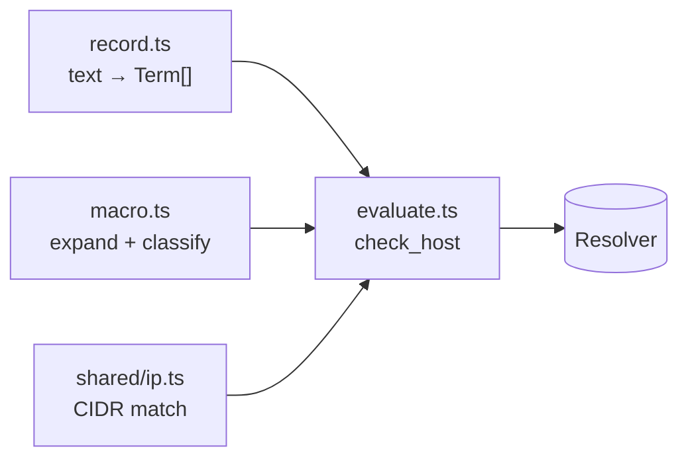
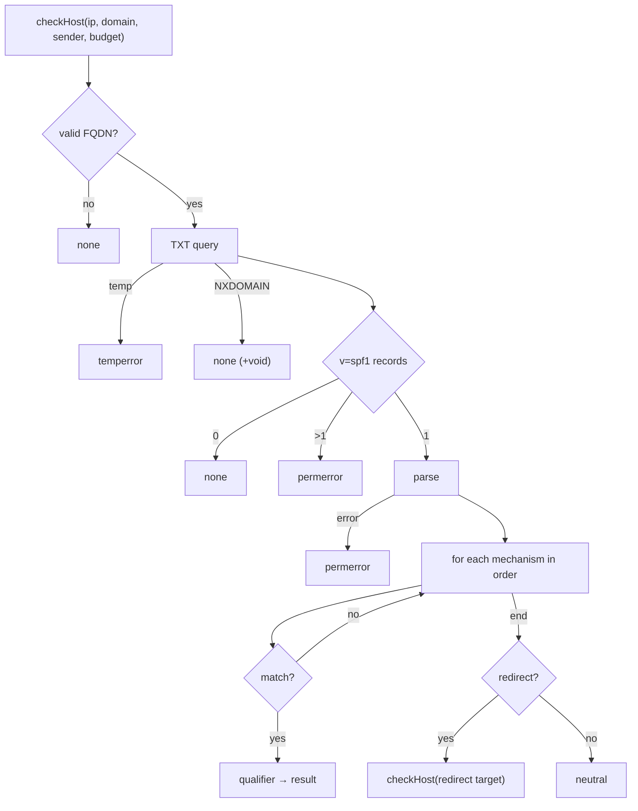
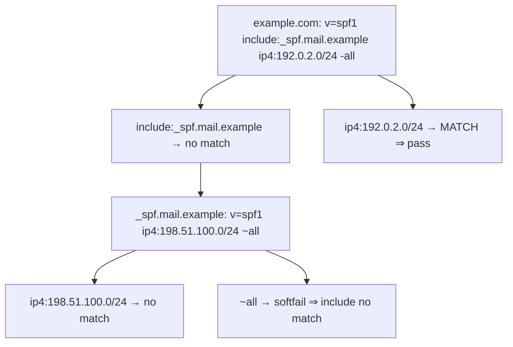

# SPF

Spec: [SPF](../../reference/mail/spf.md).

## Modules



## Record AST (`record.ts`)

```ts
type Qualifier = '+' | '-' | '~' | '?';
type Term =
  | { kind: 'all'; q: Qualifier }
  | { kind: 'include' | 'exists'; q: Qualifier; spec: MacroString }
  | { kind: 'a' | 'mx'; q: Qualifier; spec?: MacroString; cidr4?: number; cidr6?: number }
  | { kind: 'ptr'; q: Qualifier; spec?: MacroString }
  | { kind: 'ip4' | 'ip6'; q: Qualifier; net: Cidr }
  | { kind: 'redirect' | 'exp'; spec: MacroString }
  | { kind: 'unknown-modifier'; name: string };
type MacroString = readonly (string | Macro)[];  // parsed once, expanded per use
```

- Parsing is total: a syntax error yields `spf.syntax` with the failing term's position, and the record result is `permerror`.

## Macro expansion (`macro.ts`)

```ts
function expand(m: MacroString, env: MacroEnv): { name: string; sensitive: boolean } | { error: 'syntax' };
```

| Letter | Source | Sensitive (DNS-9) |
|---|---|---|
| `s` `l` | sender / local part | yes |
| `o` `d` `h` | domains | no |
| `i` `p` `c` | client IP, validated PTR name, IP text | yes |
| `v` | `in-addr` / `ip6` | no |
| `r` `t` | receiver, time (`exp` only) | no |

- Result is truncated from the left to 253 octets (RFC 7208 §7.3).
- `sensitive` flows into `DnsQuery.sensitivity`. The policy layer decides.

## `check_host` (`evaluate.ts`)



```ts
interface Budget { dnsTerms: number; voids: number }   // shared by include/redirect recursion
```

| Mechanism | Queries | Counts toward 10 | Notes |
|---|---|---|---|
| `include` | TXT (recursive) | yes | Mapping per SPF-11 |
| `a` | A or AAAA by IP family | yes | |
| `mx` | MX, then A/AAAA per name (≤ 10, in parallel) | yes (once) | |
| `ptr` | PTR, then A/AAAA per name (≤ 10) | yes | Always sensitive |
| `exists` | A | yes | |
| `ip4` `ip6` `all` | none | no | |
| `redirect` | TXT (recursive) | yes | |

- Mechanisms are evaluated strictly in order; DNS calls are sequential except the per-name lookups inside `mx` and `ptr`.
- Void lookups (NXDOMAIN or NODATA) increment `budget.voids`; the third → `permerror`.
- `BLOCKED` anywhere → the identity is `not-evaluated` (SPF-13). Partial results are kept in the trace.

## Trace


