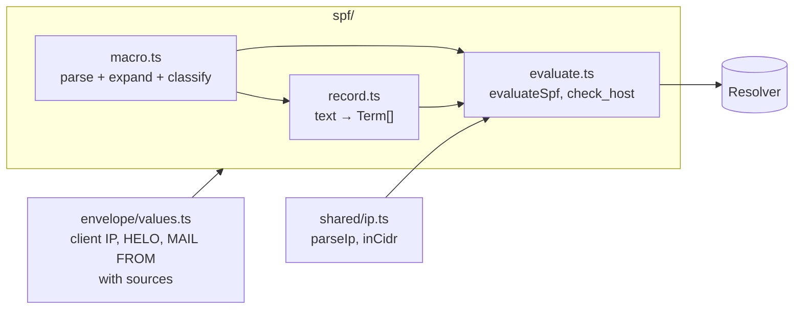
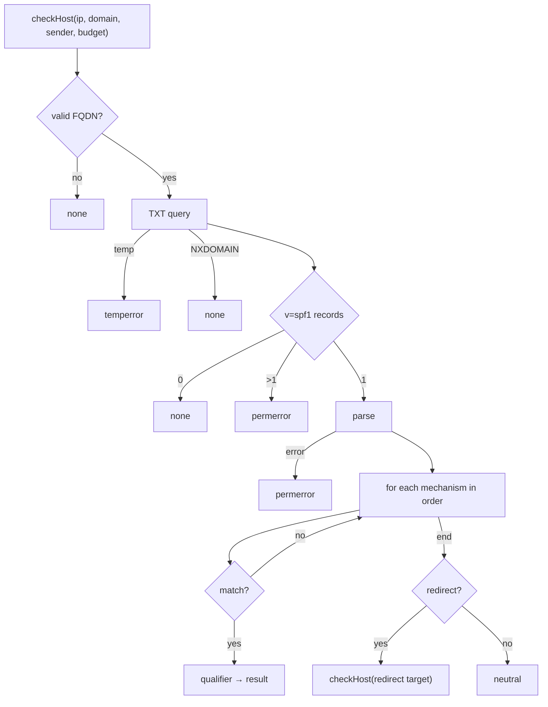
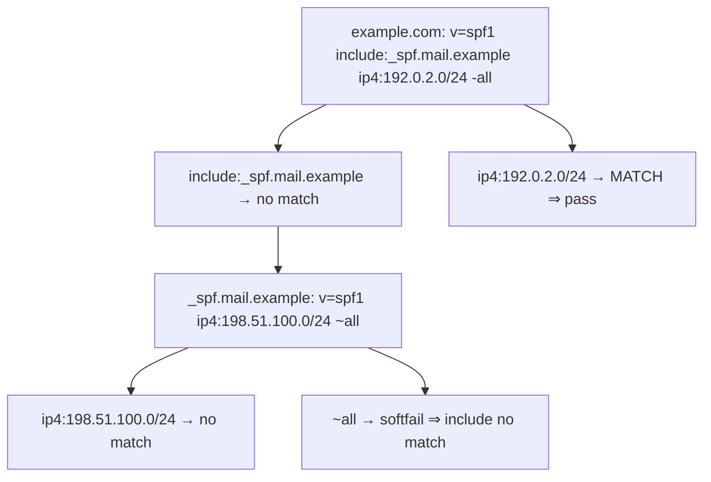

# SPF

Spec: [SPF](../../reference/mail/spf.md).

## Modules



- `analyze` gets the identities from `envelope/values.ts` and calls `evaluateSpf` once, next to DKIM and ARC. It evaluates MAIL FROM and HELO concurrently.
- Each identity is guarded on its own (REP-7, REP-8) with `guard` from `shared/abort.ts`, the helper DKIM and ARC use.
- A null MAIL FROM reuses the HELO identity's result, so its queries are made and counted once (DNS-13).

## Record AST (`record.ts`)

```ts
type Qualifier = '+' | '-' | '~' | '?';
type Term =
  | { kind: 'all'; q: Qualifier }
  | { kind: 'include' | 'exists'; q: Qualifier; spec: MacroString }
  | { kind: 'a' | 'mx'; q: Qualifier; spec?: MacroString; cidr4: number; cidr6: number }
  | { kind: 'ptr'; q: Qualifier; spec?: MacroString }
  | { kind: 'ip4' | 'ip6'; q: Qualifier; net: Ip; prefix: number }
  | { kind: 'redirect' | 'exp'; spec: MacroString };   // unknown modifiers are dropped
type MacroString = readonly (string | Macro)[];  // parsed once, expanded per use
interface Macro { letter: string; upper: boolean; digits?: number; reverse: boolean; delimiters: string }
```

- Parsing is total: a syntax error yields `spf.syntax` quoting the failing term, and the record result is `permerror`.
- `ip4`/`ip6` use a stricter address check than the envelope parser (no brackets, no `IPv6:`, no leading zeros). An IPv4-mapped `ip6` network stays IPv6.
- For `a` and `mx`, only a trailing `/n` or `//n` is a CIDR length, because `/` is also a macro delimiter.

## Macro expansion (`macro.ts`)

```ts
function parseMacroString(text: string, o: { exp: boolean }): MacroString | null;   // null: syntax error
function expandMacro(m: MacroString, env: MacroEnv): Promise<{ text: string; sensitive: boolean }>; // async: %{p} looks up PTR
```

| Letter | Source | Sensitive (DNS-9) |
|---|---|---|
| `s` `l` | sender / local part | yes |
| `o` `d` `h` | domains | no |
| `i` `p` `c` | client IP, validated PTR name, IP text | yes |
| `v` | `in-addr` / `ip6` | no |
| `r` `t` | receiver, time (`exp` only) | no |

- Result is truncated from the left to 253 octets (RFC 7208 §7.3).
- `sensitive` flows into `DnsQuery.sensitivity`. The policy layer decides.

## `check_host` (`evaluate.ts`)



```ts
interface Budget { dnsTerms: number; voids: number }   // shared by include/redirect recursion
// An outcome that ends evaluation (permerror, temperror, not-evaluated) is thrown as Stop
// and caught once per identity, so no term has to pass it up by hand.
```

| Mechanism | Queries | Counts toward 10 | Notes |
|---|---|---|---|
| `include` | TXT (recursive) | yes | Mapping per SPF-11 |
| `a` | A or AAAA by IP family | yes | |
| `mx` | MX, then A/AAAA per name (≤ 10, in parallel) | yes (once) | |
| `ptr` | PTR, then A/AAAA per name (≤ 10) | yes | Always sensitive |
| `exists` | A | yes | |
| `ip4` `ip6` `all` | none | no | |
| `redirect` | TXT (recursive) | yes | |

- Mechanisms are evaluated strictly in order; DNS calls are sequential except the per-name lookups inside `mx` and `ptr`.
- Void lookups (NXDOMAIN or NODATA on the first query of `a`, `mx`, `ptr`, `exists`) increment `budget.voids`; the third → `permerror`.
- `ptr` and `%{p}` share one lookup per identity (memoized): PTR names (first 10), each confirmed by A/AAAA. Each term copies its query IDs into its own trace. PTR queries are always `sensitive`.
- Record data is read per DNS-19: `MX` is `pref name`, names lose a trailing dot.
- `BLOCKED` anywhere → the identity is `not-evaluated` (SPF-13). Partial results are kept in the trace.

## Trace


