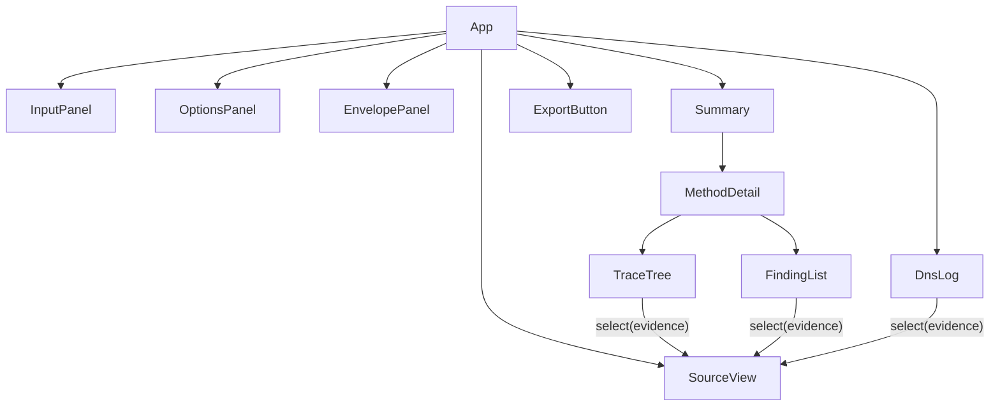
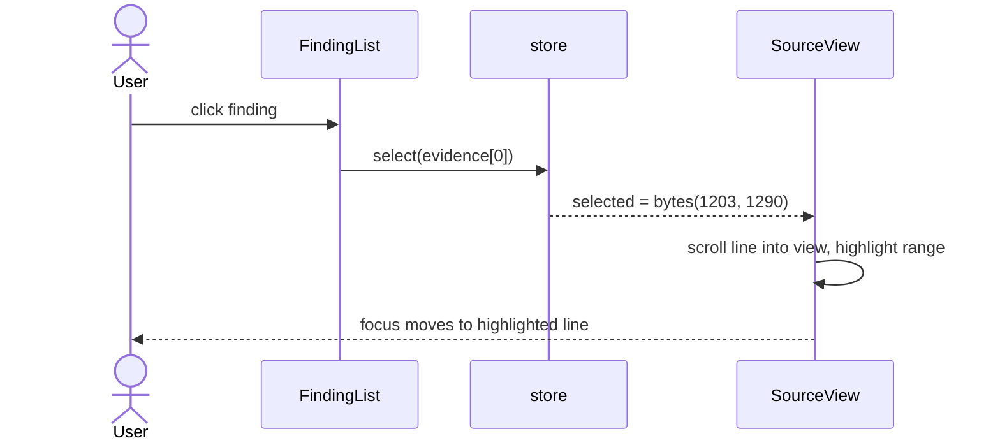
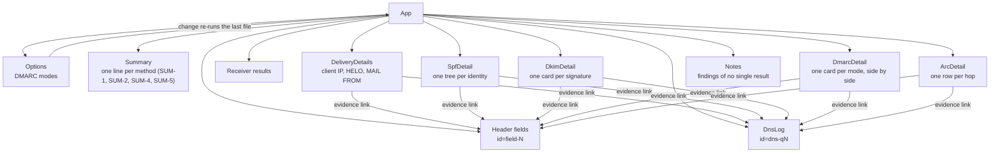

# UI

Requirements: [REQ-MAIL-002](../requirements/REQ-MAIL-002-explain-results.md), [REQ-MAIL-009](../requirements/REQ-MAIL-009-delivery-details.md), [REQ-MAIL-010](../requirements/REQ-MAIL-010-dns-control.md).

## Layout

```
┌──────────────────┬───────────────────────────┬────────────────────────────┐
│ InputPanel       │ OptionsPanel              │ EnvelopePanel              │
│ drop / paste     │ DMARC mode, DoH, offline, │ IP, HELO, MAIL FROM,       │
│                  │ sensitive queries, time   │ RCPT TO, boundary picker   │
├──────────────────┴───────────────────────────┴────────────────────────────┤
│ Summary: SPF pass · DKIM 1 pass 1 fail · DKIM2 none · DMARC pass · ARC none │
├──────────────────────────────────────────────┬────────────────────────────┤
│ MethodDetail                                 │ SourceView                 │
│   TraceTree                                  │   header block,            │
│   FindingList                                │   highlighted evidence     │
├──────────────────────────────────────────────┼────────────────────────────┤
│ DnsLog                                       │ ExportButton               │
└──────────────────────────────────────────────┴────────────────────────────┘
```

## Component tree



## Evidence selection



| Evidence | Target |
|---|---|
| `header` | SourceView, whole field |
| `bytes` | SourceView, exact range |
| `dns` | DnsLog row |

## SourceView

| Concern | Design |
|---|---|
| Size | Header block only by default; body on demand |
| Rendering | Virtual scrolling: fixed line height, render visible lines + 20 above and below |
| Text | `TextDecoder('utf-8', { fatal: false })` per line; control characters shown as `␍`, `␊`, `·` |
| Highlight | Ranges mapped to (line, column) by binary search over line starts |

## Accessibility

| Rule |
|---|
| Every result shows a text label, not only color |
| Summary lines are buttons; Enter expands |
| Trace is a `tree` role with arrow-key navigation |
| Selecting evidence moves focus to SourceView and announces the field name |
| Experimental results (DKIM2) carry a visible "experimental" label |

## Current build (SPF, DKIM, DMARC, ARC)

The full layout above is the target. The page grows towards it method by method.



| Element | Shows | REQ |
|---|---|---|
| Options | DMARC modes as two checkboxes, RFC 9989 (checked by default) and RFC 7489. At least one stays checked. A change re-runs the analysis of the last file | DMARC-27 |
| Summary | `DKIM: pass (1 pass, 1 fail)`; `none` without signatures. `ARC: pass (2 sets)`. `SPF: softfail`. `DMARC: fail (disposition reject)`. A `not-evaluated` reason comes before the counts: `ARC: not evaluated (offline; 1 set)` | REQ-MAIL-002, SUM-1, SUM-2, SUM-4, SUM-5 |
| Delivery details | Client IP, HELO, MAIL FROM, each with the header field and rule it came from (ENV-15), or "not found" | REQ-MAIL-009 |
| SPF | Per identity (MAIL FROM, HELO): domain, result in words with its reason, counters (DNS terms / 10, void lookups / 2), findings, and the record tree: each record with its domain, each term with its outcome and DNS links; `include`/`redirect` nest; the matching term is marked | REQ-MAIL-003, SPF-18, SPF-19 |
| DKIM card | `d=`, `s=`, result as text, the `not-evaluated` reason, findings with severity | REQ-MAIL-002, REQ-MAIL-004 |
| Trace (`<details>`) | Tags, signed header fields, key query, header hash input, body hash computed vs `bh=` | DKIM-16 |
| Canonical body | Shown open when the computed body hash differs from `bh=`; marked when only the first 64 KiB is shown | REQ-MAIL-004 |
| DMARC | Per mode: author domain, result in words with its reason, where the record was found and its text, the organizational domain and how it was chosen, the policy in effect (`p`/`sp`/`np`, test mode), the disposition (with `pct` weights: `reject (50%), quarantine (50%)`), findings, and an alignment table: identifier, domain, its SPF/DKIM result, strict or relaxed, organizational domain, aligned, counts. RFC 7489 adds the PSL rule and version, and with several author domains one line per domain. Two modes sit side by side on wide screens | REQ-MAIL-006, DMARC-3, DMARC-7, DMARC-18 |
| ARC chain | Chain result in words with its reason; the oldest hop whose message signature still verifies (ARC-6); the chain's findings; a table with one row per hop: instance, sealer `d=` and `s=` and seal time (`t=` in UTC, as written when it is not decimal seconds; from the message signature when the seal is missing), `cv=`, message signature result, seal result, the hop's own results (AAR authserv-id and its entries worded as in receiver results, or "(no results)"), links to the ARC fields and key queries | REQ-MAIL-007, ARC-10 |
| Evidence | In-page links: `header` → the header list item, `dns` → the DNS log row. Every finding list (SPF, DKIM, DMARC, ARC, receiver results, Notes) uses the same `FindingList` view | REQ-MAIL-002 |
| DNS log | Query ID, name, type, result, DNSSEC flag (`n/a` when no answer was received), cache hit, purpose | DNS-15 |

- Result words are always text; color is only a second cue.
- `not-evaluated` reads "Not evaluated (offline)", never like a failure.
- Views live in `apps/mail/src/views/`; `summarizeDkim` (SUM-2) lives in the package.
