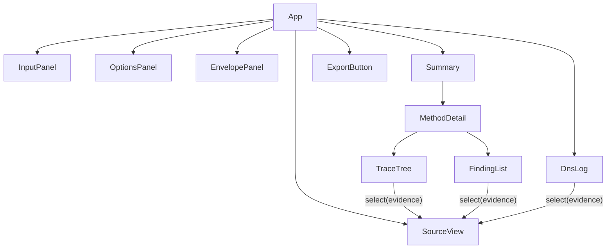
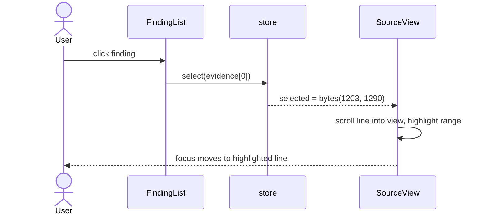

# UI

Requirements: [REQ-MAIL-002](../requirements/REQ-MAIL-002-explain-results.md), [REQ-MAIL-009](../requirements/REQ-MAIL-009-delivery-details.md), [REQ-MAIL-010](../requirements/REQ-MAIL-010-dns-control.md).

## Layout

```
┌──────────────────┬───────────────────────────┬────────────────────────────┐
│ InputPanel       │ OptionsPanel              │ EnvelopePanel              │
│ drop / paste     │ DMARC mode, DoH, offline, │ IP, HELO, MAIL FROM,       │
│                  │ sensitive queries, time   │ RCPT TO, boundary picker   │
├──────────────────┴───────────────────────────┴────────────────────────────┤
│ Summary: SPF pass · DKIM 1 pass 1 fail · DKIM2 none · DMARC pass · ARC none │
├──────────────────────────────────────────────┬────────────────────────────┤
│ MethodDetail                                 │ SourceView                 │
│   TraceTree                                  │   header block,            │
│   FindingList                                │   highlighted evidence     │
├──────────────────────────────────────────────┼────────────────────────────┤
│ DnsLog                                       │ ExportButton               │
└──────────────────────────────────────────────┴────────────────────────────┘
```

## Component tree



## Evidence selection



| Evidence | Target |
|---|---|
| `header` | SourceView, whole field |
| `bytes` | SourceView, exact range |
| `dns` | DnsLog row |

## SourceView

| Concern | Design |
|---|---|
| Size | Header block only by default; body on demand |
| Rendering | Virtual scrolling: fixed line height, render visible lines + 20 above and below |
| Text | `TextDecoder('utf-8', { fatal: false })` per line; control characters shown as `␍`, `␊`, `·` |
| Highlight | Ranges mapped to (line, column) by binary search over line starts |

## Accessibility

| Rule |
|---|
| Every result shows a text label, not only color |
| Summary lines are buttons; Enter expands |
| Trace is a `tree` role with arrow-key navigation |
| Selecting evidence moves focus to SourceView and announces the field name |
| Experimental results (DKIM2) carry a visible "experimental" label |
