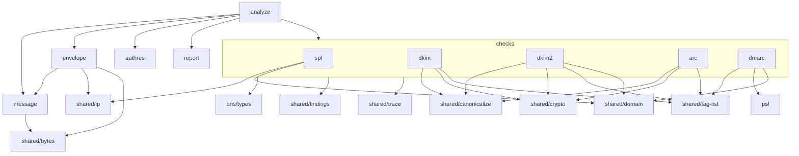
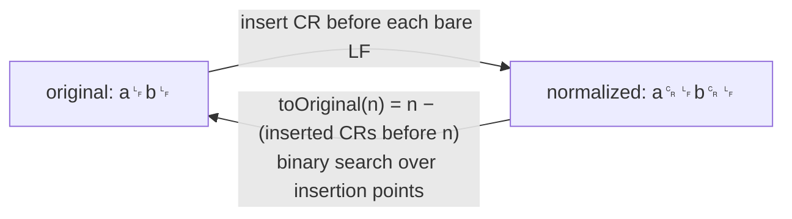
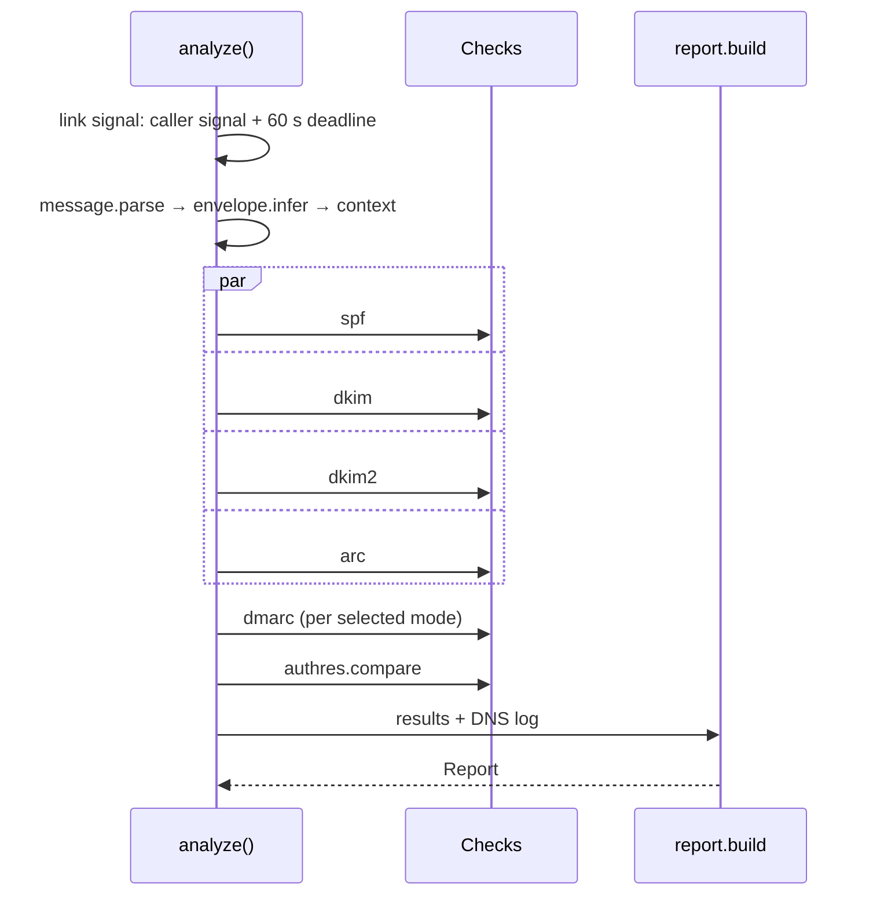
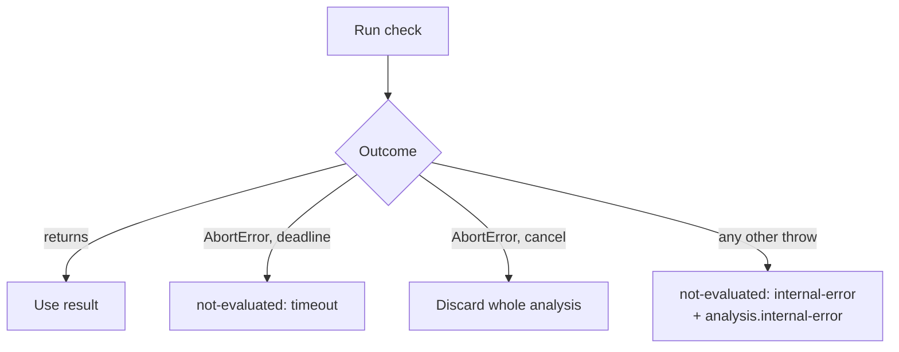
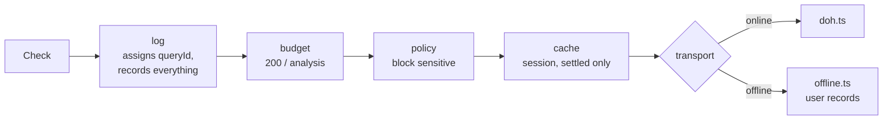
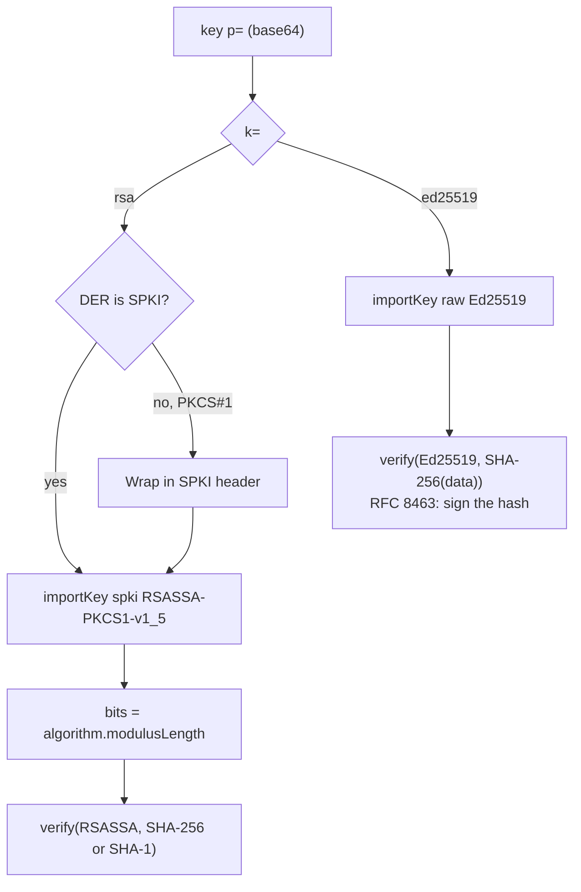
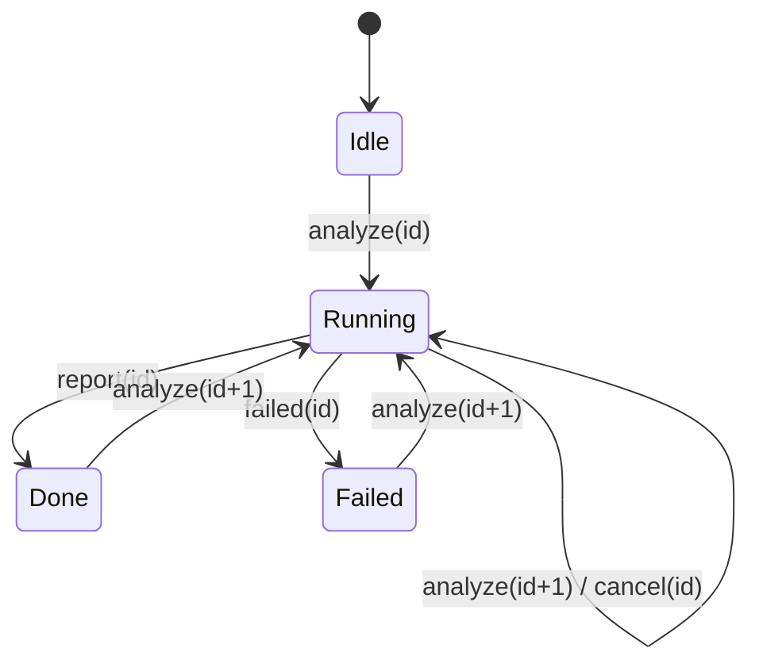
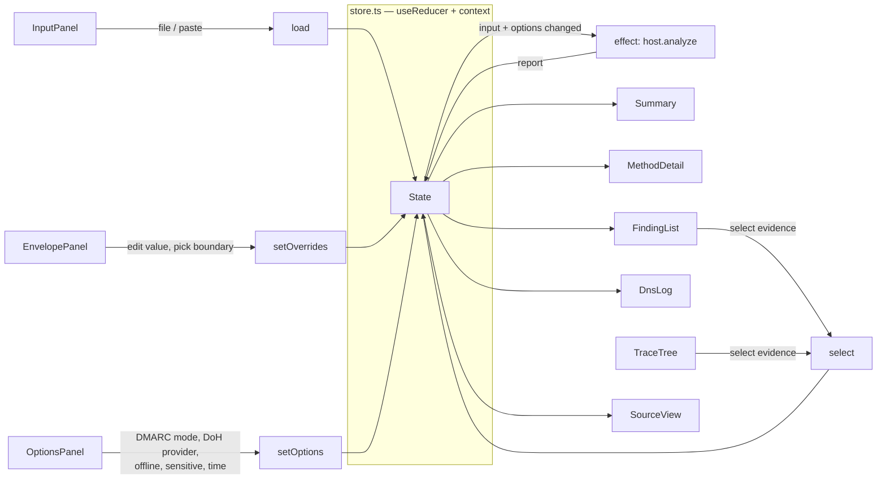
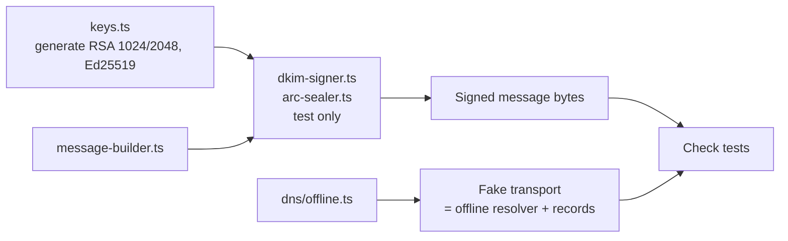

# Mail analyzer detailed design

Builds on [Mail analyzer architecture](mail-architecture.md). Behavior rules: [specification](../reference/mail/). Module internals: [module design](mail-design/).

## 1. File layout

```
packages/mail/
  data/public_suffix_list.dat     # PSL snapshot (0003)
  src/
    index.ts                      # public API: analyze(), types
    analyze.ts                    # orchestrator
    context.ts                    # AnalysisContext
    message/   parse.ts  headers.ts  mime.ts  line-endings.ts  encoded-words.ts
    envelope/  received.ts  heuristics.ts  boundary.ts  infer.ts  reference-time.ts
    dns/       types.ts  compose.ts  log.ts  budget.ts  policy.ts  cache.ts  offline.ts  txt.ts
    spf/       record.ts  macro.ts  evaluate.ts
    dkim/      verify.ts
    dkim2/     fields.ts  recipes.ts  custody.ts  hashes.ts  verify.ts
    dmarc/     author.ts  record.ts  discover-rfc9989.ts  discover-rfc7489.ts  align.ts  policy.ts  evaluate.ts
    arc/       sets.ts  seal.ts  validate.ts
    authres/   parse.ts  list.ts  compare.ts
    psl/       lookup.ts
    shared/    bytes.ts  tag-list.ts  canonicalize.ts  crypto.ts  domain.ts  ip.ts  base64.ts  findings.ts  trace.ts
               signature-core.ts         # DKIM + ARC: header selection, body hash, keys, verify
               rfc5322-tokens.ts         # envelope + authres: CFWS, quoted strings
    report/    build.ts  summary.ts  export.ts
  test/support/  message-builder.ts  dkim-signer.ts  arc-sealer.ts  keys.ts

apps/mail/
  index.html
  vite.config.ts                  # defineApp('mail', { connect: DOH_ORIGINS })
  src/
    main.tsx  App.tsx
    worker/   protocol.ts  host.ts  worker.ts
    dns/      doh.ts
    state/    store.ts  actions.ts
    views/    InputPanel  EnvelopePanel  OptionsPanel  Summary  MethodDetail
              TraceTree  FindingList  SourceView  DnsLog  ExportButton
```

## 2. Module dependencies



| Rule |
|---|
| Checks import only `message` types, `dns/types`, and `shared/*`. Never each other. |
| `dns/types` is the only DNS import in checks. Composition lives in `analyze.ts` and the worker. |
| `shared/*` imports nothing from the package except `shared/*`. |

## 3. Core types

```ts
// shared/bytes.ts
export interface ByteRange { readonly start: number; readonly end: number } // half-open, original input

// message/parse.ts
export interface Message {
  readonly original: Uint8Array;        // as given
  readonly normalized: Uint8Array;      // IN-7: bare LF → CRLF
  readonly toOriginal: (n: number) => number; // normalized offset → original offset
  readonly lineEnding: 'crlf' | 'lf' | 'mixed';
  readonly headers: readonly HeaderField[];
  readonly body: ByteRange | null;      // null: header-only input
  readonly mime: MimeNode | null;
  readonly findings: readonly Finding[];
}
export interface HeaderField {
  readonly index: number;               // 0 = topmost
  readonly name: string;                // as written
  readonly lname: string;               // lowercase, for lookup
  readonly raw: ByteRange;              // whole field incl. folding, in normalized bytes
  readonly value: string;               // unfolded, undecoded
}

// context.ts
export interface AnalysisContext {
  readonly message: Message;
  readonly envelope: Envelope;
  readonly referenceTime: Date;
  readonly resolver: Resolver;
  readonly signal: AbortSignal;
}

// shared/findings.ts
export interface Finding {
  readonly id: FindingId;               // 'dkim.expired', …  (union of all spec IDs)
  readonly severity: 'error' | 'warning' | 'info';
  readonly message: string;
  readonly evidence: readonly Evidence[];
}
export type Evidence =
  | { kind: 'header'; index: number }
  | { kind: 'bytes'; range: ByteRange }
  | { kind: 'dns'; queryId: string };

// Every check returns this shape.
export interface CheckResult<R extends string> {
  readonly result: R | 'not-evaluated';
  readonly reason?: NotEvaluatedReason;
  readonly trace: TraceNode;
  readonly findings: readonly Finding[];
}
```

### Offset mapping



- Checks work on `normalized`. `report/build.ts` converts every `bytes` evidence with `toOriginal` (REP-2).

## 4. Public API and checks

```ts
// index.ts
export function analyze(input: Uint8Array, options: AnalyzeOptions, deps: {
  transport: Transport;                  // doh.ts in the app; offline/fake in tests
  cache: DnsCache;                       // survives across analyses in one session
  signal: AbortSignal;
}): Promise<Report>;

// check signatures
spf.evaluate(ctx): Promise<{ mailFrom: CheckResult<SpfResult>; helo: CheckResult<SpfResult> }>;
dkim.verifyAll(ctx): Promise<DkimSignatureResult[]>;      // + d, s, i per signature
dkim2.verify(ctx): Promise<CheckResult<Dkim2Result> & { stage?: Dkim2Stage }>;
arc.validate(ctx): Promise<CheckResult<ArcResult> & { oldestPass?: number }>;
dmarc.evaluate(ctx, inputs: { spf; dkim }, mode: DmarcMode): Promise<DmarcResult>;
authres.list(message, envelope): AuthResult[];          // AR-1, AR-4, AR-10
authres.compare(results, ours): Comparison[];           // AR-5..9, AR-11
```

## 5. Orchestration





- Each check is wrapped in `runCheck()`, so one bug never loses the other results.
- `runCheck` uses `Promise.allSettled`, never `Promise.all`.

## 6. DNS composition



```ts
// dns/compose.ts
export function composeResolver(o: {
  transport: Transport; source: string;  // 'cloudflare' | 'google' | 'offline'
  cache: DnsCache; budget: number; allowSensitive: boolean;
}): { resolve: Resolver; log: readonly DnsLogEntry[] };
// The layers are steps inside resolve(); see mail-design/dns.md.
```

| Layer | Detail |
|---|---|
| `log` | Outermost, so blocked and cached queries are logged too (DNS-11, DNS-15) |
| `budget` | Counts every query, cached or not (DNS-13) |
| `policy` | Uses `query.sensitivity`, set by the caller (SPF marks macro-expanded and `PTR` names) |
| `cache` | Stores finished `NOERROR`/`NXDOMAIN` answers per `(source, name, type)`. Concurrent identical queries in one analysis share one in-flight promise |
| `doh.ts` | `fetch(url, { signal: AbortSignal.any([signal, AbortSignal.timeout(5000)]), credentials: 'omit', referrerPolicy: 'no-referrer' })` |

IDN: `shared/domain.ts` converts each non-ASCII label with the URL parser and refuses labels the parser would treat as URL syntax (DNS-18). No punycode library.

## 7. Shared primitives

| Module | Functions | Used by |
|---|---|---|
| `tag-list.ts` | `parseTagList(value) → { tags, duplicates, errors }` | DKIM, DKIM keys, DKIM2, ARC, DMARC |
| `canonicalize.ts` | `headerSimple`, `headerRelaxed`, `bodySimple(bytes)`, `bodyRelaxed(bytes)`; `l=` is applied by the caller | DKIM, ARC, DKIM2 |
| `crypto.ts` | `importDkimKey(k, p, hash) → { ok, key, kind, bits? }`, `verifySignature(key, data, sig)`; digests use `crypto.subtle.digest` directly | DKIM, ARC, DKIM2 |
| `domain.ts` | `labels`, `isFqdn`, `toALabel`, `relaxedMatch` (DKIM2), `isSubdomain` | SPF, DKIM, DKIM2, DMARC |
| `ip.ts` | `parseIp`, `inCidr`, `reverseName`, `isPublic` | SPF, envelope |
| `base64.ts` | strict decode, ignoring folding whitespace | DKIM, DKIM2, ARC |
| `psl/lookup.ts` | `organizationalDomain(name) → { domain, rule }`. Rules parsed lazily from `data/public_suffix_list.dat?raw` on first use | DMARC (`rfc7489`) |

### Crypto details



- Web Crypto has no streaming digest. Bodies are canonicalized into one buffer, then hashed. Peak memory ≈ 2 × body size (≤ 100 MiB).
- `globalThis.crypto.subtle` exists in browsers, workers, and Node. No crypto port or interface.

## 8. Worker protocol

```ts
// apps/mail/src/worker/protocol.ts
export type ToWorker =
  | { type: 'analyze'; id: number; bytes: Uint8Array; options: AnalyzeOptions }
  | { type: 'cancel'; id: number };

export type FromWorker =
  | { type: 'progress'; id: number; stage: 'parsed' | 'envelope' | Method }
  | { type: 'report'; id: number; report: Report }
  | { type: 'failed'; id: number; message: string };   // bugs only
```



| Rule |
|---|
| The UI keeps the input bytes. The worker gets a structured-clone copy. Reports carry offsets, not bytes. |
| `host.ts` ignores any message whose `id` is not the latest. |
| The worker keeps one `DnsCache` for its lifetime (DNS-14). |
| The worker is created with `import Worker from './worker.ts?worker&inline'` (0004). |

## 9. UI state



```ts
interface State {
  input: { name: string; bytes: Uint8Array } | null;
  options: AnalyzeOptions;               // includes envelope overrides
  run: { id: number; status: 'idle' | 'running' | 'done' | 'failed'; stage?: string };
  report: Report | null;
  selected: Evidence | null;
}
```

- No state library. `useReducer` and one context.
- `SourceView` renders the normalized header block with virtual scrolling and highlights the selected range.
- Option changes re-run analysis after 300 ms of no further change.

## 10. Build: `vite.shared.ts`

```ts
export const DOH_ORIGINS = ['https://cloudflare-dns.com', 'https://dns.google'];

export function defineApp(name: string, o: { connect: string[] }): UserConfig {
  return {
    base: `/benchside/${name === 'home' ? '' : name + '/'}`,
    plugins: [preact(), cspMeta(o.connect)],
    worker: { format: 'es' },
  };
}

function cspMeta(connect: string[]): Plugin {
  const policy = [
    "default-src 'self'",
    `connect-src ${connect.length ? connect.join(' ') : "'none'"}`,
    'worker-src blob:',
    "img-src 'self' blob: data:",
    "object-src 'none'",
    "base-uri 'none'",
    "form-action 'none'",
  ].join('; ');
  return {
    name: 'benchside-csp',
    apply: 'build',                       // dev uses inline styles (0002)
    transformIndexHtml: () => [{ tag: 'meta', attrs: { 'http-equiv': 'Content-Security-Policy', content: policy }, injectTo: 'head-prepend' }],
  };
}
```

- `head-prepend` places the CSP before any script or stylesheet.
- `base-uri 'none'` and `form-action 'none'` close two gaps `default-src` does not cover.

## 11. Test support



- The offline resolver doubles as the test fake. No separate mock.
- Signers live in `test/support`. They never ship (signing is out of scope).
- PSL tests use a small inline list, not the snapshot.
