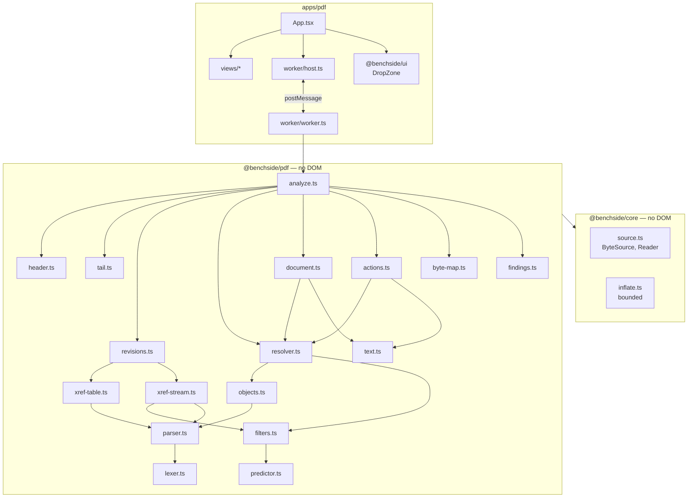
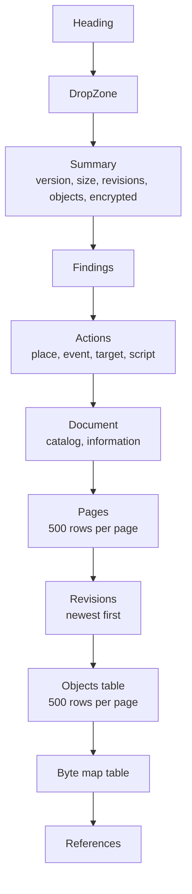

# PDF analyzer architecture

Spec: [PDF analyzer specification](../reference/pdf/README.md). Decisions: [0009](decisions/0009-pdf-read-from-the-end.md), [0010](decisions/0010-shared-core-package.md), [0011](decisions/0011-pdf-resolve-on-demand.md).

## Modules

| Module | Does | Rules |
|---|---|---|
| `lexer.ts` | Tokens from a byte window: white space, comments, delimiters, numbers, strings, names, keywords | LEX-*, OBJ-2..5 |
| `parser.ts` | Objects from tokens: arrays, dictionaries, references, indirect objects, stream extents | OBJ-*, IND-* |
| `header.ts` | `%PDF-` header, version, binary marker | HDR-* |
| `tail.ts` | `startxref`, offset, `%%EOF`, trailing bytes | EOF-* |
| `xref-table.ts` | Table sections and their trailers | XREF-2..5, TRL-* |
| `xref-stream.ts` | Cross-reference stream dictionary and entries | XST-1, XST-2, XST-4, XST-5 |
| `predictor.ts` | PNG predictors | XST-3, FLT-7 |
| `filters.ts` | Filter pipeline: ASCIIHex, ASCII85, LZW, Flate, RunLength; per-stream and per-file limits | FLT-* |
| `resolver.ts` | References to values; object streams decoded once; value cache | RES-*, OST-* |
| `text.ts` | Text strings: UTF-16BE, PDFDocEncoding, truncation | TXT-* |
| `document.ts` | Catalog, document information, page tree, annotations | CAT-*, INF-*, PG-*, ANN-* |
| `actions.ts` | Actions at every place, `Next` chains, outline, field and name trees, targets, scripts | ACT-* |
| `revisions.ts` | Section chain through `XRefStm` and `Prev`, loop guard, merge | XREF-1, REV-* |
| `objects.ts` | Reads each object at its offset; type, subtype, stream extent | OBX-*, IND-* |
| `byte-map.ts` | Regions, gaps, overlaps | MAP-* |
| `findings.ts` | Finding collector with the 1 000 limit; severity and clause per ID | REP-6, REP-7 |

## Worker protocol

| Direction | Message |
|---|---|
| UI → worker | `{ type: 'analyze', id, file: Blob }` |
| worker → UI | `{ type: 'report', id, report }` |
| worker → UI | `{ type: 'failed', id, message }` |

- A `File` is passed by reference; it is not copied into memory.
- The host keeps only the latest request's answer, like the other apps.

## UI

| Rule | Why |
|---|---|
| Tables show 500 rows, then "Show more" | Large files have hundreds of thousands of objects |
| Offsets show decimal and hex | Hex editors use hex; sizes read better in decimal |
| Findings show their ISO 32000-1 clause | REQ-PDF-002: users can check the rule |
| Names and strings from the file render as text | They come from the file |
| Replaced objects say "replaced in revision n", not only a color | Distinctions must not rely on color alone |
| Actions come right after findings | REQ-PDF-005: what a PDF can do is the first question for an untrusted file |
| Actions that run without a click say "runs on open" in words | Distinctions must not rely on color alone |
| Scripts show in a closed `
` as preformatted text | Long scripts would push the rest away; text, never run or rendered |
