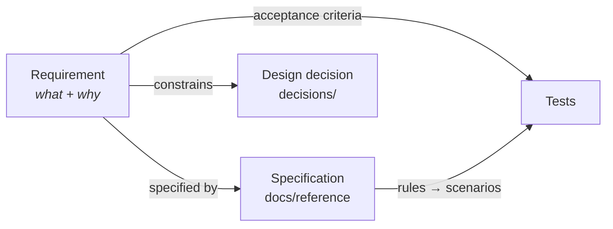

# Requirements

What users need and why. Each record is written like an ADR.

| Status | Meaning |
|---|---|
| Proposed | Under discussion |
| Accepted | Agreed; specs and tests follow it |
| Superseded | Replaced by another record (linked) |

## Mail analyzer

| ID | Title | Status |
|---|---|---|
| [REQ-MAIL-001](REQ-MAIL-001-local-only.md) | Analyze messages without sending them anywhere | Accepted |
| [REQ-MAIL-002](REQ-MAIL-002-explain-results.md) | Explain every result with evidence | Accepted |
| [REQ-MAIL-003](REQ-MAIL-003-spf.md) | Evaluate SPF | Accepted |
| [REQ-MAIL-004](REQ-MAIL-004-dkim.md) | Verify DKIM | Accepted |
| [REQ-MAIL-005](REQ-MAIL-005-dkim2.md) | Verify DKIM2 (experimental) | Accepted |
| [REQ-MAIL-006](REQ-MAIL-006-dmarc.md) | Evaluate DMARC under both versions | Accepted |
| [REQ-MAIL-007](REQ-MAIL-007-arc.md) | Validate ARC | Accepted |
| [REQ-MAIL-008](REQ-MAIL-008-receiver-results.md) | Compare with the receiver's results | Accepted |
| [REQ-MAIL-009](REQ-MAIL-009-delivery-details.md) | Inferred, editable delivery details | Accepted |
| [REQ-MAIL-010](REQ-MAIL-010-dns-control.md) | Control what DNS lookups reveal | Accepted |
| [REQ-MAIL-011](REQ-MAIL-011-export.md) | Export the report | Accepted |
| [REQ-MAIL-012](REQ-MAIL-012-robust-responsive.md) | Robust and responsive analysis | Accepted |
| [REQ-MAIL-013](REQ-MAIL-013-show-used-header-fields.md) | Show the header fields the checks read | Accepted |
| [REQ-MAIL-014](REQ-MAIL-014-cite-standards.md) | Cite the standard behind each step | Accepted |

## ZIP analyzer

| ID | Title | Status |
|---|---|---|
| [REQ-ZIP-001](REQ-ZIP-001-local-only.md) | Analyze archives without sending them anywhere | Accepted |
| [REQ-ZIP-002](REQ-ZIP-002-show-structure.md) | Show the archive's structure | Accepted |
| [REQ-ZIP-003](REQ-ZIP-003-zip64.md) | Read ZIP64 archives | Accepted |
| [REQ-ZIP-004](REQ-ZIP-004-nested-archives.md) | Open nested archives | Accepted |
| [REQ-ZIP-005](REQ-ZIP-005-robust-responsive.md) | Robust and responsive analysis | Accepted |
| [REQ-ZIP-006](REQ-ZIP-006-security-checks.md) | Warn about archives built to harm extraction | Accepted |
| [REQ-ZIP-007](REQ-ZIP-007-reader-disagreement.md) | Show where ZIP readers would disagree | Accepted |
| [REQ-ZIP-008](REQ-ZIP-008-parameters.md) | Adjustable analysis parameters | Accepted |
| [REQ-ZIP-009](REQ-ZIP-009-hex-view.md) | Hex view of records and fields | Accepted |
| [REQ-ZIP-010](REQ-ZIP-010-extra-fields.md) | Decode more extra fields | Accepted |

Not yet planned in detail: content checks (file types, CRC-32 of every entry).
