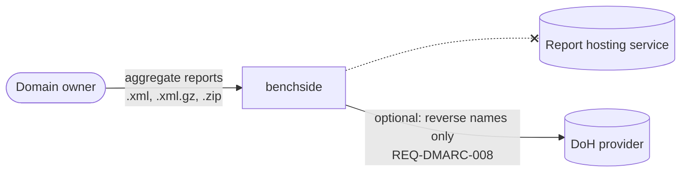

# REQ-DMARC-001: Read reports without sending them anywhere

Status: Accepted

## Need

- Aggregate reports list the IP addresses that send mail for a domain, how much, and how it authenticated.
- That is a map of an organization's mail infrastructure. Many owners do not want to upload it to a third-party dashboard.
- RFC 9990 §7.1 notes that report recipients can analyze a receiver's traffic. The same holds for anyone the owner forwards reports to.

## Requirement

- Report files must never leave the browser tab.
- The only network traffic is the optional reverse lookup of REQ-DMARC-008, and it is off by default.
- The app's CSP makes the browser enforce this, in addition to our code.

## Rationale

- Parsing, combining, and classifying need no outside data.
- A CSP limited to the DoH endpoints blocks every other host, including from the worker.

## Alternatives rejected

| Alternative | Why not |
|---|---|
| Server-side processing, like hosted DMARC dashboards | Requires uploading the reports |
| `connect-src 'none'` with no reverse lookup at all | Host names are the fastest way to recognize a source. An opt-in with a clear label keeps the default private |

## Acceptance

- The built DMARC aggregate app's `index.html` carries a CSP whose `connect-src` lists only the DoH endpoints.
- With reverse lookup off, analyzing a batch makes no network request.
- The worker starts from a `blob:` URL ([0004](../decisions/0004-worker-from-blob-url.md)).

## Specified in

- [DMARC aggregate report analyzer specification](../../reference/dmarc-aggregate/README.md), [Reverse DNS](../../reference/dmarc-aggregate/reverse-dns.md)
- [Privacy model](../privacy-model.md)
