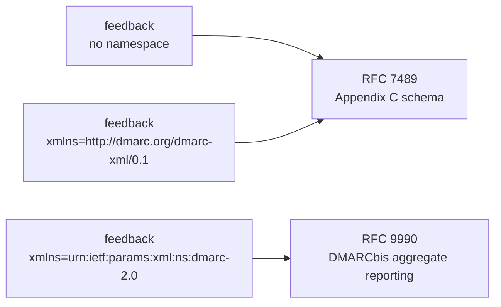

# REQ-DMARC-002: Read both aggregate report formats and show which one each report uses

Status: Accepted

## Need

- RFC 9990 obsoletes RFC 7489 and defines a new XML schema with its own namespace, `urn:ietf:params:xml:ns:dmarc-2.0` (RFC 9990 §6.1).
- RFC 7489's schema declared `http://dmarc.org/dmarc-xml/0.1` (RFC 7489 Appendix C), but many reporters send no namespace at all.
- Receivers will move to the new schema at different times. One week of reports will hold both.
- The schemas differ in more than the namespace: `pct` and `sampled_out` are gone; `np`, `testing`, `discovery_method`, `generator`, the `pass` disposition, and extensions are new; the DKIM `selector` is now required.
- Reporters mix them: a report without a namespace may carry `np`; a report in the new namespace may still send `pct`.

## Requirement

- The analyzer reads reports in both schemas and in the common no-namespace form.
- Each report shows its root namespace as written and the format it implies: "RFC 9990 (DMARCbis)", "RFC 7489", or unknown.
- Elements and values that belong to the other format are listed as content hints.
- Deviations from the schema produce findings. The analyzer still uses what it can read, as RFC 9990 §3.1.1 allows.
- The summary counts reports per format and per namespace.
- Only aggregate reports are read. Failure reports (RFC 9991; RFC 7489 §7.3) are out of scope.

## Rationale

- Users need to know which receivers have moved to DMARCbis. A field such as `testing` or `np` means something only in the format that defines it.
- RFC 9990 §3.1.1 lets an evaluator "try to utilize some of the data" from a report that does not match. Dropping such reports would lose most real-world data.

## Alternatives rejected

| Alternative | Why not |
|---|---|
| Validate against the XSD and drop failing reports | Most reports deviate in small ways; users would see little data |
| Ignore the namespace and read by element name only | Hides the format change the user asked to see |
| Also read failure reports | Each one is a mail message about a single message, in another format (RFC 9991). It needs a different reader and a different view |
| Guess the format from content | Content hints conflict in real reports; the namespace is the only declared signal |

## Acceptance

- A report in the RFC 9990 namespace shows "RFC 9990 (DMARCbis)" and its namespace URI.
- A report without a namespace shows "RFC 7489, no namespace". If it carries `np`, that is listed as an RFC 9990 element.
- A report with `pct` and `sampled_out` in the RFC 9990 namespace lists both as RFC 7489 content.
- The RFC 9990 sample report (Appendix B) and a report built from the RFC 7489 schema both parse.

## Specified in

- [Format](../../reference/dmarc-aggregate/format.md), [XML reader](../../reference/dmarc-aggregate/xml.md)
